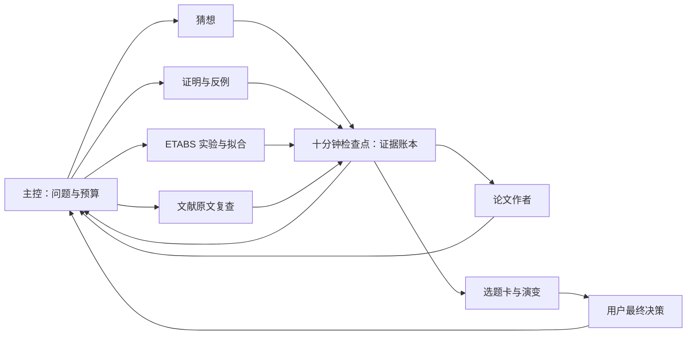

# 多角色协同论文研究框架

日期：2026-10-17。目标是把“提出猜想—验证与反驳—文献原文复查—实验拟合—写入论文”组织成可继续、可追溯的研究循环，并以选题卡记录演变、交给用户最终决策。

统一研究仓库已指定为 [sunny19900911/01-lunwen](https://github.com/sunny19900911/01-lunwen)，并从空远端克隆到本地。本文件与[仓库技能](../.agents/skills/research-paper-lab/SKILL.md)作为共同版本来源；框架、技能和仓库约定已在本地准备，尚未首次 `commit` 或 `push`，不能视作已同步远端。尚无为本框架指定的课题、模型和数据集；本次未创建新聊天、启用长期自动化或运行工程分析。

## 1. 角色与共同工作区

| 角色 | 本轮交付 | 可写范围与约束 |
|---|---|---|
| 主控 | 冻结研究问题，分配任务，裁决证据，记录下一轮与选题演变 | 单独维护研究计划、主张账本、检查点、运行清单与选题卡 |
| 猜想提出者 | 少量可证伪命题、适用条件、预测、最小检验 | 写自己的提案；不能自行宣布猜想成立 |
| 验证者 | 独立推导、证明缺口、反例搜索与复核 | 写审核记录；先检查假设，再评价结论 |
| 文献复查者 | 用已有论文原文对照当前猜想、证明与反例 | 写原文对照及索引；不代替证明审核或用户定题 |
| ETABS 拟合者 | 数据口径、拟合、独立验证、残差与适用域 | 写获分配的实验目录；原始数据只读 |
| 论文作者 | 章节、图表、证据定位和待补项 | 写获分配稿件；每个结论对应可查证据 |



角色是研究职责，不要求六个窗口同时在线。根据依赖安排猜想、验证、文献复查和实验，主控可兼任作者；资源不足时分批执行。Codex 的子代理可承担当前任务的并行工作，见[官方多代理说明](https://developers.openai.com/codex/multi-agent)。设计中的文献专用对话框可由独立子代理承担，实际用户聊天在明确启动要求后创建；窗口之间不会自动共享记忆。

各角色交接时先读同一版本的[仓库约定](../AGENTS.md)、本框架与仓库技能，再读课题计划、账本和检查点；同时记录输入版本或快照标识。共同上下文以这些文件为准，每个课题放在 `papers/<topic>/` 内：

```text
research/plan.md          # 问题、假设、预算、文件所有者
research/claims.md        # 主张与证据账本，主控单写
research/runs.md          # 数据版本、实验参数、状态与输出位置
research/rounds/          # 每轮检查点、争议与下一步
research/roles/           # 各角色提案与审核记录
research/topic-cards/     # 当前选题卡、历史版本、变化与用户决定
literature/index.md       # 已收集论文、全文状态、原文位置与对照索引
experiments/              # 分析脚本、配置、结果与图表
manuscript/               # 正文、引用与图表说明
```

这些是建议目录；启动时复用课题现有约定，不为凑目录创建空文件。

## 2. 十分钟检查点如何运转

十分钟是汇总间隔，允许提前交付，也允许长实验跨轮运行；它不意味着每个实验必须十分钟完成。

1. **轮次开始**：主控确定一个具体问题，冻结命题、数据与代码版本，写清本轮预算、成功判据和各角色可写文件。
2. **并行推进**：猜想者提出可检验解释；验证者独立寻找漏洞和反例；文献复查者与已有原文对照；实验者运行最有区分力的低成本实验。作者先写方法和缺口，不等所有结果齐全。
3. **到检查点**：各角色提交“新证据、反对证据、失败尝试、当前障碍、下一步”。长实验提交实际运行标识与完成部分，不能虚报完成。
4. **交叉质疑**：验证者检查最强结论与最强反证；主控按证据调整命题和实验优先级，不按赞同票数裁决。
5. **同步稿件与选题卡**：作者根据已审核证据更新段落与图表；主控记录选题判断及演变、剩余预算、未解决争议和下一轮可执行任务。
6. **继续或收束**：有授权预算就继续；预算耗尽、关键数据缺失、连续若干轮无有效进展或用户要求停止时，落盘检查点并交付。

默认先完成一轮可检查的研究。持续模式应给出总时长或轮数、单实验超时与规模、无进展阈值；不能以“不停研究”替代这些边界。

活跃会话内可以按真实时间记录检查点，但 Skill 本身不会在后台计时。需要离开后继续时，使用正式自动化工具设置同一聊天的分钟级唤醒，能力见[官方 Automations 说明](https://developers.openai.com/codex/app/automations)。设置成功后才能报告已安排；记录实际触发时间，不承诺准点或无中断常驻。

只设一个主控调度入口。上轮未结束时读取检查点并合并待办，避免重复派工和重跑实验；恢复前先核对运行状态。角色互不无限等待，缺少依赖时报告缺口并做独立工作。

## 3. 证据如何进入论文

每条主张分配 C-ID，记录命题、条件与量词、证据、反证、审核人、版本、论文位置和下一项检验。每条证据保留数据来源或散列、脚本版本、参数、随机种子、结果位置和复现方法。

| 证据 | 可支持的表述 | 不能直接推出 |
|---|---|---|
| 完整且独立审核的证明 | 在列明假设下证明该命题 | 假设外也成立；已经形式化认证 |
| 解析推导 | 在近似与条件下得到关系式 | 省略条件的普遍定理 |
| 数值实验 | 在测试参数域和误差口径下获得支持 | 对连续参数域的普遍证明 |
| 数据拟合 | 在训练与独立验证样本上达到所报误差 | 因果机制、样本外无条件有效 |
| 有效反例 | 满足原前提的案例推翻原命题 | 不满足前提的异常也构成反例 |

工作状态采用 `proposed / testing / supported / refuted / unresolved / retired`，证据类型另列。`supported` 仅表示记录范围内得到支持；高拟合精度、没有找到反例、多个角色意见一致都不能替代证明。

浮点异常先记为候选反例，复核单位、前提与数值误差后再裁决。修改假设产生新版本，保留旧反例；数据或代码变化时，相关图表和段落标记待重核。引用需核查真实来源及其是否支持本句。

## 4. 论文结构

| 部分 | 要回答的问题 |
|---|---|
| 题目 | 研究对象、方法或发现是什么？避免超出证据范围 |
| 摘要 | 问题、方法、实际结果、适用条件是什么？结果稳定后再定稿 |
| 引言 | 已有研究做到哪里，缺口是什么，本研究贡献如何检验？ |
| 模型与理论 | 变量、假设、控制方程、方法、命题及证明或推导是什么？ |
| 实验 | 数据、工况、参数域、基线、划分方式、误差指标如何定义？ |
| 结果 | 哪些主张得到何种证据支持，误差、残差与稳健性如何？ |
| 适用边界 | 反例、失效区间、未验证范围和竞争解释是什么？ |
| 结论 | 回答了什么问题，证据强度如何，下一项关键检验是什么？ |
| 复现 | 模型和数据版本、脚本、参数、运行顺序及获取条件是什么？ |

用 C-ID 将结果段落和图表连回证据账本。未闭合证明保留为猜想或推导缺口；负结果与适用边界也可以形成论文贡献。

## 5. 角色提示词示例

**主控**：“读取研究计划、主张账本与上轮检查点。在现有预算内选择一个最能区分竞争解释的任务，派给合适角色；指定文件所有者。检查证据冲突后更新账本和下一轮任务，记录实际完成情况。”

**猜想者**：“围绕当前问题提出最多三个可证伪命题。逐条给出定义、量词、适用条件、预测、可能反例及最低成本检验；区分观察与猜测，不引用尚未产生的实验结果。”

**验证者**：“独立审查指定命题，优先寻找隐藏假设、推导缺口和最小反例。说明反例是否满足全部前提，数值异常是否复核；未证明时明确缺少哪一步，不把其他角色的赞同作为证据。”

**文献复查者**：“读取已收集论文及当前命题、证明或反例，逐项对照对象、指标、量词、前提和结论，定位页、式与图。区分已有覆盖、条件不同和真正冲突；全文不足时保留缺口，向主控、验证者、作者和选题卡提供建议。”

**ETABS 拟合者**：“只读指定原始导出，核查单位、坐标、时间步、工况和响应定义。先冻结独立验证方案，再比较可解释基线与候选拟合；报告验证误差、残差、失败样本和适用域，保存复现配置。”

**论文作者**：“根据已审核的主张账本更新指定章节。每项结论对应证据及适用条件；缺数据或证明处标注待补，不补造引用、数值或普遍性结论。”

## 6. 示范问题与数据需求

示范问题：对给定结构、地震动组和阻尼器参数域，能否用少量可解释参数预测最大层间位移角与楼层绝对加速度，并在独立地震记录上保持可接受误差？

可探索的猜想包括“某一参数域内响应随阻尼参数呈特定趋势”或“某种归一化形式提高跨记录预测能力”。这些只是待检验候选；本次未建模、未运行 ETABS，也未验证任何工程结论。

开始前需指定：

- 模型与版本：结构体系、层高、质量刚度、边界条件、阻尼与阻尼器定义、线性或非线性假设。
- 输入与工况：地震动记录、分量、单位、采样步长、缩放方法、方向组合和参数扫描表。
- 输出与口径：节点位移、楼层绝对加速度、层间位移角或其计算所需量、楼层力；标明坐标和时程类型。
- 拟合契约：预测目标、允许输入、独立样本单元、误差阈值、基线和不确定性评价方式。
- 来源与复现：原始导出路径、工作表说明、求解设置、已有脚本、数据可使用范围。

训练与验证优先按独立地震记录或结构样本划分，避免相邻时刻泄漏。最终测试集冻结，不能随着反复调参变成新的训练集。实际分析优先复用现有 `etabs-response-analysis` 技能。

## 7. 统一仓库与 GitHub 交接

已指定的统一仓库是 [sunny19900911/01-lunwen](https://github.com/sunny19900911/01-lunwen)，本地克隆已就绪。GitHub 用于版本和异步交接；研究依据仍是数据、代码与证据账本，定时运行由调度器承担。

1. 当前远端为空，新增文件仅在本地；先审阅本地框架、技能与[README](../README.md)，不再另建一套研究仓库。
2. 每轮从同版本文件读取上下文。首次提交前使用明确的本地快照与文件散列，不虚构 commit ID；其他设备或独立克隆尚不能从空远端取得这些未推送文件。
3. 按角色分配目录，主控单写共享状态。需要同时修改同一文件时使用独立分支或 worktree，由指定整合人审阅差异；交接注明使用的版本与未提交改动。
4. 小文本、脚本、配置和运行清单适合版本化；大型模型与导出先保留本地路径和散列，上传前确认大小及保密范围。使用现有安全认证方式，不把令牌写入文件或聊天。
5. 首次 `commit` 和 `push` 均待明确授权后执行；完成实际推送后才报告远端已更新。后续整合、合并和发布也按相应授权执行，不强制覆盖本地或远端工作。

## 8. 本地启动

统一技能入口：[research-paper-lab/SKILL.md](../.agents/skills/research-paper-lab/SKILL.md)。本机个人技能是安装副本；以仓库版本为准，不假定同名技能会自动合并或同步。

1. 在本仓库打开聊天，先读取仓库约定与统一技能，再选择 `papers/<topic>/` 下的课题；提供现有稿件、模型说明与数据路径，不修改其他论文项目。
2. 用下面的调用启动一轮；没有数据时先完成问题定义、论文蓝图与数据需求。

```text
$research-paper-lab
为【课题名称】建立研究契约，读取【资料/数据路径】。
采用主控、猜想、验证、文献复查、ETABS拟合、作者六种职责，每10分钟汇总。
先完成一轮；本轮实验规模【上限】，单实验超时【时长】。
已收集论文位于【原文或索引路径】。
交付问题定义、原文对照、主张账本、选题卡、论文结构及下一轮任务。
选题卡每30分钟或重大变化形成决策版，记录演变，最终由我定题。
```

3. 首轮可运行后，再补充持续运行总预算和停止条件；确需后台继续时明确要求设置定时唤醒并核验设置结果。
4. 每轮交付应说明实际读了什么、运行了什么、哪些结论已核验、哪些仍是猜想，以及下一步最有价值的检验。

## 9. 已收集论文的原文复查

把已有论文放在获准本地目录或课题 `literature/local/`，用索引登记题名、来源、版本、全文状态和指纹；仓库默认共享索引及自写复查记录。文献复查者对照新猜想、证明与反例，给出原文页、定理、公式、图表定位，逐项比较前提、量词、模型和响应指标。

全文不可得时只做能核实的书目和相关性检查，不据摘要判定证明正确、反例无效或贡献新颖。出现冲突时先排除条件与口径差异，再交验证者做最小独立检验。复查结果同时反馈给主控、作者和选题卡。详见[文献复查协议](../.agents/skills/research-paper-lab/references/literature-review.md)。

## 10. 选题卡与最终决策

每个候选选题有稳定标识，记录问题价值、文献差异、候选贡献、证明与反例、数据拟合、可行性、成稿条件、风险和备选路线。每个十分钟检查点复核，默认每30分钟或重大变化形成决策快照；短任务结束交首版，用户可改间隔。

演变记录保留“旧判断→新判断→触发证据→对论文的影响→下一步”，不覆盖旧版和失败路线。决策版向用户说明最关键变化、支持与反对证据、继续/收窄/转向的资源需求及团队建议。最终选题由用户决定；内部讨论不替换已批准主线。见[选题卡协议](../.agents/skills/research-paper-lab/references/topic-cards.md)及[模板](../.agents/skills/research-paper-lab/assets/topic-card.template.md)。

选题卡与研究检查点共用主控；未配置自动化时不承诺离线定期生成，向其他应用或聊天发卡片仍按用户授权执行。
