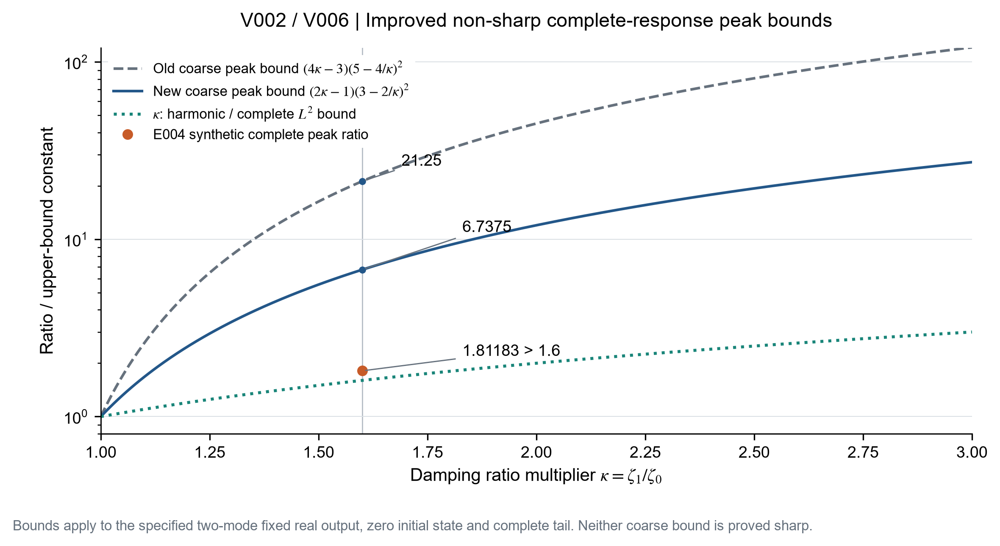
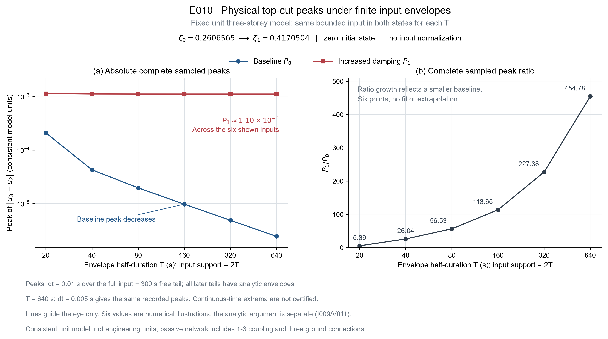
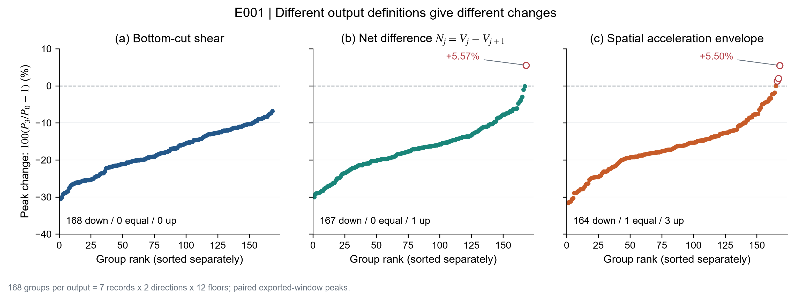

# 增阻尼输出边界：审阅入口

用户已选择集中理论主线，第二轮时段12:19:08—14:19:08。题目/期刊/署名未最终确定；旧工程与拟合证据完整保留。

- [当前理论稿v002](manuscript/theory-draft-v002.md)：五主节/两核心图；引用重排已独核，新理论增量正在另稿整合。
- [原混合工作稿v009](manuscript/working-draft-v009.md)：保留原生工程、代理诊断及旧支线证据。
- [当前选题卡](research/topic-cards/T001.md)与[演变记录](research/topic-cards/events.md)：为什么从初始判据问题推进到统一界、物理反例及失谐边界。
- [A理论稿/C分层结合稿两版蓝图](research/roles/ideation/topic-options-final-candidate.md)、[待用户决策](research/decisions-pending.md)。
- [主张账本](research/claims.md)：C-ID、前提、证据类型、反对证据及审核状态。
- [文献索引](literature/index.md)、[三篇全文最小补件](research/roles/literature/fulltext-request-list.md)、[新物理零点先例核查](research/roles/literature/physical-topcut-targeted-search-001.md)。
- [两小时研究计划](../../research/sessions/20261017-0847/plan.md)、[实际状态](../../research/sessions/20261017-0847/status.json)、[角色聊天登记](../../research/sessions/20261017-0847/threads.json)。
- [复用研究skill](../../.agents/skills/research-paper-lab/SKILL.md)：五角色、文献原文比对、选题卡、定时检查点、Git交接及证据边界。

## 先看哪些结果

| 结果 | 可复核入口 | 必须保留的限制 |
|---|---|---|
| 至多双有效模态有κ-only完整峰界，κ=1.6时保守界6.7375 | [V006](research/roles/verification/round-006.md)、稿件附录A | 整体常数未证最优；完整尾段界不能直接套截断同窗 |
| 真实正m/k三层topcut在特定临界共同阻尼路径失界，同类最少3有效模态 | [一般证明](research/roles/verification/addendum-V011-general-topcut.md)、稿件§3.3 | 固定模型/阻尼对，输入时长变化；绝对输出有界，不是天然波风险 |
| 另一个固定隐式模型实现精确5%→8%存在性 | [IVT证明](research/roles/verification/appendix-V011-low-damping-IVT.md)、稿件附录E | 小数近似未认证为根集最小元；精确等式靠定义和定理 |
| 每个固定失谐阻尼对仍有模型相关有限界 | [失谐审核](research/roles/verification/detuning-boundary-review.md)、稿件附录F | 近临界参数集合没有据此获得统一有限界 |
| 指定模型族存在六正理想黏滞支路 | [网络解析证明](research/roles/verification/network-realizability-proof.md) | 含跨层1↔3，三基底支路须同一移动基底；不是施工方案 |
| 原生168截面峰均下降，1组净差、3组空间加速度峰上升 | [原生核查](research/roles/experiments/round-001.md) | 导出窗、输出定义及逐阶阻尼身份；未闭合唯一模态机理 |
| 三个预定简单代理漏掉全部少数增加 | [分组诊断](research/roles/experiments/round-007-grouped-diagnostic.md)、[主控独立复算](../../research/sessions/20261017-0847/grouped-diagnostic-independent-audit.json) | 7个record-ID组不等于认证独立事件；不是所有模型不可预测 |

## 在GitHub查看核心图

冻结稿为Codex本机预览使用绝对PNG路径；这里提供仓库相对路径的同一资产，便于GitHub阅读。原图字节未改。图、采样点及解析证明的证据身份以原图注和稿件为准。

原始Excel/EDB、论文全文缓存和本地5MB冻结输入NPZ未上传；复现指纹、生成脚本和未共享条件见各轮记录。已有依赖和隔离输出要求见根[AGENTS.md](../../AGENTS.md)，不要直接重跑会覆盖冻结结果的脚本。新颖性仍未解决，agent审阅不等于形式化证明器认证。
