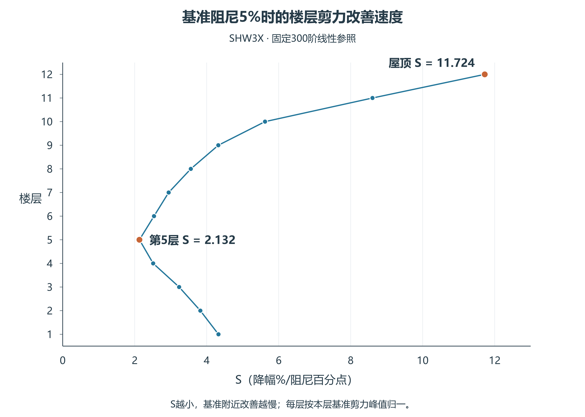
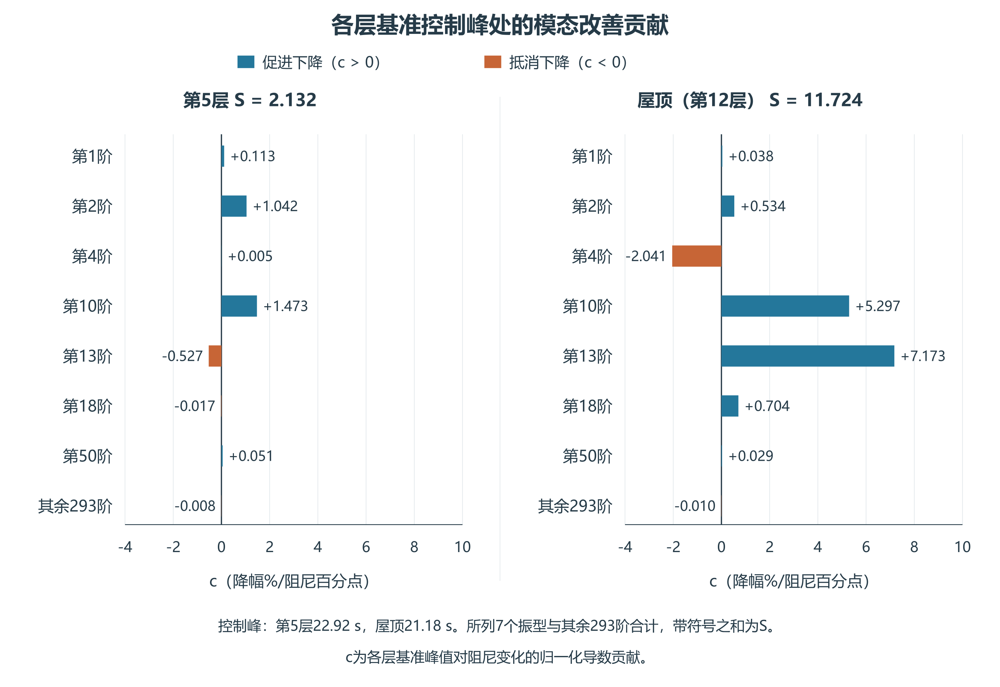
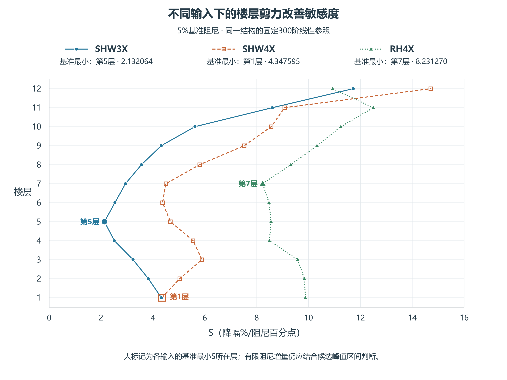

# 增大模态阻尼后的楼层剪力改善敏感度与控制楼层识别

**Sensitivity of Story Shear Reduction and Identification of Governing Stories under Increased Modal Damping**

## 摘要

为解释增大模态阻尼后的楼层剪力差异并识别控制楼层，从5%基准运动及其阻尼导数定义改善敏感度S，并分解为各振型独立绝对峰之和的变化S_U与合成比例变化S_C，满足S=S_U+S_C。SHW3X第5层两项为4.642959、−2.510894，合成比例上升抵消部分独立峰值下降；屋顶两项为6.373211、5.350638，同向促进改善。公开模型第1层的比例上升超过独立峰值下降，S略负。有限候选采用完整地震作用历程预测和逐时区间。三输入工程例中6%、7%可排除，8%、10%仍需复算，参照最小包络降幅为9.228100%、14.634810%，分别未达到和达到10%目标。保留排序改变、点预测漏判与二阶更差工况；简单统一系数在公开例部分指标更好，完整预测成本仍高于直接求解。方法将基准局部解析解释与候选工程判断衔接。

**关键词：** 模态阻尼；楼层剪力；改善敏感度；模态叠加；控制楼层

## Abstract

To explain differences in story shear reduction under increased modal damping and identify governing stories, an improvement sensitivity S is evaluated from responses and damping derivatives at a 5% baseline. It is decomposed as S=S_U+S_C, where S_U describes changes in the sum of individual modal absolute peaks and S_C describes changes in the synthesis ratio between the combined peak and that sum. Under SHW3X, the two terms are 4.642959 and −2.510894 at Story 5: an increasing synthesis ratio offsets part of the decrease in individual peaks. At the roof, the terms 6.373211 and 5.350638 both promote reduction. In the public model, the synthesis-ratio increase exceeds the decrease in individual peaks at Story 1, giving a slightly negative local sensitivity. Complete response-history approximations and discrete envelopes are then used for finite damping changes. For the three-input maximum-peak objective, the 6% and 7% candidates are rejected, while 8% and 10% require complete analysis. Their reference minimum reductions are 9.228100% and 14.634810%, respectively. Ranking changes, point-prediction errors, and poorer second-order estimates are retained. A uniform baseline performs better in some comparisons, and total prediction cost exceeds direct solution. The method links local modal interpretation with engineering candidate decisions.

**Keywords:** modal damping; story shear; improvement sensitivity; modal superposition; governing story

## 1 工程问题

在结构已完成5%模态阻尼响应计算后，工程师常需比较若干较高阻尼方案。本文研究如何复用基准模态运动及结构参数，预测候选阻尼下的楼层剪力峰值，并在逐个完整求解前识别可能达不到预定降幅的楼层。目标降幅D_req由项目事先规定，10%仅作流程演示。研究对象为质量、刚度、模态基及地震输入不变、统一改变经典模态阻尼比的线性参照。

预测需要基准模态相对位移和速度，以及模态频率和带符号楼层系数。仅有一幅振型图或一条楼层总剪力曲线，通常不足以提供这些信息。本文先预测候选阻尼下的完整模态运动，按固定楼层系数叠加，再在整个观察窗搜索绝对峰。已经求得两种阻尼响应后的幅值与叠加解释，可用于分析预测结果，但不能替代事前预测。

## 2 改善敏感度、振型作用与控制楼层

### 2.1 指标读法与两个模型的楼层结果

S表示基准5%附近，每增加1个百分点模态阻尼时剪力峰值的局部降幅百分数。工程上先按S由小到大识别改善慢的楼层，再看同一控制峰时各振型的促进与抵消，最后用候选阻尼的完整地震作用历程和区间判断是否达到目标。

**表1 SHW3X各层的基准改善敏感度**

|层|局部改善由慢到快排序|控制峰时/s|基准峰/kN|S|促进项和|抵消项和|
|---|---:|---:|---:|---:|---:|---:|
|1|9|22.700|13133.091689|4.327313|+5.093903|-0.766590|
|2|7|22.720|12582.093274|3.824084|+4.369208|-0.545124|
|3|5|22.760|10497.683860|3.234793|+3.281484|-0.046692|
|4|2|22.820|9166.459903|2.513645|+2.646813|-0.133168|
|5|1|22.920|8691.808507|2.132064|+2.727068|-0.595004|
|6|3|22.980|8516.758591|2.536880|+2.742033|-0.205153|
|7|4|23.020|8142.092719|2.944001|+3.109820|-0.165819|
|8|6|23.060|7512.051356|3.559472|+3.659037|-0.099565|
|9|8|23.100|6624.406572|4.323238|+4.710857|-0.387619|
|10|10|23.140|5370.760602|5.620949|+6.065592|-0.444644|
|11|11|23.180|2874.950662|8.605928|+9.133882|-0.527955|
|12|12|21.180|850.295475|11.723849|+13.878999|-2.155150|

第5层S=2.132064，为本条输入下12层最小值；屋顶为11.723849，约为其5.499倍。第5层与屋顶的峰力变化率分别约为−185.315、−99.687 kN/阻尼百分点，因此归一降幅较快与绝对力削减量较大分别判断。

**图1 SHW3X输入下各层的基准改善敏感度。** S单位为降幅%／阻尼百分点，各层以自身5%基准剪力峰值归一，标出第5层与屋顶。

以c表示各振型对局部降幅速度的有符号贡献，单位与S相同。正值促进下降，负值抵消下降；各层分别在自身5%控制峰处分解。

**表2 第5层与屋顶贡献绝对值最大的五个振型及余项**

|各层内部名次|第5层模态|c|屋顶模态|c|
|---|---:|---:|---:|---:|
|1|10|+1.473275|13|+7.173442|
|2|2|+1.042284|10|+5.297377|
|3|13|-0.527229|4|-2.041323|
|4|1|+0.112966|18|+0.703791|
|5|50|+0.050990|2|+0.534018|
|其余295阶|—|-0.020222|—|+0.056544|

第5层第10、2振型促进峰值下降，第13振型贡献为−0.527229，抵消部分促进作用；屋顶第13振型则为+7.173442，与第10振型共同促进下降。各层分别按贡献绝对值选取五个振型，其余295阶保留有符号和。表中分解是5%基准峰降幅对阻尼的导数贡献，不是候选阻尼下实际剪力的逐阶分担。

**表3 第13振型的固定系数与基准响应导数因子**

|输入/层|B/kg|z/m每单位ζ|sign V0|v13/kN|v′13/kN每单位ζ|c13|
|---|---:|---:|---:|---:|---:|---:|
|SHW3X/5|−349831.835|−.066752635|+1|−42.616833|+4582.575145|−.527229|
|SHW4X/5|−349831.835|+.018335310|+1|+25.115529|−1258.720884|+.123705|
|SHW3X/屋顶|−440679.414|−.070533075|−1|−369.307987|+6099.544994|+7.173442|

SHW3X第5层的第13振型剪力为负，原本抵消正向总峰；阻尼增大使该负项向零变化，减弱了抵消，因此其改善贡献反为负。屋顶总峰为负，而第13振型的剪力导数为正，使负峰趋零，因而促进改善。同一第5层换成SHW4X时，B和总峰号不变、z反号，使贡献转正；这里改变的是输入响应与控制时刻，振型基保持不变。

**图2 SHW3X各层基准控制峰处的有符号模态改善贡献。** 第5层与屋顶峰时分别为22.92 s、21.18 s。图中采用两层所选振型的并集，即第1、2、4、10、13、18、50振型及其余293阶；正值促进下降，负值抵消下降，各项合计为本层S。表2每层分别展示五项，余项为295阶。

**表4 公开三层框架的基准改善敏感度**

|层|局部改善排序|控制峰时/s|基准峰/kip|S|促进项和|抵消项和|
|---|---:|---:|---:|---:|---:|---:|
|1|1|16.525|81.613609|-0.012382|+0.054300|-0.066682|
|2|2|16.520|62.258112|0.246201|+0.279268|-0.033066|
|3|3|10.960|34.541797|6.064525|+6.319227|-0.254702|

公开第1层第2振型的抵消项−0.066682大于全部促进项+0.054300，S略负；但6%参照下降0.743%，说明基准附近导数的符号与增加1个百分点后的实际变化可不同。公开屋顶的基准峰在10.960 s，16.520 s处第二局部峰幅值仅低1.366277%，却在6%成为控制峰；两个分支按同一基准峰归一的S为6.064525和0.555914。预设1%近峰诊断漏掉了第二峰，实际降幅2.654%也小于第一分支的局部线性读数6.065%。工程检查应保留多个独立局部峰，有限增量仍由完整历程及误差区间判断。

### 2.2 简要计算关系

M为质量矩阵，φ_r与ω_r为第r阶振型和圆频率，b为输入方向向量，a_s选择楼层切口以上的水平平移。固定物理系数为B_sr=(φ_rᵀMb)(a_sᵀMφ_r)/(φ_rᵀMφ_r)，局部B可为负。单位参与相对运动s_r满足共同零初始方程；基准ζ₀=0.05，z_r、w_r分别为基准阻尼的一、二阶导数：

$$
\ddot s_r+2\zeta\omega_r\dot s_r+\omega_r^2s_r=-a_g(t),\qquad
L_{r,\zeta_0}z_r=-2\omega_r\dot s_r^0,\qquad
L_{r,\zeta_0}w_r=-4\omega_r\dot z_r.
$$

L为第一式左侧算子，导数的位移及速度初值均为零。相对运动与伪加速度ω_r²s_r分别按m和m/s²计算；工程主例B用kg，剪力换为kN时取u_F=1000。公开模型运动用in、B用kip·s²/in，剪力为kip时u_F=1。

定义V₀[n]=ΣB_srω_r²s_r⁰[n]/u_F、V_ζ[n]=ΣB_srω_r²z_r[n]/u_F、P₀=max_n|V₀[n]|。达到基准最大绝对剪力的全部计算时刻组成集合𝒜；在其中取使峰值右导数最大的分支：

$$
P'_+(\zeta_0)=\max_{n\in\mathcal A}
\{\operatorname{sign}(V_0[n])V_\zeta[n]\},\qquad
S_s=-P'_+(\zeta_0)/P_0,\qquad
c_{sr}[n]=-\frac{\operatorname{sign}(V_0[n])B_{sr}\omega_r^2z_r[n]}{u_FP_0}.
$$

P₀>0时，阻尼增大b个百分点即δ=0.01b，降幅百分数为S_s b+o(b)，S不再乘100。每个控制分支的Σc=S，多个并列峰分别报告；P₀=0时改报力峰右导数，不定义归一S。线性动力响应导数的直接微分法见Liu等[1]。

对有限候选ζ_c=ζ₀+δ>0，由基准运动构造：

$$
\widehat s_r^{(1)}=s_r^0+\delta z_r,\qquad
\widehat s_r^{(2)}=s_r^0+\delta z_r+\frac{\delta^2}{2}w_r,\qquad
\widehat V_s=\sum_r B_{sr}\omega_r^2\widehat s_r/u_F.
$$

在完整地震作用历程的共同计算网格上求P̂_s=max|V̂_s|，降幅为D̂_s=100(1−P̂_s/P₀)%。各阶阻尼统一改变，质量、刚度、振型、输入与楼层系数固定；候选态不重新拟合B。Ritz参照与实际软件目标输出的对应按原模型约定核对。计算细节见补充说明S1。

### 2.3 各振型峰值与合成比例的局部变化

在同一保存时间网格上，令p_r=max_t|v_r(t)|为第r振型剪力的独立绝对峰，U=Σ_rp_r为各振型独立绝对峰之和，P=max_t|Σ_rv_r(t)|为楼层合成剪力峰，C=P/U为合成比例。在基准P、U均为正时：

$$
S=-\frac{P'_+}{P}=S_U+S_C,\qquad
S_U=-\frac{U'_+}{U},\qquad S_C=-\frac{C'_+}{C}.
$$

S_U描述各振型独立峰值之和的变化，S_C描述这些峰值形成合成剪力峰的比例变化；三者数值单位均为相应量的降幅%／阻尼百分点。U'_+由每个振型在自身绝对峰时的右导数相加，P'_+则由楼层总剪力达到最大绝对值的时刻确定，两种时刻和归一化分母分别使用。

**表5 基准改善敏感度的两部分，表内取六位小数**

|输入及楼层|S_U|S_C|S|
|---|---:|---:|---:|
|SHW3X第5层|4.642959|−2.510894|2.132064|
|SHW3X屋顶|6.373211|5.350638|11.723849|
|公开模型第1层|0.560312|−0.572694|−0.012382|

第5层的各振型独立峰值之和随阻尼增加而下降，但合成比例上升，抵消了部分改善；屋顶两部分同向促进合成峰下降。公开第1层合成比例上升的作用略大于独立峰值下降，故总剪力峰在基准附近略增。

同一第13振型在20.48 s的自身绝对峰随阻尼增加而降低，对S_U贡献+0.339632；在22.92 s的楼层总剪力峰处，它削弱原有抵消，对S贡献−0.527229。两个分项使用各自峰时和分母，分别闭合到S_U和S，不能直接替代。

三条工程输入各12层及公开模型3层，构成39个楼层—输入组合。其中19个S_C为负，本批S_U均为正；这些符号为本组结果，计算时不预设其正负。

C综合振型权重、符号抵消、不同达峰时刻及控制峰更换，不作为纯相位份额。该分解描述基准右导数，旧5%至8%的有限比值仍作为已知两态机制背景，分别报告。

### 2.4 原控制峰的竞争预警

在基准最大峰及某个较小的局部峰时刻，分别记幅值p₀=P₀>p_j>0、导数g_i=sign(V₀)V_ζ；固定这些时刻作一阶幅值支路p_i+g_iδ。若g_j>g₀且交点幅值保持正，两支路给出的正向增量提示为：

$$
b_j=100\,\frac{P_0-p_j}{g_j-g_0}
=\frac{100(1-p_j/P_0)}{S_0-S_j},
\qquad S_i=-g_i/P_0.
$$

S_j与S₀均按同一P₀归一。公开屋顶上述两个分支得到b_j≈0.2480256362阻尼百分点；6%候选增量为1个百分点，已经触发竞争提示，应检查其他峰。这是固定基准时刻的一阶支路预警，实际控制峰切换由完整历程确定。

## 3 逐时误差包络与峰值区间

### 3.1 由离散缺陷传播逐时误差

为保留误差随时间的变化，令每阶状态x_r[n]=(s_r[n],ṡ_r[n])ᵀ。对已知候选阻尼、频率和步长h，分段线性输入的状态递推写为x_r[n+1]=A_r,c x_r[n]+b_r,c[n]，其中A_r,c为完整2×2状态转移矩阵，b由地震输入确定。将一阶或二阶预测状态代入，定义：

$$
d_r[n]=A_{r,c}\widehat x_r[n]+b_{r,c}[n]-\widehat x_r[n+1],
\qquad
e_r[n+1]=A_{r,c}e_r[n]+d_r[n],\quad e_r[0]=0.
$$

缺陷d包含位移d_s和速度d_v，均由预测及候选参数计算，不需目标响应。分别传播其绝对值，得到位移误差包络及楼层剪力包络：

$$
Q_r[n]=\sum_{j=0}^{n-1}
\left(
\left|(A_{r,c}^{\,n-1-j})_{11}\right||d_{s,r}[j]|
+\left|(A_{r,c}^{\,n-1-j})_{12}\right||d_{v,r}[j]|
\right),\qquad
E_s[n]=\frac1{u_F}\sum_r|B_{sr}|\omega_r^2Q_r[n].
$$

Q_r[0]=0。传播使用完整状态矩阵的幂，其第一行同时接收位移和速度缺陷；实际计算加入预先规定的浮点保护。以下区间对应保存网格，步长及保护量的数值约定见[补充说明S1](../../../research/sessions/20261101-2213/roles/role5/R010/supplement-S1.md)。

### 3.2 峰区间与降幅区间

若E_s(t)在所用观察窗有效，可由完整预测曲线形成：

$$
P_{s,L}=\max_{t\in\mathcal T}\max(0,|\widehat V_s(t)|-E_s(t)),\qquad
P_{s,U}=\max_{t\in\mathcal T}(|\widehat V_s(t)|+E_s(t)).
$$

相应参照峰满足P_s,L≤P_s(ζ_c)≤P_s,U，不要求峰唯一或控制时刻不变。若仅使用统一E_s=max E_s(t)，也可取[max(0,P̂_s−E_s),P̂_s+E_s]。在同一参照基准峰P_s⁰已知且大于零时：

$$
D_{s,L}=100\left(1-\frac{P_{s,U}}{P_s^0}\right),\qquad
D_{s,U}=100\left(1-\frac{P_{s,L}}{P_s^0}\right).
$$

D端点以%表示，D_s,U−D_s,L以百分点表示。基准峰也有误差时，分母须用其有效区间传播，并要求分母下限为正。不同来源的模型偏差不能仅靠候选阻尼展开残差覆盖。

### 3.3 允许增量作为前筛

对项目预定的误差要求，可用基准导数尺度先估算直接外推范围。设J₁,s=2Σ|B_sr|ω_r‖ż_r‖∞/u_F，J₂,s=Σ|B_sr|ω_r‖ẇ_r‖∞/u_F；由候选核的绝对积分范数得到E₁=J₁δ²κ(ζ₀+δ)、E₂=J₂|δ|³κ(ζ₀+δ)，κ为相应阻尼核尺度。将绝对力、相对基准峰和降幅区间宽度要求换为力误差预算，扣除固定数值误差预留后，求满足预算的δ范围。宽度5个百分点对应E_total≤0.025P₀。

正侧可用保守闭式，也可对单调误差界二分，返回已通过端点；负侧保留ζ>0。单调性属于误差界，不属于真实剪力。半径仅用于精度前筛，候选目标仍按逐时区间判断。基准峰太小时改用绝对力要求。尺度、公式及分母处理详见[补充说明S1](../../../research/sessions/20261101-2213/roles/role5/R010/supplement-S1.md)。

既有固定基截断对照还显示，保留前10项虽累计95.182892%的X向参与质量，屋顶相对300阶的最大曲线NRMSE为64.731660%、最大绝对峰相对差为25.149481%。质量比例不能代替局部剪力检查，曲线误差与峰值误差分别报告；详细截断条件见补充说明S1。

## 4 工程判定与简便使用步骤

D_req与D采用相同单位，演示值为10%。按有效区间作三类主判断：

|条件|判断|工程动作|
|---|---|---|
|D_s,L≥D_req|达到目标|按区间所对应的有效范围使用|
|D_s,U<D_req|降幅不足|调整候选或按项目要求复核|
|D_s,L<D_req≤D_s,U|需完整复算|求候选响应后判断|

另列响应增大标记：D_s,U<0表示确定增大；D_s,L<0≤D_s,U表示不能排除增大。等于目标的边界按表中≥和<处理，不裁去负降幅。只有点预测时，可排序候选并提示风险，不能作有误差界支持的保证判断。

当设计要求全部目标层均达到D_req时，在逐层结果之上作候选整体决定：

|目标层区间结果|候选决定|
|---|---|
|任一层D_s,U<D_req|舍弃该候选，无须等待其他层变为确定|
|全部层D_s,L≥D_req，且宽度均满足要求、资料有效|直接采纳该候选的本项降幅判断|
|其余情形|对该候选作一次完整分析|

宽区间若已全部处于目标以下，仍足以舍弃候选，同时记录其宽度不满足要求；不能把这称为准确预测峰值。目标层集合应在比较前规定。候选采纳只针对本项降幅要求，其他设计验算仍按项目完成。项目要求三条输入均满足时，须分别检查每条输入的全部目标层，单输入通过不代替联合判断；最大峰包络目标另按第6.8节定义。

工程使用依次完成以下步骤：

1. 先规定逐输入目标或最大峰包络目标，再确定目标层集合、D_req、W_max、候选阻尼和误差要求，核对结构、单位、方向、初值及时间窗。
2. 由5%运动与z计算各层S及控制峰的带符号模态贡献，先识别局部改善慢的楼层。需要二阶时求w；保存误差尺度，固定数值误差预留并求允许增量范围。
3. 用满足预算的阶次预测全部模态运动，求得完整地震作用历程内的剪力并取峰，按离散缺陷构造逐时区间，分别报告目标判定、宽度和峰区状态。两阶均未满足精度预算时，不作有精度支持的点值外推。
4. 按表作候选整体决定：任一目标层确定不足即舍弃；全部目标层通过且宽度合格才采纳；其余每候选完整分析一次。峰区不确定本身不否定有效降幅判断。
5. 比较完整分析与预测，分别统计逐层误差、候选错误判断和整工况分析次数。保留全部结果，按相同运行环境计入基准、灵敏度、区间及复算成本。

宽区间可能覆盖真值却无法确定目标是否达到，应同时评价区间宽度和复算比例。宽但完全位于目标一侧的有效区间仍可支持该侧判断；宽度的实用性与是否跨目标分别记录。

## 5 验证设计与评价指标

工程线性参照采用实际有控模型同源300阶LinModRitz振型、频率和广义质量，在18个质心点由模态投影识别方向质量。已有三输入5%与8%软件对照中，216条质心有符号运动曲线的最大NRMSE为0.354370%，72条弹性惯性参照剪力绝对曲线为0.658221%，绝对峰误差最大0.235170%。这些值说明既定输出的前向恢复程度，候选阻尼的预测误差另行评价。

工程300阶线性参照采用SHW3X、SHW4X、RH4X，公开三层框架的12阶重构采用H-E12140，组成两个模型、四组模型—输入。均比较5%基准至6%、7%、8%、10%的两种阶次预测：工程三输入覆盖12层、合计288项，公开模型覆盖3层、24项，共312项；另列96项三输入包络区间。工程8%复用已有参照，其他目标参照在预测后取得。目标降幅10%、区间宽度5个百分点均为演示要求。

SHW3X用于方法开发，其余输入与公开模型按固定设置补充检验。同一输入的楼层、候选及采样点相关，各模型—输入结果分别保留，时间点不作独立样本随机拆分。

数值对照采用相同输入、候选、输出与网格，包括逐层S线性读数、统一中位S读数及完整历程一、二阶预测，并保留仅在5%峰时刻外推的一阶方案。统一系数只由基准计算，候选完整求解作参照，旧峰方案使用原基准峰时。

峰值误差为e_P=100(P̂−P_ref)/P_ref，降幅误差e_D=D̂−D_ref以百分点计。报告有符号误差、最大绝对误差及最不利层。低降幅漏判定义为真实D_ref<D_req却判达到；响应增大的行动漏判为真实D_ref<0却判达到，另报告未标记增大可能性的风险标记漏判。各类分母为零时记不适用，不记零风险。

区间同时报告覆盖率、宽度、达到与不足的确定判定比例及完整复算比例。单层经验覆盖率不直接等于全楼联合可靠性。计算工作量包含基准、灵敏度、残差区间、叠加寻峰、数据处理以及触发后的完整复算；同一次全模型求解不按楼层重复计费。实际计时前不宣称加速比。

## 6 有限候选的预测误差与设计决策

### 6.1 峰值精度与逐时包络

采用SHW3X、固定300阶线性参照和全部12层，比较5%至6%、7%、8%、10%的候选。6%、7%、10%目标响应在预测确定后生成，8%为已有案例复核；逐时包络则是在这组已知结果上的方法开发检验。两种包络使用相同预测、目标和判断阈值。

**表6 二阶预测误差及两种包络的逐层筛查结果**

|候选阻尼|最大峰误差/%|coth中位宽/百分点|逐时中位宽/百分点|coth标记层数|逐时标记层数|
|---:|---:|---:|---:|---:|---:|
|6%|0.134881|0.824|0.285|1/12|0/12|
|7%|1.032871|5.655|2.004|9/12|1/12|
|8%|3.407483|16.707|6.023|12/12|11/12|
|10%|15.763300|61.949|22.850|12/12|12/12|

6%二阶的12层均能作降幅判断，宽度也满足5个百分点要求：1层达到、11层不足。7%二阶仅1层未能确定。相比之下，coth分别标记1层与9层。8%和10%的逐时包络仍有11层和12层标记复算，较大增量下仍需保留完整分析。

本组96项的峰值区间及保存曲线均覆盖参照，逐时区间也均比coth窄。较窄区间提高了本组判断信息，不能据覆盖率代替对误差、错误判断及总成本的评价。结果对应固定模态参照和保存网格，数值步长及保护量见补充说明S1。

第5层与屋顶的完整预测对照见补充说明S1。6%时屋顶已下降10.8115%，第5层仅下降2.2140%；10%时两层参照降幅均超过10%，但第5层一阶预测仅9.3458%，屋顶二阶则明显低估实际降幅。因而同一候选下，不能用一个整体折减率代表各层，也不能只凭某一层判断所有楼层的数值误差。

**表7 SHW3X已知5%至8%的两态叠加解释**

|楼层|U₈/U₅|C₈/C₅|P₈/P₅|参照峰降/%|软件绝对峰降/%|
|---|---:|---:|---:|---:|---:|
|第5层|0.903493|1.030990|0.931492|6.850816|6.851271|
|屋顶|0.846186|0.847092|0.716798|28.320179|28.335360|

U为各振型独立峰幅之和，P为合成剪力峰，U>0时C=P/U。已知两态满足P₈/P₅=(U₈/U₅)(C₈/C₅)：第5层U下降而C增加，峰降较小；屋顶两项同时下降，峰降较大。C综合符号、波形与峰值选择，不等于纯相位。此表解释已经取得的两态响应，候选预测仍使用基准导数。

### 6.2 二阶更差及点预测漏判

48个楼层—目标组合中，有14例二阶峰误差反而大于一阶。10%屋顶的实际峰降为41.953112%，一阶预测39.009842%，二阶预测32.803007%，二阶峰误差为15.763300%。二阶预测与参照控制峰均在21.18 s，说明这一误差不能归因于选错峰时。在完整地震作用历程内重新搜索峰值，考虑了预测曲线的控制峰更换，仍需控制有限Taylor增量误差。

以D_req=10%为演示目标，8%候选有两个点预测漏判，分别发生于一阶第8层与二阶第3层。第8层一阶预测10.437783%、参照9.904300%；第3层二阶预测10.523516%、参照9.437101%。两项均由区间送入复算。

两例表明，接近目标时点预测可能误判，区间将其转入完整复算。

### 6.3 剪力峰值搜索与候选方案复算

相对只在5%旧峰时刻外推，一阶完整历程预测的峰误差在48项中19项减小、13项相同、16项增大。10%候选全层最大峰误差由旧峰方案的28.7115%减至7.4652%，8%由9.5583%减至7.0712%。完整历程搜索改善了部分最不利峰值估计，但没有逐项优于旧峰方案。

表6的标记层数用于定位需要关注的楼层，不能直接换算为节省的求解次数。在coth对照下，按“所有标记层均完整核查”的原流程，即使6%二阶只有1层被标记，该候选仍触发一次全楼分析；四个目标与两种阶次形成的8个组合均需完整分析。因此，原逐层流程没有减少完整分析次数。

两种包络的候选整体决定详见补充说明S1。逐时包络使一阶可舍弃6%、7%，二阶可舍弃6%、7%、8%；10%实际各层均达到目标，两种阶次仍需完整复算。

逐时包络下，一阶舍弃2个、复算2个，二阶舍弃3个、复算1个，均无直接采纳。仍只有4个物理候选，按两种阶次和两种包络的相关评价不增加独立样本数。部署前应选定方法，不逐候选事后拼接有利结果。

8%二阶第5层的区间为[5.374%,9.668%]，上限低于10%，足以舍弃该候选；屋顶区间为[20.458%,31.297%]，虽达到目标但宽度超过5个百分点。第5层限制全层目标，屋顶过宽不改变舍弃决定。6%二阶时，第5层区间为[2.150%,2.344%]、屋顶为[10.429%,10.953%]，两层均无需按逐层要求复算，却分别属于不足与达到，说明“无需复算”不等于方案达标。

SHW3X的开发组结果与其他输入、公开模型的固定设置检验分别记录。候选标记层数、完整分析次数和总成本同时报告。

### 6.4 区间计算成本

逐时包络的8组构造、FFT及投影核心合计2.3643994 s，而当前每目标完整状态求解加投影约0.06 s；导数准备、直接卷积核对及I/O另计。因此当前实现虽缩窄区间、减少部分操作复算，计算成本仍高于直接求目标响应，不能由候选淘汰数推断端到端省时。7%二阶若核查唯一标记层，仍需一次全楼分析。

### 6.5 公开三层模型与真实地震输入

采用公开Example5三层三跨弹性框架参数[2]的自写线性重构，保留12个独立水平质量自由度和全部12阶。H-E12140记录[3]对应1979年Imperial Valley地震、El Centro Array #12的140°分量，原PGA为0.1433283g；7802点、步长0.005 s，观察窗至39.005 s。单位为in、kip、s，输入由g乘386.4换为in/s²，剪力ΣBω²s直接为kip，不除1000。四个柱脚平动固定、转动自由，同层四个水平质量点独立，采用弹性截面和线性几何。基准统一5%阻尼、原幅值及全记录窗是本研究设置，模型作为公开数值算例使用。

四个候选均由5%基准先形成预测及区间，再求目标参照；本模型的8%同样为新目标。三层实际降幅、最大峰误差及整体候选决定见表8。

**表8 公开三层框架的峰值预测和候选整体决定**

|候选阻尼|三层参照降幅范围/%|一阶最大峰误差/%|二阶最大峰误差/%|一阶决定|二阶决定|
|---:|---|---:|---:|---|---|
|6%|0.743—2.654|0.845|0.195|舍弃|舍弃|
|7%|2.572—4.775|2.852|1.397|舍弃|舍弃|
|8%|4.945—7.337|5.638|4.261|舍弃|完整复算|
|10%|10.257—12.865|12.464|16.665|完整复算|完整复算|

6%、7%、8%均不满足全层至少降低10%的要求，一阶舍弃前三个，二阶舍弃前两个；相应舍弃均与参照一致。10%三层实际均达标，两种阶次仍需完整复算。24项峰值区间及全部保存曲线覆盖参照，当前没有直接采纳的候选。

8%二阶屋顶点预测降幅11.195%，参照为7.337%，区间将这一低降幅漏判列为不确定。10%二阶第1、2层峰值误差大于一阶；第2层预测控制峰为10.530 s的正剪力，参照峰为16.525 s的负剪力。一阶第1层四个负降幅预测均为误报，实际没有峰值增大的候选；控制剪力为负与D<0分别记录。

**表9 公开模型候选整体流程与直接求解的成本比较**

|方法|触发完整分析次数|流程组件合计/s|四候选直接求解/s|成本比|
|---|---:|---:|---:|---:|
|一阶|1|0.548287|0.446146|1.229|
|二阶|2|0.839534|0.446146|1.882|

流程成本包含输入准备、基准、导数、预测、包络、分类及触发的完整分析，是同一运行环境的一次实测组件之和。减少完整分析次数后，当前总成本仍高于直接求解。此结果将方法定位为候选判断和机制解释工具；计算收益需由整体实现另行评价。

### 6.6 输入变化与控制楼层改变

在同一300阶模型下补充SHW4X的6%、7%候选，6%基准最慢为第1层、实际为第6层，7%两者均为第1层。两目标分别有2对、1对排序倒置，完整表见补充说明S1。SHW4X的历史响应已知，本组用于另一输入的检验。

第1层与第6层的S分别为4.347595、4.371630，两者接近；6%实际降幅分别为4.139295%、4.111917%，最慢层已由基准首位第1层变为第6层，差约0.0274个百分点。相关系数虽高，首位判断仍有真实错误。第5层的S为4.676272、慢改善排名第4，第13振型贡献为+0.123705，与SHW3X同层的−0.527229相反。输入和控制峰变化会同时改变改善排序及模态促进、抵消关系。

SHW4X的7%一阶在第3、8层分别预测降幅10.808598%、11.538163%，参照为9.577531%、9.766405%，两项均由区间送入复算。二阶6%未标记复算、7%标记2层，但两个候选均已有确定不足层，可舍弃整个方案。基准敏感度用来定位重点，最终控制层及候选去留由有限增量结果和区间判断。

### 6.7 RH4X的单输入通过候选

对同一300阶模型补充RH4X的6%、7%候选，按原10%降幅目标和5个百分点区间宽度判据，结果见表10。7%二阶使全部12层达到原定要求。

**表10 RH4X的候选决定与逐层复算标记**

|候选阻尼|预测阶次|标记复算层数|候选决定|参照全12层是否达到10%|
|---:|---:|---:|---|---|
|6%|一阶|7/12|舍弃|否|
|6%|二阶|2/12|舍弃|否|
|7%|一阶|10/12|完整复算|是|
|7%|二阶|0/12|采纳|是|

**表11 RH4X 7%二阶全部12层的通过依据**

|量|计算结果|要求|
|---|---:|---:|
|降幅区间下限的全层最小值|12.412290%|≥10%|
|区间宽度的全层最大值|3.821629个百分点|≤5个百分点|
|参照降幅的全层最小值|13.731792%，第7层|≥10%|

这一通过结论属于RH4X单条输入。工程项目若要求SHW3X、SHW4X及RH4X联合满足，还须逐输入检查全部目标层，不能将本次单输入通过当作三输入联合通过。当前采纳组合仅1个，参照核查一致。

6%一阶第9层预测降幅10.325695%、参照9.389932%，区间将点预测漏判列为不确定。RH4X基准S最小层为第7层，S=8.231270，两目标的实际最慢层也为第7层；其余排名各有2对倒置；第5层的基准排序为第4、实际为第3，屋顶基准排序第10，并非最快。基准S能定位重点，有限增量的楼层排序仍须核查。

**图3 不同输入下5%基准阻尼处的楼层剪力改善敏感度。** 大标记分别为SHW3X第5层、SHW4X第1层、RH4X第7层的基准最小S；各层按本层基准峰归一。图中为逐输入S，包络S另按基准控制输入选择，有限增量的最慢层仍由候选结果判断。

### 6.8 三输入最大峰包络的工程判断

除逐输入分别达到目标外，另考虑预先指定SHW3X、SHW4X、RH4X的最大峰包络目标。每层先在各条输入自身的完整地震作用历程求独立绝对峰P_s,e，再取P_s,env=max_eP_s,e，不将不同输入当作同时作用。

若各峰区间为[L_s,e,U_s,e]，则包络峰及相对包络基准P_s,0env=max_eP_s,e0的降幅区间为：

$$
L_{s,\mathrm{env}}=\max_eL_{s,e},\qquad U_{s,\mathrm{env}}=\max_eU_{s,e},\qquad
D_{s,\mathrm{env}}\in
\left[100\left(1-\frac{U_{s,\mathrm{env}}}{P_{s,0\mathrm{env}}}\right),
100\left(1-\frac{L_{s,\mathrm{env}}}{P_{s,0\mathrm{env}}}\right)\right].
$$

包络S取基准控制输入；若并列，仅在这些并列控制输入中取最小S，不能在全部输入中取最小值。第5层包络基准由SHW4X控制，S_env=4.676272，而三输入中最小S为SHW3X的2.132064。包络S最小的楼层是第8层，S_env=3.559472。

**表12 三输入最大峰包络的全层目标判断**

|候选阻尼|包络参照最小降幅/%|限制层|一阶包络决定|二阶包络决定|二阶逐输入强目标决定|
|---:|---:|---:|---|---|---|
|6%|3.462937|8|舍弃|舍弃|舍弃|
|7%|6.411918|7|舍弃|舍弃|舍弃|
|8%|9.228100|7|完整复算|完整复算|舍弃|
|10%|14.634810|7|完整复算|完整复算|完整复算|

包络点预测另有两项低降幅漏判，发生于7%一阶第3层和8%一阶第8层，均由区间送入复算。6%、7%可在包络区间判断后排除，8%、10%仍需完整分析；参照表明8%未达到10%，10%已达到。第7层的基准包络由SHW4X控制，四个候选则均由SHW3X控制，说明包络控制输入也会改变。

逐输入全部达标可推出最大峰包络达标，反向一般不成立。这是两个工程目标，保留原逐输入结果：RH4X的7%二阶单输入通过，与三输入7%包络舍弃同时成立。当前两个目标的参照真假相同，8%二阶的区间决定却不同；项目应先规定采用哪一个目标。三输入包络的一次完整复核须包含列定三条状态历程，按输入而非标记楼层计量。

### 6.9 简便估计与完整历程预测的对照

比较逐层S×b、同输入统一中位S×b及完整历程的一、二阶点预测，b为阻尼增量的百分点。统一系数仅由基准S确定，SHW3X为3.691777839，公开模型为0.246201207；负预测值保留。

**表13 点预测降幅误差及层级判断错误，误差单位为百分点**

|输入|方法|MAE|最大误差|层级误通过/误拒绝|
|---|---|---:|---:|---:|
|SHW3X|逐层S|1.689|16.666|1/0|
|SHW3X|统一中位S|3.561|23.494|6/4|
|SHW3X|完整历程一阶|1.102|5.814|1/2|
|SHW3X|完整历程二阶|1.029|9.150|1/0|
|公开例|逐层S|6.300|17.457|2/2|
|公开例|统一中位S|4.883|11.634|0/3|
|公开例|完整历程一阶|4.789|11.185|0/3|
|公开例|完整历程二阶|4.525|14.956|1/0|

公开模型统一系数的MAE为4.883，小于逐层S的6.300；二阶最大误差14.956，又大于统一系数11.634和一阶11.185。平均误差与最不利误差应同时比较。统一系数在SHW3X的8%有一次全楼误通过，逐层S在公开10%有一次全楼误拒绝。

这些简便方法只有点预测，不借用完整历程方法的区间；表中层级错误与整候选错误分别计数。S同样需要导数准备，末步乘法少不直接代表总成本低。

### 6.10 适用范围与复核

计算采用固定线性模型、共同输入约定和保存网格。局部S排序、近峰诊断及二阶预测均存在上述反例，候选决定还需同时检查区间与宽度。全部参照未出现D<0，不利响应漏判率为不适用；RH4X直接采纳仅一例、错误数为0，只报告0/1计数。工程浮点包络的数值覆盖与连续时间保证分别评价，完整成本按实际输入历程计量。

## 7 工程含义与结论

基准关系S=S_U+S_C把楼层改善分为各振型独立绝对峰之和的变化与合成比例变化。SHW3X第5层S_U=4.642959、S_C=−2.510894，后者抵消部分改善；屋顶两项6.373211、5.350638同向，局部改善更快。公开第1层则因比例上升略大于独立峰值下降而出现局部总峰增加。C反映完整叠加关系，不解释成纯相位份额。

振型贡献应连同取峰时刻和归一化分母报告。第13振型在第5层自身峰降低，对S_U为正；在楼层总峰时，负剪力项趋零削弱原有抵消，对S为负。同一层更换输入时固定振型系数不变，响应导数可改变符号。已知5%至8%的U、C比值用于有限两态机制背景，与基准导数分别使用。

有限增量仍须检查完整地震作用历程及区间。排序改变、竞争峰接管、点预测漏判及二阶误差更大均在结果中保留；简单系数和复杂预测也各有优势。三输入最大峰包络与逐输入全部达标分别定义，工程例6%、7%可排除，8%、10%仍需复算，实际8%不足而10%达标。RH4X单输入7%通过不能替代包络判断。

当前结果对应两个固定线性模型、四组模型—输入组合及保存网格，39个基准楼层—输入组合按模型和输入分别汇总。平均误差、最不利误差、错误判断和完整成本共同评价；本实现的完整预测成本高于直接全解。

## 参考文献

[1] LIU Q, ZHANG J, GU L, YAN L. An Accurate Method for First and Second Derivatives of Dynamic Responses[J]. Journal of Mechanics, 2011, 27(3): 389–398. DOI: [10.1017/jmech.2011.41](https://doi.org/10.1017/jmech.2011.41). 一、二阶直接微分与递推参见392页式(21)–(24)、393页式(26)–(30)。

[2] MAZZONI S, MCKENNA F. OpenSees Example 5: 2D Frame, 3-story 3-bay, Reinforced-Concrete Section & Steel W-Section[EB/OL]. 2006. [官方示例与ElasticSection输入](https://opensees.ist.berkeley.edu/wiki/index.php?title=OpenSees_Example_5._2D_Frame%2C_3-story_3-bay%2C_Reinforced-Concrete_Section_%26_Steel_W-Section).

[3] OpenSees Example 5配套加速度记录H-E12140：Imperial Valley 1979, El Centro Array #12, 140°[DS/OL]. [官方示例记录下载](https://opensees.ist.berkeley.edu/wiki/images/9/98/H-E12140.zip).
