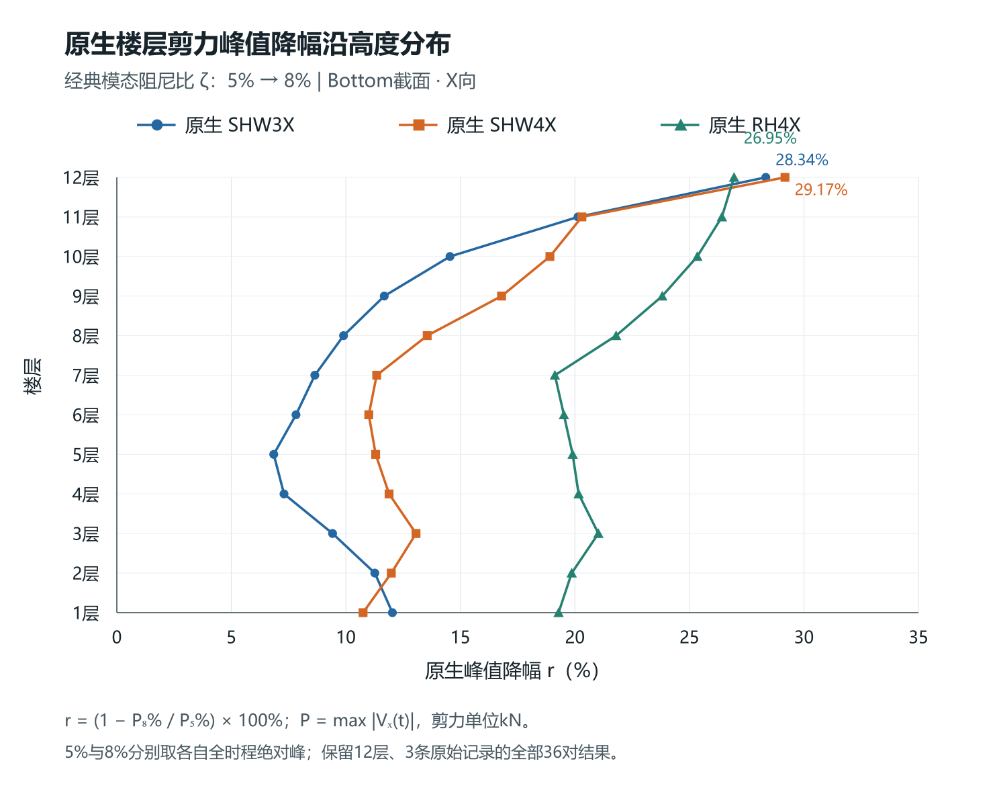

# 模态阻尼增加引起的楼层剪力削弱差异：全楼配对响应与控制峰转移

## 摘要

研究相同结构、相同输入下模态阻尼从5%增至8%时，各层剪力削弱程度不同的原因。采用12层结构三条X向原生记录，先报告完整时程峰值及控制时刻，再以两条5%记录训练固定输出映射，检验另一条5%整波留出与三条8%响应。全楼36项原生峰值均下降，降幅为6.85%—29.17%，最小降幅所在楼层随输入改变。针对目标剪力扩展参照阶数后，第12层8%时程误差由12阶的45.28%—60.19%降至36阶的1.12%—2.41%；第11层RH4X仍有5.06 s峰时偏差。进一步用原生曲线建立“旧峰点削弱减去新控制峰差额”的精确记账：屋顶SHW4X旧峰点削弱31.9149%，扣除控制峰转移差额2.7415%后，总峰下降29.1734%。第5层稳定低阶参照组的变化主要与幅值削弱对应，所选峰锚点组间抵消较弱。结果支持先核整体曲线与控制峰，再讨论稳定响应组合；高阶逆拟合巨项的相消不作为真实物理贡献。

**关键词**：模态阻尼；楼层剪力；响应叠加；峰值转移；固定输出映射

## Floor-dependent shear reduction under increased modal damping: paired building responses and controlling-peak transfer

**Abstract:** This study examines why increasing classical modal damping from 5% to 8% produces different story-shear reductions in the same structure under identical inputs. Three native X-direction records of a twelve-story structure are compared using full-history peaks and their controlling times. A signed output map is trained only on two 5% records and kept fixed for a third 5% record and all three 8% records. All 36 native peaks decrease, by 6.85%–29.17%, while the story with the smallest reduction depends on the input. Increasing the reference order from 12 to 36 reduces the roof-level 8% time-history error from 45.28%–60.19% to 1.12%–2.41%; a 5.06 s peak-time error remains for Story 11 under RH4X. An exact native-response ledger separates suppression at the old peak from the gap to the new controlling peak. For roof-level SHW4X, the corresponding percentages are 31.9149% and 2.7415%, giving a net peak reduction of 29.1734%. Stable low-order reference groups at Story 5 mainly reflect amplitude reduction, with weak intergroup cancellation at the selected anchors. Physical attribution therefore requires waveform accuracy and group stability in addition to peak agreement; cancellation among large inverse-fit terms is not interpreted as identified high-mode shear.

**Keywords:** modal damping; story shear; response superposition; peak transfer; fixed output mapping

## 1 工程问题与研究对象

增加阻尼通常用于削弱地震响应，但同一阻尼增量并不对应各层相同的剪力降幅。固定质量矩阵M、刚度矩阵K及经典模态阻尼条件下，无阻尼振型与固有频率不变；各阶受迫响应的幅值、时序和叠加关系改变，进而改变各层剪力。本文以原生5%与直接模态8%为主对照，从工程整体曲线出发，检查这些变化如何与不同楼层的削弱相联系，不预设装置位置或装置未充分作用为原因。

研究对象为12层结构，采用SHW3X、SHW4X、RH4X三条原生记录、Bottom切面全局X向剪力，单位分别为kN和s。三波名称保持原样，SHW3X不与其他工况中的SHW7混用。只用SHW3X与SHW4X的5%资料训练输出映射，RH4X整波5%不进入系数估计；全部8%记录均固定该映射。数据已用于研究，后续扩阶也是由已见误差触发，故本项属于记录分离的回顾性检验。实际Maxwell响应仅作辅助对象，不默认等同全阶统一增加3个百分点。

## 2 分析方法

### 2.1 先比较原生峰值，再检查同刻变化

对阻尼设置j=5、8，记P_j=max_t|V_j(t)|，t_j为相应控制峰时刻，峰值降幅为100(1−P_8/P_5)。各峰从各自完整时程取得，同时保存另一种阻尼在该时刻的有符号剪力。这样既可观察最终峰值变化，也可区分原控制点削弱和控制峰转移，避免把不同时间的分量拼成同刻分解。

### 2.2 固定输出映射及目标响应截断检查

以相同输入a_g(t)驱动单位参与SDOF核，初始位移和速度为零：

$$\ddot s_r+2\zeta\omega_r\dot s_r+\omega_r^2s_r=-a_g(t),\qquad \widehat V_s^\zeta(t)=\sum_{r=1}^{N}a_{sr}g_r^\zeta(t).$$

依据弹性剪力T_SKx和含阻尼广义剪力T_S(Cẋ+Kx)的区分[1]，并列弹性基g_r^E=ω_r²s_r与含阻尼平衡基g_r^B=ω_r²s_r+2ζω_r dot(s_r)。不同N分别在两条5%记录上确定系数、列尺度和活动列，随后固定用于8%。初设N6/N12及两个SVD阈值10⁻¹⁰、10⁻⁸，再针对输出误差扩展至N24/N36。两种输出基保留，不能因某基误差较小便倒推原生VX的物理定义。

CSI手册要求通过改变模态数检查具体动力响应[2]。本研究按目标楼层分别报告曲线、峰值和峰时误差，不以质量参与率代替局部剪力收敛。各N重新训练的比较属于参照模型敏感性，不是真实模态时程直接删阶的误差。采用：

$$\mathrm{NRMSE}=\frac{\|\widehat V-V\|_2}{\|V\|_2},\qquad e_p=\frac{\max_t|\widehat V(t)|}{\max_t|V(t)|}-1.$$

### 2.3 原生峰值变化的精确记账

当P_5>0时，取s_0=sign[V_5(t_5)]，定义旧峰点沿原符号的削弱D，以及新控制峰相对于该同刻值的差额M：

$$D=s_0[V_5(t_5)-V_8(t_5)],\qquad M=P_8-s_0V_8(t_5)\ge0,\qquad P_5-P_8=D-M.$$

因为s_0V_5(t_5)=P_5，直接代入即得该恒等式；M非负来自s_0V_8(t_5)≤|V_8(t_5)|≤P_8。D可正可负，M=0也不保证控制时刻唯一。D与M均为原生曲线的记账量，不是能量比例或可独立操纵的因果贡献。

### 2.4 幅值、波形及剩余响应

对稳定的有符号参照项或组，令v=A h，A为同一时段绝对峰。两态A均非零时：

$$\Delta v=\Delta A\,\frac{h_8+h_5}{2}+\frac{A_8+A_5}{2}\,\Delta h.$$

前项为幅值变化，后项为归一波形变化，包含包络、频率组成和到峰时序；只有单频或可靠相位定义下才称纯相位。零幅值项直接报告差值。该式解释同刻差值，不能将两个锚点的分解拼接为独立峰差。

原生模态坐标并未直接取得，参照系数不等于实测物理模态输出系数。低阶参照L之外，统一以R=V_native−L记录剩余响应；R可含未表示动态、拟合分配及误差，不命名为真实高阶剪力贡献。对于逆拟合中出现的巨项相消，仅保留其数值警示，不用来解释真实高阶内部抵消。

## 3 全楼原生响应与参照误差

### 3.1 相同阻尼增量的高度分布

**表1 原生5%至8%剪力峰值降幅，单位%**

|楼层|SHW3X|SHW4X|RH4X|
|---:|---:|---:|---:|
|1|12.03|10.75|19.29|
|2|11.26|11.98|19.86|
|3|9.42|13.06|21.03|
|4|7.30|11.89|20.16|
|5|6.85|11.30|19.90|
|6|7.82|11.00|19.52|
|7|8.65|11.35|19.13|
|8|9.90|13.55|21.80|
|9|11.68|16.80|23.81|
|10|14.55|18.91|25.34|
|11|20.13|20.31|26.42|
|12|28.34|29.17|26.95|

图1 原生Bottom切面X向剪力的峰值降幅；两种阻尼分别取各自完整时程绝对峰，三条记录的全部36项比较均保留。

本组三波、12层的36项原生峰值全部下降，范围为6.85%—29.17%。SHW3X最小降幅位于第5层6.85%，SHW4X位于第1层10.75%，RH4X位于第7层19.13%；三波最大值均在第12层。分布随输入改变，且不随楼层单调变化。仅列第5层与第12层不能代表全楼最小削弱位置。

### 3.2 截断误差需逐层检查

第12层弹性参照的8%曲线误差由N12的45.28%—60.19%，降为N24的2.58%—5.03%，N36进一步降至1.12%—2.41%。第5层N36相应范围为0.86%—1.42%。这说明较低截断在不同输出层的充分性不同，扩阶可显著改善整体复原。

**表2 N36弹性固定映射的全楼NRMSE，单位%**

|楼层|5% RH4X整波留出|8% SHW3X|8% SHW4X|8% RH4X|
|---:|---:|---:|---:|---:|
|1|2.44|1.98|2.60|2.77|
|2|2.37|1.40|2.11|2.72|
|3|2.01|1.38|1.95|2.10|
|4|1.15|0.47|0.89|1.23|
|5|1.38|0.86|1.27|1.42|
|6|1.28|0.55|0.95|1.15|
|7|1.24|0.53|1.00|1.25|
|8|1.47|0.68|1.10|1.24|
|9|1.63|0.53|1.12|1.37|
|10|2.09|0.68|1.39|1.78|
|11|5.72|1.92|4.03|4.55|
|12|2.95|1.12|2.41|2.32|

第11层是本次全楼结果的重要限制。RH4X的5%留出NRMSE为5.72%；8%为4.55%，独立峰幅误差为−1.084%，但原生峰时16.64 s、参照峰时21.70 s，相差5.06 s。较小的曲线误差和峰幅误差不能替代峰时检查，该记录不用于宣称峰时已准确复原。

N36归一设计矩阵秩36、条件数约4.56×10⁷。满秩只说明当前矩阵的代数性质；扩阶改善总响应，并未证明各个高阶参照系数具有唯一物理对应。以下机制解释因此先用原生曲线及稳定组合，避免从整体精度跳到真实逐阶归因。

## 4 从旧峰削弱到新控制峰

### 4.1 屋顶三波的原生精确记账

**表3 第12层原生峰值变化D−M记账**

|输入|t5→t8/s|旧峰点削弱D/kN|控制峰差额M/kN|P5−P8/kN|最终降幅/%|
|---|---|---:|---:|---:|---:|
|SHW3X|21.18→21.18|240.932|0.000|240.932|28.3354|
|SHW4X|28.34→20.58|190.527|16.366|174.161|29.1734|
|RH4X|20.24→20.24|137.728|0.000|137.728|26.9488|

SHW3X与RH4X的M为零，旧控制点已经达到新控制幅值。SHW4X则由28.34 s转至20.58 s：在旧峰点，8%剪力由原5%的596.985 kN降为406.457 kN，D=190.527 kN，即31.9149%；新全程峰422.824 kN又比该同刻值高16.366 kN，对应M/P_5=2.7415%。最终下降174.161 kN，即29.1734%。如果只检查旧峰点，会高估总体峰值的削弱。

新峰时20.58 s，5%原生剪力为523.093 kN，8%为422.824 kN。它与旧峰时是两组独立同刻比较；不能用旧时刻的一部分和新时刻的另一部分拼接成“幅值贡献+相位贡献”。D−M由原生曲线直接成立，不依赖逆向模态系数的唯一性。

### 4.2 稳定低阶响应与波形修正

第5层既有N12参照诊断中，1—3阶组在N6/N12之间的波形差仅为原生总体L2的0.50%—0.65%。其自身峰降幅为7.71%、10.17%、21.68%，与三波原生总峰降幅6.85%、11.30%、19.90%方向和量级相近。在各波8%参照峰锚点，四组χ=1−|Σv_g|/Σ|v_g|较小，约0.00009—0.005；它只在分母非零时定义，并随分组改变。这些实数支持本例主要关注主组幅值响应，而不是强行将抵消变化作为主导机制。

SHW3X、RH4X的归一波形项抵消一部分幅值削弱，SHW4X则在该锚点增强同刻削弱。它说明相同阻尼增量对不同输入产生不同响应变化。当前证据支持有限参照组的对应解释，不将小误差提升为真实单阶因果关系。

屋顶两个原生峰锚点上的拟合低阶组合与拟合剩余项同号，两组间χ为零；这并不表示组内无相消。尤其13阶以上逆拟合单项出现近乎完全的巨项抵消，本文不将这些数值当作物理高阶剪力。屋顶真实峰转移的结论以表3原生记账为依据。

### 4.3 单频参照说明频率选择性

为说明相同增阻尼为何对不同响应成分产生不同削弱，取固定单阶、同一非零谐波力及固定非零弹性输出系数，只比较稳态。β为输入频率与固有频率之比，由经典SDOF方程代入可得：

$$R^2=\frac{(1-\beta^2)^2+0.01\beta^2}{(1-\beta^2)^2+0.0256\beta^2},\qquad 0.625\le R\le1.$$

β=1时幅比R=0.625，削弱37.5%，柔度相位却均为−90°；远离该频率比时，幅值变化较小。这是从经典方程自推的单频说明，与文献的经典模态框架和弹性输出定义一致[1–2]，并非新的地震峰值上界。地震瞬态及楼层多阶合成峰不套用37.5%上限，含ζ速度项的平衡输出也不直接套该比值。

既有三层存在性示例曾出现单阶峰均降、合成峰增39.31%，提示叠加与时序需要检查。本工程36项峰却均下降，且所选锚点的拟合组间抵消不强。因此本工程机制应围绕幅值变化与控制峰转移展开，而不是照搬简化模型的增幅现象。

## 5 工程分析步骤与适用范围

首先，对同一M/K、输入和输出定义，列全楼原生P_5、P_8、各自峰时及降幅，确定实际差异的位置。其次，在每个原生峰时交叉读取另一阻尼曲线，以D−M记录旧控制点变化与新控制峰差额；对峰时转移明显或近峰竞争的记录，不用单一旧峰点代替全程寻峰。

随后，按目标层剪力检查截断阶数、输出口径及留出误差，曲线、峰幅、峰时三者一起评价。只有在总体误差和组合稳定性支持时，再解释低阶参照项的幅值、归一波形及同刻抵消，剩余部分保持为剩余响应。第11层RH4X等峰时偏差记录保留，避免只展示总体误差较小的层。

最后，区分模型解释与工程外推。本组三条X向记录并非新的独立工程样本；N24/N36是在已有误差基础上扩展。实际Maxwell的非线性、非经典耦合及输入幅值影响需要另外对照，不由直接模态8%的结果自动推得。当前成果给出可复算的全楼比较与峰值记账，并未完成任意输入下真实逐阶贡献的识别。

## 6 结论

（1）固定M/K及同一输入，模态阻尼5%增至8%后，全楼36项原生X向剪力峰均下降6.85%—29.17%。最小降幅所在层随输入改变，不能预设固定薄弱层或由安装位置直接解释。

（2）截断充分性必须针对目标响应检查。第12层8%时程误差由N12的45.28%—60.19%降至N36的1.12%—2.41%；但第11层RH4X仍存在5.06 s峰时偏差。曲线或峰幅误差较小，不保证控制时刻准确。

（3）原生峰值变化可精确写成D−M。屋顶SHW4X旧峰点削弱31.9149%，扣除2.7415%的新控制峰差额后，实际峰降29.1734%。该记账直接处理同刻变化与峰转移，不依赖模态逆拟合解释。

（4）第5层稳定主组的变化主要与幅值削弱对应，归一波形变化可增强或抵消同刻削弱。屋顶逆拟合高阶巨项的相消不作为真实高阶贡献；机制分析以原生曲线、稳定低阶参照和剩余响应共同约束。

## 参考文献

[1] SONG J, CHU Y L, LIANG Z, LEE G C. Modal Analysis of Generally Damped Linear Structures Subjected to Seismic Excitations[R]. Buffalo: University at Buffalo, State University of New York, 2008. MCEER-08-0005:38,40.

[2] COMPUTERS & STRUCTURES, INC. CSi Analysis Reference Manual: for SAP2000, ETABS, SAFE and CSiBridge[M]. Rev.15. Berkeley: Computers & Structures, Inc., 2016. ISO#GEN062708M1:381,403–404.
