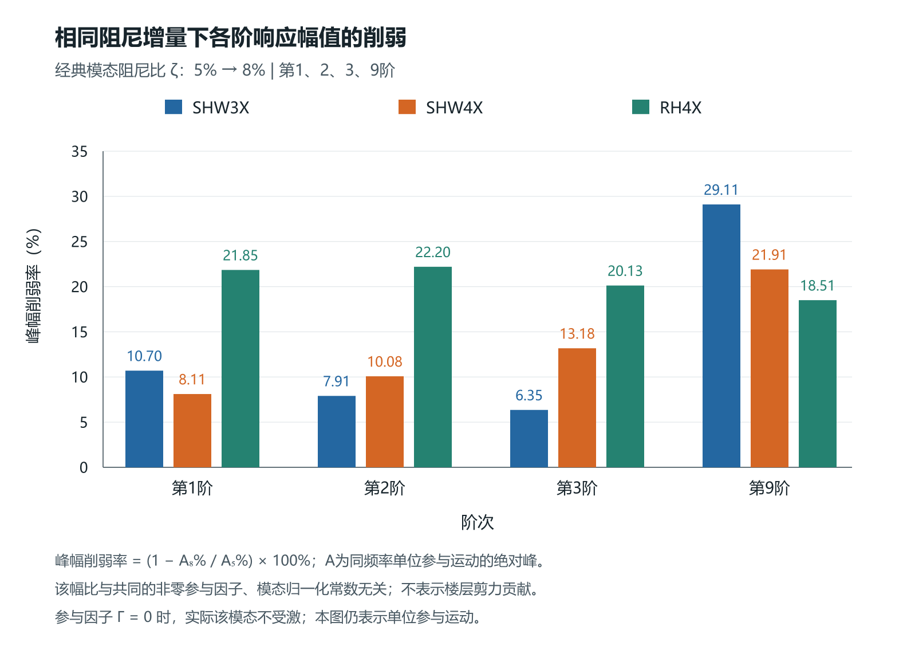
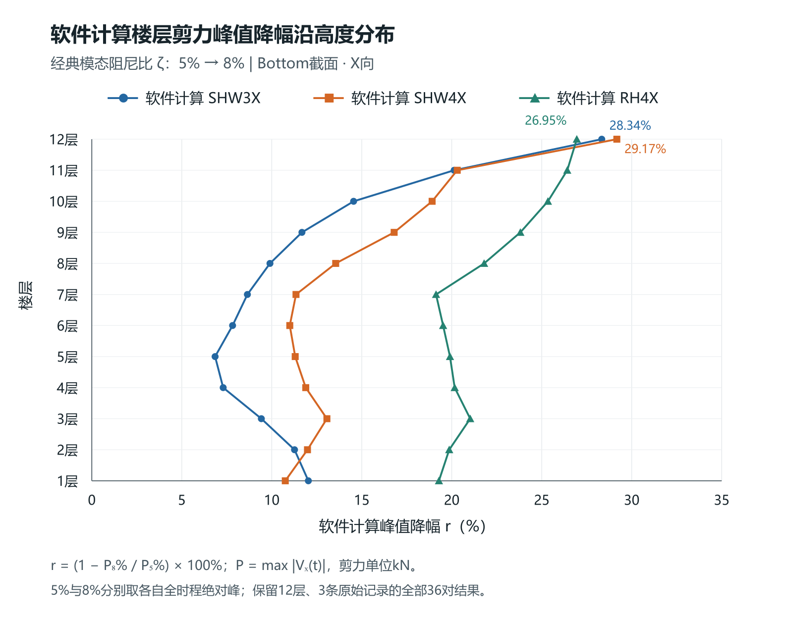

# 模态阻尼增加对各阶响应及楼层剪力削弱差异的影响

## 摘要

在质量、刚度及地震输入不变的条件下，研究经典模态阻尼比由5%增至8%如何改变各阶响应及楼层剪力。采用12层结构三条X向输入的计算结果，比较36阶单位参与响应的峰幅和归一波形，再核对全楼剪力曲线及控制峰变化。相同阻尼增量产生不同的逐阶削弱：SHW3X下第3阶峰幅下降6.355%，第9阶下降29.106%；前三阶在三条输入下也具有不同降幅与波形变化。全楼36项剪力峰均下降6.85%—29.17%，最小降幅所在楼层随输入改变。将实际峰降写为原峰时刻的同向变化减去重新选峰修正，可处理峰时及正负号转换；RH4X第1层由正峰转为负峰，22.9625%的原时刻降幅扣除3.6748%修正后，总峰下降19.2877%。基准5%下确定的剪力系数能较好复算多数8%曲线，但第11层RH4X仍有5.06 s峰时偏差。结果表明，解释楼层差异须依次考察逐阶幅值、完整波形与控制峰，单位响应比值尚不等于各阶对真实楼层剪力的物理分担。

**关键词**：模态阻尼；模态响应；楼层剪力；波形变化；控制峰

## Effects of increased modal damping on modal responses and floor-dependent story-shear reduction

**Abstract:** With mass, stiffness and seismic input held unchanged, this study examines how increasing classical modal damping from 5% to 8% changes modal responses and story shear. Three X-direction inputs for a twelve-story structure are used to compare the peak amplitudes and normalized waveforms of 36 unit-participation responses, followed by full-building shear histories and their controlling peaks. Equal damping increments produce unequal modal reductions: under SHW3X, the third and ninth response peaks decrease by 6.355% and 29.106%, respectively. The first three responses also change differently across inputs. All 36 story-shear peaks decrease, by 6.85%–29.17%, while the story with the smallest reduction depends on the input. The net peak decrease is expressed as the same-time change along the old peak sign minus a peak-reselection correction. For Story 1 under RH4X, the controlling peak changes from positive to negative; 22.9625% minus 3.6748% gives the actual reduction of 19.2877%. Shear coefficients calibrated at 5% reproduce most 8% histories reasonably well, although a 5.06 s peak-time error remains for Story 11 under RH4X. Modal amplitude changes, complete waveforms and peak selection should therefore be examined in sequence. Unit-response ratios do not by themselves identify physical modal shares of actual story shear.

**Keywords:** modal damping; modal response; story shear; waveform change; controlling peak

## 1 研究问题与工程对照

同一结构提高阻尼后，各层剪力的下降比例为何不同？在经典模态阻尼条件下，质量矩阵M和刚度矩阵K确定无阻尼振型与固有频率；两者不变时，增加阻尼改变的是各阶受迫响应的幅值、波形和发生时序。各层对这些响应的组合不同，最终由完整剪力曲线重新确定控制峰。因此，应沿“同一增阻尼—各阶响应变化—叠加与控制峰—楼层差异”分析，而不先把安装位置或装置失效当作原因。

研究采用同一12层结构、同一输入下基准5%与直接模态8%的软件计算结果。三条输入为SHW3X、SHW4X、RH4X；输出取各层Bottom截面全局X向剪力，单位kN，时间单位s。SHW3X不与其他工况的SHW7混用。本文的定量结果仅针对基准5%与直接模态8%的对照；实际Maxwell仅在讨论中说明其与统一模态增阻尼的区别。

## 2 各阶响应及完整曲线的比较方法

### 2.1 相同输入下的单位参与响应

对每一固定频率$\omega_r$，以同一地震加速度$a_g(t)$求单位参与相对运动$s_r$，初始位移、速度为零：

$$\ddot s_r+2\zeta\omega_r\dot s_r+\omega_r^2s_r=-a_g(t),\qquad g_r^\zeta(t)=\omega_r^2s_r^\zeta(t).$$

$g_r$单位为m/s²，同一阶固定乘子$\omega_r^2$不改变两种阻尼的峰幅比。以同一完整时段定义$A_{r,\zeta}=\max|g_r^\zeta|$及$h_{r,\zeta}=g_r^\zeta/A_{r,\zeta}$：

$$\rho_r=\frac{A_{r,8}}{A_{r,5}},\qquad \varepsilon_r=\frac{\|h_{r,8}-h_{r,5}\|_2}{\|h_{r,5}\|_2}.$$

1−$\rho_r$为峰幅削弱比例，$\varepsilon_r$为相同时间网格上的归一波形差，不对齐两态峰时、不移时。对两种阻尼共同的非零常数c，峰幅同乘|c|，归一波形同乘sign(c)，故ρ与ε均不变。因此固定参与因子$\Gamma_r$和固定输出乘子会在这些指标中消去；$\Gamma_r=0$时实际该阶不受激，不能由单位响应表推定其实际贡献。

### 2.2 从各阶变化到同刻合成

对于物理定义明确的弹性剪力，输出可由固定系数与各阶坐标线性组合；含阻尼平衡剪力还含速度项。Song等分别给出T_SKx与T_S(Cẋ+Kx)的输出定义[1]。因此本文并列弹性形式$\omega_r^2s_r$与含阻尼平衡形式$\omega_r^2s_r+2\zeta\omega_r\dot s_r$，不按哪一种计算误差较小倒推软件VX的物理组成。

对任一非零响应或组合v=A h，两态同刻差值可写为：

$$\Delta v=\Delta A\frac{h_8+h_5}{2}+\frac{A_8+A_5}{2}\Delta h.$$

前项说明幅值改变，后项说明归一波形改变，包含包络、频率组成及到峰时序；只有单频或可靠相位定义下才进一步称纯相位。零幅值时直接比较响应差。各阶独立绝对峰不相加为楼层峰值，两个不同时间的分解也不拼成同刻分力。

### 2.3 计算剪力的复核

为检查有限阶响应能否跟随软件剪力，利用SHW3X、SHW4X的5%结果确定有符号剪力系数，并完成归一化处理；计算8%时保持这些系数与归一化方式不变，只改变响应核的阻尼。RH4X整条5%记录不进入系数确定。以$\mathrm{NRMSE}=\|\widehat V-V\|_2/\|V\|_2$衡量整段曲线差异，同时核对各自绝对峰及峰时。

按CSI对具体动力响应进行模态数检查的要求[2]，对目标楼层比较不同保留阶数。本文保留弹性与含阻尼平衡两种形式，不用质量覆盖代替局部剪力误差。曲线、峰幅和峰时误差分别检查，阶数敏感性与系数稳定性共同用于限定解释范围。

### 2.4 总峰降幅与原控制时刻变化

设$P_5=\max|V_5|$、$P_8=\max|V_8|$，$t_0$为5%绝对峰时刻，$P_5>0$且$s_0=\operatorname{sgn}[V_5(t_0)]$。沿原峰方向计算同刻变化D，再定义8%重新选取绝对峰的非负修正M：

$$D=P_5-s_0V_8(t_0),\qquad M=P_8-s_0V_8(t_0)\ge0,\qquad P_5-P_8=D-M.$$

该式直接由峰值定义成立，不要求线性或响应一定下降。M始终保留旧峰符号$s_0$，即使新峰换号也不改用新符号；它不是相位、能量或可独立施加的因果份额。M=0表示旧时刻沿旧符号已达到8%绝对峰，但一般不保证控制时刻唯一或首个峰时不变。

## 3 相同阻尼增量下的逐阶响应差异

36阶、三波共108项单位响应的峰幅比ρ为0.70894—0.93645，本次全部峰幅下降。表1列前三阶，并同时保留波形变化。

**表1 前三阶单位参与响应的峰幅削弱与归一波形差，每格为“峰幅削弱/% / ε”**

|阶次|SHW3X|SHW4X|RH4X|
|---:|---:|---:|---:|
|1|10.703 / 0.23777|8.114 / 0.19552|21.851 / 0.22426|
|2|7.907 / 0.23163|10.078 / 0.20708|22.203 / 0.22837|
|3|6.355 / 0.22686|13.178 / 0.23774|20.128 / 0.22969|

图1 相同阻尼增量下各阶单位参与响应峰幅的削弱。共同非零参与因子及固定输出乘子不改变幅比，Γ=0时实际该阶不受激；本图不表示楼层剪力分担。

同样把ζ从5%增至8%，SHW3X下前三阶削弱依次为10.703%、7.907%、6.355%；SHW4X为8.114%、10.078%、13.178%，RH4X为21.851%、22.203%、20.128%。阶次之间、同一阶的不同输入之间，都不存在固定削弱比例。SHW3X第9阶峰幅下降29.106%，与第3阶6.355%的差别尤为明显。前三阶ε约为0.196—0.238，说明变化也包含归一波形，不能只用一组峰幅比代替完整时程，更不能把ε读成相位角。

单频稳态参照可帮助理解这种频率选择性。对同一非零谐波力、固定单阶及固定非零弹性输出系数，令β为输入频率与固有频率之比，经典方程给出：

$$R^2=\frac{(1-\beta^2)^2+0.01\beta^2}{(1-\beta^2)^2+0.0256\beta^2},\qquad 0.625\le R\le1.$$

β=1时幅值削弱37.5%，柔度相位却仍为−90°；远离该频率比时幅值变化较小。这只是经典模态框架[2]下的单频自推说明，不能将37.5%作为地震瞬态或楼层合成峰的降幅上限。

## 4 全楼剪力削弱及控制峰变化

### 4.1 削弱随输入与楼层改变

**表2 软件计算的5%至8%楼层剪力峰值降幅，单位%**

|楼层|SHW3X|SHW4X|RH4X|
|---:|---:|---:|---:|
|1|12.03|10.75|19.29|
|2|11.26|11.98|19.86|
|3|9.42|13.06|21.03|
|4|7.30|11.89|20.16|
|5|6.85|11.30|19.90|
|6|7.82|11.00|19.52|
|7|8.65|11.35|19.13|
|8|9.90|13.55|21.80|
|9|11.68|16.80|23.81|
|10|14.55|18.91|25.34|
|11|20.13|20.31|26.42|
|12|28.34|29.17|26.95|

图2 三条X向输入下的楼层剪力峰值降幅。5%与8%分别取完整时程的绝对峰，三波、12层的36项比较全部保留。

36项剪力峰均下降6.85%—29.17%。SHW3X最小降幅在第5层，SHW4X在第1层，RH4X在第7层，三波最大值均在第12层。由第3节可知，同一阻尼增量先产生不同的逐阶幅值与波形变化；到楼层剪力时，还要经历各阶有符号组合及控制峰重新选择，因而不能用统一减幅系数或固定楼层次序描述本组结果。

### 4.2 20项峰时改变及正负峰转换

36项比较中，20项控制峰时改变，另16项本数据中峰时不变且M为零；3项控制峰换号均出现在RH4X第1—3层。表3列两个换号例及屋顶峰转移例。

**表3 原峰时刻变化与重新选峰修正，百分数均以同一P5为分母**

|记录|t5→t8/s|控制峰符号|D/P5 / %|M/P5 / %|实际峰降幅/%|
|---|---|---|---:|---:|---:|
|RH4X / 第1层|21.68→12.20|正→负|22.9625|3.6748|19.2877|
|RH4X / 第2层|21.70→12.24|正→负|22.8001|2.9400|19.8601|
|SHW4X / 第12层|28.34→20.58|正→正|31.9149|2.7415|29.1734|

RH4X第1层的5%峰为21.68 s的正峰10566.753 kN；8%控制峰转为12.20 s的负峰，其绝对值为8528.665 kN。在旧时刻21.68 s，8%剪力仍为正8140.361 kN，因此D=2426.392 kN、M=388.304 kN，净峰下降2038.088 kN，即22.9625%−3.6748%=19.2877%。仅看旧正峰时刻，会高估整条曲线的削弱；计算M时也不能随新负峰改换符号。

SHW4X屋顶由28.34 s移至20.58 s。原峰时刻的削弱为190.527 kN，对应31.9149%；新控制峰比8%在旧时刻的同向值高16.366 kN，修正2.7415%，最终下降174.161 kN，即29.1734%。两例说明，完整波形及控制峰选择是连接同刻响应变化与最终楼层峰降的必要环节，并非独立的“纯相位贡献”。

### 4.3 曲线复算与已知偏差

采用36阶弹性响应、仅在5%确定系数后计算8%，关键楼层误差见表4。该计算用于核对整体曲线，不代替第3节单位响应指标，也不直接输出物理分担比例。

**表4 剪力复算的NRMSE概要，单位%**

|楼层|5% RH4X整波留出|8%三波范围|
|---|---:|---:|
|第5层|1.38|0.86—1.42|
|第11层|5.72|1.92—4.55|
|第12层|2.95|1.12—2.41|

多数层曲线能够较好复算，但第11层RH4X、8%的峰幅误差虽为−1.084%，软件峰时16.64 s与复算峰时21.70 s仍相差5.06 s。整段误差和峰幅误差均需与峰时一起判断，不能只用峰幅接近认定控制时刻准确。第12层扩大保留阶数后曲线误差明显改善，说明截断检查必须针对目标剪力进行，而非由低层表现代表全楼。

## 5 叠加解释与工程分析步骤

第5层有限阶计算中，较稳定的1—3阶组合峰降幅约为7.71%、10.17%、21.68%，与三波软件总峰降幅6.85%、11.30%、19.90%相近；选定峰时的组间抵消较弱。在这一输出参照中，主组峰幅变化与软件总峰削弱的量级相近；归一波形变化还会增强或削弱同刻合成值，完整曲线仍需继续核对。各阶独立峰值的下降本身仍不保证合成峰按同比例下降，完整曲线始终是最终依据。

各阶单位参与响应的变化已经明确，楼层剪力的逐阶物理分担仍需结合振型、参与因子和物理输出系数核对。本文以软件剪力曲线为依据，用经过误差与截断比较的有限阶输出参照检查组合变化，并保留其与软件曲线之间的复算残差。13阶以上拟合项的巨量相消仅作为数值诊断，不用于解释真实高阶作用。

工程分析可按以下顺序进行：先保持M/K、输入及输出定义一致，计算各阶峰幅比和归一波形变化；再逐层比较完整剪力曲线的两个绝对峰及各自时刻，保留最小削弱位置随输入变化的事实；随后沿旧控制峰符号计算D与M，并交叉检查新、旧控制时刻的有符号响应；最后用仅在基准阻尼下确定的系数复算增阻尼曲线，同时检查曲线、峰幅、峰时及响应组合的稳定性。

三条X向记录及根据已有误差开展的截断比较属于本结构的回顾性分析。实际Maxwell的非线性、非经典耦合及幅值影响应另外比较，不能由直接模态8%自动替代。对单阶的频率选择性、地震单位响应差异及楼层峰降，应分别说明条件后再联系起来。

## 6 结论

（1）相同5%至8%阻尼增量不产生相同逐阶削弱。SHW3X第3阶单位响应峰下降6.355%，第9阶下降29.106%；前三阶在三波中的幅值与归一波形变化也不同。共同非零参与因子和固定输出乘子在比值中消去，但单位响应指标不是楼层物理分担。

（2）全楼36项软件剪力峰下降6.85%—29.17%，最小降幅所在楼层随输入改变。各阶幅值、完整波形、有符号叠加及控制峰选择应连续考察，不能用同一阻尼增量对应统一楼层减幅。

（3）20项比较发生控制峰时改变，3项发生正负峰转换。RH4X第1层由正峰转负峰，原时刻削弱22.9625%扣除重新选峰修正3.6748%后，总峰下降19.2877%；SHW4X屋顶相应为31.9149%−2.7415%=29.1734%。修正M是峰值定义产生的差额，不是相位或因果份额。

（4）以基准5%确定的剪力系数可复算多数8%曲线，但第11层RH4X仍有5.06 s峰时偏差。机制解释应保留这一限制，并将单位响应变化与真实楼层逐阶分担区分；当前结果尚不支持将高阶拟合巨项的相消认作真实物理作用。

## 参考文献

[1] SONG J, CHU Y L, LIANG Z, LEE G C. Modal Analysis of Generally Damped Linear Structures Subjected to Seismic Excitations[R]. Buffalo: University at Buffalo, State University of New York, 2008. MCEER-08-0005:38,40.

[2] COMPUTERS & STRUCTURES, INC. CSi Analysis Reference Manual: for SAP2000, ETABS, SAFE and CSiBridge[M]. Rev.15. Berkeley: Computers & Structures, Inc., 2016. ISO#GEN062708M1:381,403–404.
