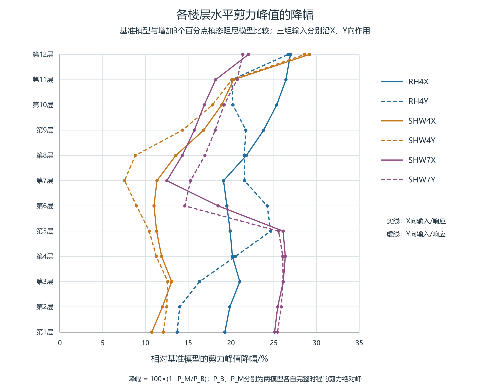
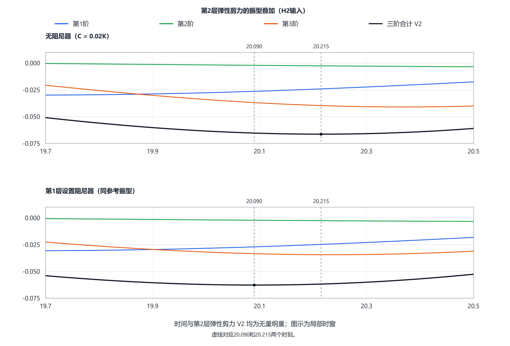

# 附加阻尼作用下双塔连体结构楼层剪力的分层评价

**Story-by-story assessment of shear changes under added damping in a coupled twin-tower structure**

作者、单位及邮编：待作者填写。

## 摘要

针对附加阻尼后各层剪力改善程度不同的问题，采用双塔连体结构的ETABS时程分析结果，按输入方向逐层比较基准模型与增加3个百分点模态阻尼的参考模型，并结合阻尼器模型的同刻出力讨论复核方法。14工况、12层共168条主方向记录的剪力峰均下降6.85%～30.55%；共同六工况中改善最少的记录为SHW4Y第7层，下降约7.561%，表明整体改善不能替代逐层检查。第8层RH4X、RH4Y两例的剪力峰时装置合力仅为自身峰的58.67%和62.53%，说明装置自身峰值不能直接表示控制时刻的出力。三层剪切模型进一步说明，小方向有效质量的模态仍可能形成较大局部剪力项。工程评价宜同时保留剪力峰值、逐层减幅及峰时，在不同输入下复核改善较小楼层，并结合装置同刻出力和目标输出的模态数量变化检查结果。

**关键词**：楼层剪力；分层评价；附加阻尼；黏滞阻尼器；时程分析

## Abstract

ETABS time-history results for a coupled twin-tower structure are used to assess differences in story-shear reduction after added damping. A baseline model is compared story by story with a reference model having three additional percentage points of modal damping; simultaneous damper forces are examined separately in a device-equipped model. All 168 main-direction records from 14 cases and 12 stories show peak-shear reductions of 6.85–30.55%. Among six common cases, the smallest reduction occurs at story 7 under SHW4Y, at approximately 7.561%. At story 8 under RH4X and RH4Y, damper-force magnitudes at the story-shear peak are only 58.67% and 62.53% of their own peaks. A three-story shear model illustrates how a mode with small directional effective mass can still produce a large local shear term. Assessment should retain peak shear, story-specific reduction and peak time, compare less-improved stories across inputs, and examine simultaneous damper forces and the sensitivity of the target output to the number of modes.

## 1 引言

同样的阻尼设置变化，在不同楼层未必产生相同减幅。屋顶位移、方向有效质量参与系数和楼层剪力分别对应不同输出；解释减剪时，需要先确认实际比较的是哪种剪力、哪一层及哪个时刻。

Song等分别建立弹性层剪力与含阻尼作用的广义层剪力，二者采用不同输出系数[1]。Londoño等在线性Maxwell模型中说明，支撑柔度会随频率改变传力幅值和相位[2]。Conde和Bernabeu讨论储能、损耗及等能线性化的频率依赖，指出基本与高阶振型的表现可能不同[3]。本文据此先报告工程模型的逐层响应差异，再以已知模型分析同刻叠加；装置出力时序作为辅助解释。

对工程设计而言，仅知道剪力峰值总体下降还不够，还需辨认哪些楼层改善较小、这些楼层是否随输入改变，以及装置出力能否与楼层剪力需求在时间上对应。本文以已有工程计算结果为主体，依次给出模型与数据范围、逐层比较步骤、代表性楼层结果及工程复核要求；三层模型只用于解释局部输出与模态叠加的关系。

## 2 工程概况与分析资料

### 2.1 工程模型与对照

本文采用所提供双塔连体结构的ETABS时程分析结果，比较基准阻尼模型、附加模态阻尼模型和设置黏滞阻尼器的模型，下文分别简称基准模型、参考模型和阻尼器模型。基准与参考模型各含14工况，已有输入对照表明输入逐样本一致。按所提供的模型资料，参考模型在基准模型上增加3个百分点模态阻尼。阻尼器模型覆盖RH4、SHW4、SHW7三组输入各X/Y方向的六工况；其与另两模型的输入及主体质量、刚度尚缺完整对照，三模型结果分别列示。软件编号Story1—12对应本文第1—12层。

本文采用软件Story Forces表中楼层底部（Bottom位置）的剪力。现有导出资料尚不能确定其中是否已包含所列阻尼器作用，也未完整给出截面侧别与正方向。因此，将该量作为软件楼层剪力直接比较，不另作阻尼器扣除。各层均以自身保存时程绝对最大值为峰；令两模型对应峰为P_B、P_M，减幅定义为1−P_M/P_B。峰时分别来自各模型，不把两个独立峰当成同一时刻。

现有工程模型资料包含3416个节点和88只Link的几何信息；本文用于出力时序分析的是第8—11层32只装置在六工况下的轴力与变形时程。上述覆盖与楼层剪力的比较范围分别列于表1。

**表1 本文采用的计算资料及用途**

|资料|范围|本文用途|
|---|---|---|
|基准与参考模型的楼层剪力|14工况×12层，168条主方向记录|同输入逐层比较峰值、减幅和峰时|
|阻尼器模型的楼层剪力|RH4、SHW4、SHW7各X/Y六工况，72条主方向记录|与另两模型并列描述输出|
|装置轴力与变形|第8—11层32只装置×六工况|分析已有楼层装置合力及出力时序|

### 2.2 模态资料与输出范围

三模型前三阶周期在所示精度下相同，约为2.7781、2.7322、2.5669s；主要方向参与质量分别为第一阶UY 65.22%、第二阶UX 64.87%、第三阶RZ 64.34%。在各自300阶汇总中按方向质量排序，X向前三重要阶次为2/4/10，Y向为1/5/11。全局阶次编号不代表目标层剪力贡献的大小，参与因子换号本身也不说明振型形状改变。

工程结构的精确逐阶剪力分解需要相应节点振型及响应时程。本文利用工程资料讨论逐层响应差异，并在参数完整的三层剪切模型中解释局部叠加机制。

## 3 逐层响应计算与分层评价步骤

对每个输入工况c和楼层s，分别取基准与参考模型保存时程的绝对最大值P_B,s,c和P_M,s,c，并保留各自峰时。逐层减幅定义为：

$$\eta_{s,c}=1-\frac{P_{M,s,c}}{P_{B,s,c}},\qquad P_{B,s,c}>0.$$

η为无量纲量，表中以百分数表示。正值表示该记录峰值下降，负值表示增大。各模型独立取峰是峰值比较，不能将两峰相减解释为同一时刻的内力分配。

分层评价首先按X、Y主输入方向列出各层峰值和减幅，再在每个工况内辨认改善较小的楼层。这样的楼层用于确定后续查看时程的位置，不能直接据此判断承载力最不利楼层。跨输入评价还应检查同一楼层在不同输入下的变化，保留改善较小和排序变化的记录，不能只展示平均减幅或改善最明显的工况。

随后对所选楼层查看控制峰附近的剪力时程，区分幅值变化与控制峰切换。装置出力按统一方向投影，既报告自身绝对峰，也报告剪力峰时的有符号合力。两者回答的工程问题不同：前者反映本输出的峰值需求，后者描述控制剪力时刻的实际出力。

本文先采用上述直接比较流程列示已有工程结果。多输入下如何汇总为简便的分层指标，还需在同一数据范围内检验排序稳定性并与直接逐层比较对照；下文不以尚未完成的汇总结果判断方法优劣。

## 4 工程结果与复核要求

### 4.1 基准与参考模型的减幅与峰时

14工况、12层共168条主方向记录峰全部下降，减幅为6.8513%～30.5458%，未发现主方向反增。表2列与阻尼器模型共同的六工况中各自下降最少的楼层。

**表2 基准与参考模型共同六工况的最小减幅记录**

|工况|楼层|P_B/kN|P_M/kN|减幅/%|峰时（基准→参考）/s|
|---|---|---:|---:|---:|---|
|RH4X|第7层|6725.06|5438.72|19.128|21.58→21.56|
|RH4Y|第1层|10123.05|8735.50|13.707|12.20→12.20|
|SHW4X|第1层|11399.73|10174.19|10.751|29.94→29.92|
|SHW4Y|第7层|7343.57|6788.32|7.561|29.84→29.86|
|SHW7X|第7层|8481.83|7421.40|12.502|38.12→38.10|
|SHW7Y|第6层|8091.99|6909.98|14.607|48.88→38.10|

共同六工况中，SHW4Y的第7层减幅最小，约7.561%；全14工况最小值则来自SHW3X的第5层，为6.851%。样本范围不同，不能混作同一最小记录。本组各层记录均下降，但降幅随楼层和输入变化。

全14工况最大绝对峰时迁移为12.76s。峰时差可能包含不同波包或控制峰的切换，不是相位角，也不能单独判定某阶模态因果。

图1 基准模型与参考模型在共同六工况下的逐层楼层底部剪力峰减幅。减幅为1−P_M/P_B，P_B和P_M分别为基准与参考模型的剪力绝对峰，各取自完整记录；实线为X向，虚线为Y向。

### 4.2 三模型峰值对照

**表3 两组代表性记录的三模型峰值与各自峰时**

|工况／楼层|基准模型峰/kN|参考模型峰/kN|阻尼器模型峰/kN|三模型各自峰时/s|阻尼器模型/参考模型|
|---|---:|---:|---:|---|---:|
|SHW4Y／第7层|7343.5700|6788.3221|6715.1270|29.84／29.86／29.92|0.98921749|
|RH4X／第1层|10566.7533|8528.6654|8916.7141|21.68／12.20／12.08|1.04549934|

72个共同工况—楼层记录中，阻尼器模型峰高于参考模型为34项、低于为38项。RH4X／第1层的阻尼器模型峰比参考模型高约4.55%，而SHW4Y／第7层略低。结合第2.1节模型范围，表3作三类输出的描述性对照。

阻尼器模型六工况的楼层剪力峰最大均在第1层，稀疏漂移记录中的控制层则为第4、5或7层。剪力峰所在层与变形控制层不同，二者均不能直接作为判断承载力最不利楼层的依据。上部四层32只装置的轴力时程可补充查看出力时序，不据此补齐全楼装置作用。

### 4.3 装置合力与楼层剪力的峰时

第8层所列阻尼器的I端位于第7层，J端位于第8层，单位方向向量n由I指向J。在导出轴力P取正拉力的约定下，本节QD=Σn_eP是J端结构内力抵抗项，装置对J节点的外力为−QD。每个主输入方向有4只非零投影装置，表中合力保留该层8只装置的方向投影。

**表4 第8层两例装置水平合力与楼层底部剪力**

|工况|QT绝对峰/kN（时刻/s）|QD绝对峰/kN（时刻/s）|QT峰时QD/kN|QT峰时QD绝对值／QD自身绝对峰/%|tQD−tQT/s|
|---|---|---|---:|---:|---:|
|RH4X|5776.6513（21.60）|405.8268（11.50）|-238.1133|58.6736|-10.10|
|RH4Y|5205.2112（21.58）|447.2019（11.46）|-279.6257|62.5278|-10.12|

第8层六工况在QT峰时的|QD|相对QD自身绝对峰为48.5899%～65.9515%。RH4X/Y中，装置合力自身峰比层剪峰分别早10.10s和10.12s；层剪峰时的合力绝对值仅为自身峰的58.6736%和62.5278%。这些比例描述同刻出力相对于本输出峰的大小，不是减震贡献率、耗能效率或利用率。

因此，比较层剪力需求与装置出力时，应同时查看层剪力峰时的有符号合力和装置自身峰。

图2 第8层在RH4X、RH4Y工况下的软件输出楼层剪力与装置水平合力时程。图示5～25s的原采样值，未作平滑处理；上下子图纵坐标范围分别为±6500kN和±500kN。虚线标出各自完整记录的绝对峰时刻。QD为J端内力抵抗项，装置对节点J的外力为−QD。

### 4.4 工程计算的复核顺序

对本例而言，SHW4Y第7层是共同六工况中改善较小的记录，应先查看该输入下第7层及相邻楼层的响应，再与其他输入对照。全14工况的最小记录则为SHW3X第5层，说明改变输入范围会改变优先复核对象。两者均需与剪力绝对值一起阅读，不能只按百分比决定设计优先级。

实际使用时，先确认比较模型的质量、刚度、输入和输出定义一致，再形成逐层结果表；对改善较小楼层补充控制峰附近时程，并将剪力与层间位移角分别检查。对于阻尼器模型，需按连接方向汇总同层装置水平分力，核对该合力在剪力峰时的数值。现有模型中剪力峰所在层与变形控制层不同，说明两类结果宜分别用于需求检查。

CSI手册指出，动力荷载参与率主要反映模态基对荷载空间分布的覆盖，响应精度还与荷载随时间变化的频率成分有关，应改变模态数量检查不同动力荷载的响应[4]。因此，目标层剪力仍需检查增阶后的峰值及控制时段稳定性；累计质量阈值不能直接给出局部内力误差界。

## 5 三层剪切模型的机制说明

为说明小方向有效质量与局部剪力的关系，采用无量纲单向三层模型，M=diag(1,1.2,.8)，K=[[2.4,−1,0],[−1,1.7,−.7],[0,−.7,.7]]，C=.02K；比较无装置与第1层κ=.5、c=.02、α=.3的Maxwell装置方案。H2有意含第二阶及近第三阶频率，用于考察高阶影响。完整输入、零初态、装置方程和隐式中点积分条件见[参数补充](../../../research/sessions/20261021-0737/roles/role5/R001-methods-supplement.md)。

在完整质量归一参考基中，第s层弹性剪力为：

$$V_s(t)=\sum_r(\ell_s^T\phi_r)q_r(t).$$

其中ℓs包含楼层刚度与输出映射，q取自完整耦合响应投影。表5显示，第三阶方向有效质量仅4.7892%，但第1、2层反向运动使层间差达到−1.316516，因k2=1，这也是第2层剪力系数。质量加权和与局部层间差反映不同物理对象，系数本身也不是剪力占比。

**表5 三层模型的方向有效质量及第2层剪力系数**

|阶次|方向有效质量比/%|第2层剪力系数（无量纲）|
|---|---:|---:|
|1|87.0289|+0.315637|
|2|8.1819|-0.022186|
|3|4.7892|-1.316516|

图3 无装置方案与第1层装置方案在局部时段19.7～20.5内的第2层剪力模态分量及合计。两方案采用相同横、纵坐标范围，时间和响应均为无量纲量；竖线标示共同取值时刻20.090和20.215。图中仅截取完整0～200时程的一段。

在两个共同控制时刻，装置方案第三阶向零的变化被前两项变化部分抵消，说明各阶全程峰值下降并不等于控制时刻同比改善。该模型前两阶累计质量为95.2108%，由同一完整响应仅保留前两阶后，第2层剪力峰分别低估43.3215%和41.6360%。这是该合成输入下的后验重构差，不是减少模态后重新求解的误差，也不代表工程结构或一般天然地震输入的误差率。该单向第三阶不对应工程结构的扭转阶次。其工程启示是：针对局部剪力，需同时查看输出系数、实际响应和同刻叠加。

## 6 结论

（1）本例同输入基准与参考模型的168条主方向记录剪力峰全部下降6.85%～30.55%，但各层改善程度不同。共同六工况的最小记录为SHW4Y第7层，约7.561%；全14工况的最小记录位于SHW3X第5层，约6.851%，复核对象随输入范围改变。

（2）逐层评价应保留剪力绝对峰、减幅和各自峰时，并将改善较小楼层与相邻层、其他输入和层间位移角对照。本例结果支持按楼层复核需求，不能据单条最小减幅直接判断承载力最不利楼层。

（3）第8层RH4X、RH4Y两例中，剪力峰时装置合力绝对值为其自身峰的58.6736%和62.5278%。装置自身峰不能替代控制剪力时刻的出力；这些比例用于说明时序，不作为减震贡献率。

（4）三层模型表明，小方向有效质量仍可形成较大局部剪力项。工程剪力评价除检查质量覆盖外，还需复核目标输出的模态数量影响及控制时段，而不能将简化模型的逐阶比例直接移用于工程结构。

## 参考文献

[1] SONG J, CHU Y L, LIANG Z, LEE G C. Modal Analysis of Generally Damped Linear Structures Subjected to Seismic Excitations[R]. Buffalo: University at Buffalo, State University of New York, 2008. Technical Report MCEER-08-0005.

[2] LONDOÑO J M, WAGG D J, NEILD S A. Supporting brace sizing in structures with added linear viscous fluid dampers: A filter design solution[J]. Earthquake Engineering & Structural Dynamics, 2014,43:1999–2013. DOI:10.1002/eqe.2433.

[3] CONDE J, BERNABEU A. Influence of Maxwell Stiffness in Damage Control and Analysis of Structures with Added Viscous Dampers[J]. Applied Sciences, 2021,11:3089. DOI:10.3390/app11073089。

[4] COMPUTERS & STRUCTURES, INC. CSi Analysis Reference Manual: for SAP2000, ETABS, SAFE and CSiBridge[M]. Rev.15. Berkeley: Computers & Structures, Inc., 2016. ISO#GEN062708M1.
