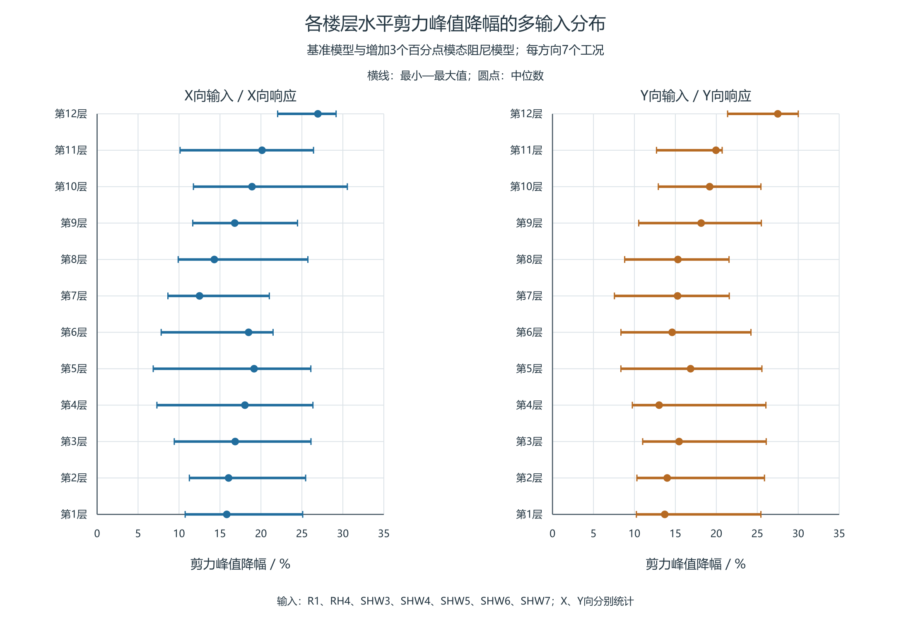
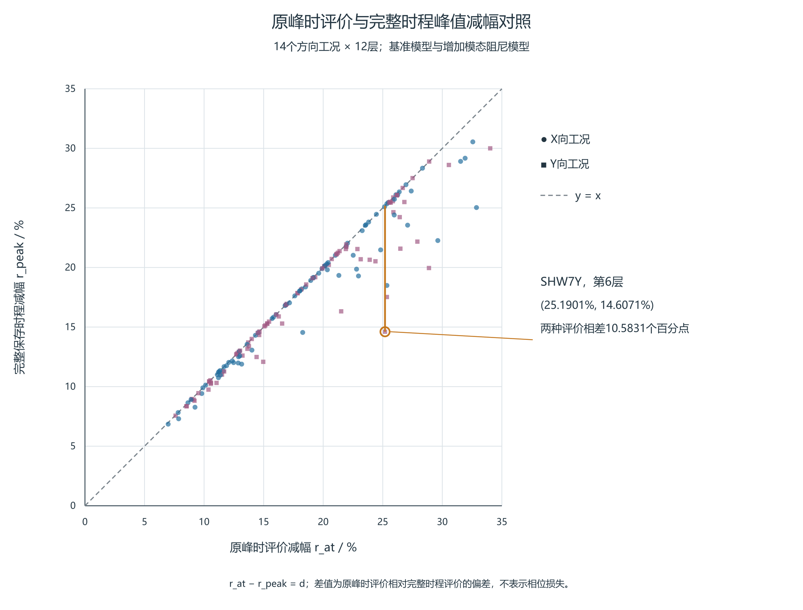
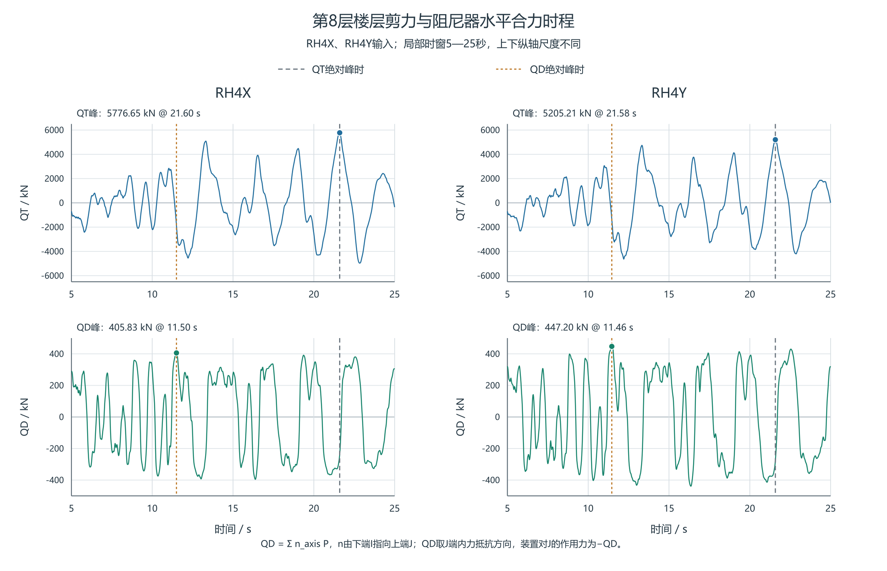

# 附加阻尼作用下双塔连体结构楼层剪力的分层评价

**Story-by-story assessment of shear changes under added damping in a coupled twin-tower structure**

作者、单位及邮编：待作者填写。

Authors, affiliations and postal codes: to be supplied by the authors.

## 摘要

针对附加阻尼后各层剪力降幅不一致的问题，以一双塔连体结构为例，建立按楼层与输入方向逐项复核的评价流程。采用相同输入的基准模型与增加3个百分点模态阻尼的参考模型，比较14个方向工况、12层的168条剪力记录，统计各层最小、中位和最大减幅，并保留最小减幅控制工况的成对绝对剪力；进一步计算只在基准峰时取值造成的减幅高估量。结果表明，全部记录峰值下降6.85%～30.55%，但底层仅在3个工况取得最小减幅。SHW7X中底层与第7层降幅分别为25.10%和12.50%，仅看底层或各层平均值会遗漏局部改善较小的情况。原峰时评价高估量中位数为0.0558个百分点，最大为10.5831个百分点，说明需同时保留参考模型自身控制峰。装置出力按层剪力控制时刻与其自身峰分别检查，三层模型用于解释小质量参与模态仍可能形成较大局部剪力的机制。所给流程可利用常规时程输出直接形成分层复核表，为确定重点查看的楼层、输入和时段提供依据。

**关键词**：楼层剪力；分层评价；附加阻尼；黏滞阻尼器；时程分析

## Abstract

A story-by-story assessment procedure is presented using ETABS time-history results of a coupled twin-tower structure. It retains the minimum, median and maximum shear reduction for each story and direction, together with paired absolute demands for the case controlling the minimum reduction. Evaluation-time bias distinguishes a value taken at the baseline peak time from comparison of the separate peaks. The baseline and reference model, with three additional percentage points of modal damping, are compared under identical inputs across 168 main-direction records from 14 cases and 12 stories. Peak shear decreases by 6.85–30.55% in all records. Under SHW7X, the reduction at story 7 is 12.50%, compared with 25.10% at the bottom story and a 20.60% arithmetic mean over the 12 stories. Both simplified readings miss the smaller local improvement; the bottom story controls the minimum reduction in only 3 of the 14 cases. Direction-specific ranges and the associated demands provide a basis for selecting stories for time-history inspection. The overstatement from evaluation only at the baseline peak time has a median of 0.0558 and a maximum of 10.5831 percentage points. Damper-force sums at the shear peak are compared separately with their own peaks, and a three-story model explains local modal superposition. The engineering results support checks that retain story-specific demand, input range and simultaneous damper forces.

**Keywords**: story shear; story-by-story assessment; added damping; viscous damper; time-history analysis

## 1 引言

黏滞阻尼器的工程评价需要结合具体控制目标和不同输入下的响应。柳博哲和汪梦甫针对梁端铰接钢管混凝土框架—核心筒结构，比较了阻尼参数变化对基底剪力及变形响应的影响[1]。Liu等依据指定响应的主要振型及装置位置对模态阻尼的影响调整钢框架中的装置配置，并指出较大的有效阻尼不保证不同目标响应均获得最佳控制效果[2]。De Domenico和Hajirasouliha采用楼层层间位移角反馈调整非线性黏滞阻尼器的系数分布，并通过非线性时程分析及天然地震记录检查设计结果[3]。这些研究为按目标响应开展评价和复核提供了方法背景。本文在已有工程计算资料范围内，按楼层和输入方向保留剪力绝对需求及减幅，比较不同输入下的改善范围，并检查以基准模型峰时取值代替两模型各自峰值所产生的差别。

同样的阻尼设置变化，在不同楼层未必产生相同减幅。屋顶位移、方向有效质量参与系数和楼层剪力分别对应不同输出；解释减剪时，需要先确认实际比较的是哪种剪力、哪一层及哪个时刻。

Song等分别建立弹性层剪力与含阻尼作用的广义层剪力，二者采用不同输出系数[4]。Londoño等在线性Maxwell模型中说明，支撑柔度会随频率改变传力幅值和相位[5]。Conde和Bernabeu讨论储能、损耗及等能线性化的频率依赖，指出基本与高阶振型的表现可能不同[6]。本文据此先报告工程模型的逐层响应差异，再以已知模型分析同刻叠加；装置出力时序作为辅助解释。

对工程设计而言，仅知道剪力峰值总体下降还不够，还需辨认哪些楼层改善较小、这些楼层是否随输入改变，以及装置出力能否与楼层剪力需求在时间上对应。本文以已有工程计算结果为主体，依次给出模型与数据范围、逐层比较步骤、代表性楼层结果及工程复核要求；三层模型只用于解释局部输出与模态叠加的关系。

## 2 工程概况与分析资料

### 2.1 工程模型与对照

本文采用所提供双塔连体结构的ETABS时程分析结果，比较基准阻尼模型、附加模态阻尼模型和设置黏滞阻尼器的模型，下文分别简称基准模型、参考模型和阻尼器模型。基准与参考模型各含14工况，已有输入对照表明输入逐样本一致。按所提供的模型资料，参考模型在基准模型上增加3个百分点模态阻尼。阻尼器模型覆盖RH4、SHW4、SHW7三组输入各X/Y方向的六工况；其与另两模型的输入及主体质量、刚度尚缺完整对照，三模型结果分别列示。软件编号Story1—12对应本文第1—12层。

本文采用软件Story Forces表中楼层底部（Bottom位置）的剪力。现有导出资料尚不能确定其中是否已包含所列阻尼器作用，也未完整给出截面侧别与正方向。因此，将该量作为软件楼层剪力直接比较，不另作阻尼器扣除。各层均以自身保存时程绝对最大值为峰；令两模型对应峰为P_B、P_M，减幅定义为1−P_M/P_B。峰时分别来自各模型，不把两个独立峰当成同一时刻。

现有工程模型资料包含3416个节点和88只Link的几何信息；本文用于出力时序分析的是第8—11层32只装置在六工况下的轴力与变形时程。上述覆盖与楼层剪力的比较范围分别列于表1。

**表1 本文采用的计算资料及用途**

|资料|范围|本文用途|
|---|---|---|
|基准与参考模型的楼层剪力|14工况×12层，168条主方向记录|同输入逐层比较峰值、减幅和峰时|
|阻尼器模型的楼层剪力|RH4、SHW4、SHW7各X/Y六工况，72条主方向记录|与另两模型并列描述输出|
|装置轴力与变形|第8—11层32只装置×六工况|分析已有楼层装置合力及出力时序|

### 2.2 模态资料与输出范围

三模型前三阶周期在所示精度下相同，约为2.7781、2.7322、2.5669s；主要方向参与质量分别为第一阶UY 65.22%、第二阶UX 64.87%、第三阶RZ 64.34%。在各自300阶汇总中按方向质量排序，X向前三重要阶次为2/4/10，Y向为1/5/11。全局阶次编号不代表目标层剪力贡献的大小，参与因子换号本身也不说明振型形状改变。

工程结构的精确逐阶剪力分解需要相应节点振型及响应时程。本文利用工程资料讨论逐层响应差异，并在参数完整的三层剪切模型中解释局部叠加机制。

## 3 楼层剪力的逐层复核方法

对同一输入工况c、楼层s和主方向，在共同保存时间集内分别求基准与参考模型的剪力绝对峰P_B,s,c与P_M,s,c；t_B为基准峰时。逐层减幅为：

$$r_{\mathrm{peak},s,c}=1-\frac{P_{M,s,c}}{P_{B,s,c}},\qquad P_{B,s,c}>0.$$

按X、Y方向分别汇总每层七工况的最小、中位及最大减幅。最小值同时列出控制工况及该条记录的两模型绝对峰，中位值取七条记录排序后的中间一条。该表保留改善较小的楼层及绝对需求，作为查看响应时程的入口，不以减幅大小代替承载力判断。

若仅在基准峰时取参考模型的剪力绝对值A=|V_M(t_B)|，所得减幅r_at与上述独立峰比较的差别可写为：

$$r_{\mathrm{at}}=1-\frac{A}{P_B},\qquad d=\frac{P_M-A}{P_B}\ge0,\qquad r_{\mathrm{peak}}=r_{\mathrm{at}}-d.$$

由于P_M是同一保存时间集上的绝对最大值，d表示只看原峰时可能高估改善的幅度；乘以100后单位为百分点。应先逐条记录计算，再在同一工况内并列r_peak、r_at及d，不能把不同工况的r_at最小值与d最大值拼接。d反映评价时刻选择造成的减幅差异；取得P_M仍需完整保存时程。P_B=0时这些归一量不定义。并列基准峰须预定取值规则；本文已有表采用所列峰时，尚未覆盖所有并列峰的敏感性。

工程使用可按四步进行：（1）核对模型、输入、单位和保存网格，按方向形成逐层成对峰值表；（2）列各层最小—中位—最大减幅，保留最小值控制工况及两模型绝对需求；（3）对改善较小的楼层查看该控制工况的峰附近时程，按需要并列r_at与d；（4）与同一工况的底层结果和各楼层减幅算术平均对照，再检查该目标层的其他输入结果，并另查层间位移角、装置同刻合力与目标输出的模态数量变化。

例如SHW7X第7层，P_B=8481.8301kN、P_M=7421.3995kN，代入可得(1−7421.3995/8481.8301)×100%=12.5024%。同一工况底层减幅25.0972%，十二层减幅的算术平均为20.6023%，分别比第7层高12.5948和8.1000个百分点。前两种简化读法会遗漏该层较小的改善；平均值只是各层减幅的算术平均，不代表总剪力减幅。

## 4 工程结果与复核要求

### 4.1 基准与参考模型的减幅与峰时

表2、表3按方向给出各层多输入范围，表中绝对剪力始终取最小减幅对应的同一工况。X/Y分别有七条方向记录；共同三波族的X/Y六工况不是六个独立事件。

**表2 X向各层七工况减幅范围及最小值对应绝对剪力**

|楼层|最小/%|中位/%|最大/%|最小值工况|P_B/kN|P_M/kN|
|---|---:|---:|---:|---|---:|---:|
|1|10.751|15.828|25.097|SHW4X|11399.73|10174.19|
|2|11.265|16.050|25.457|SHW3X|12582.62|11165.22|
|3|9.421|16.855|26.108|SHW3X|10495.37|9506.65|
|4|7.300|18.044|26.345|SHW3X|9164.94|8495.88|
|5|6.851|19.163|26.091|SHW3X|8691.64|8096.15|
|6|7.823|18.492|21.479|SHW3X|8516.50|7850.29|
|7|8.646|12.502|21.022|SHW3X|8140.43|7436.63|
|8|9.900|14.308|25.730|SHW3X|7511.24|6767.66|
|9|11.677|16.800|24.466|SHW3X|6625.36|5851.74|
|10|11.758|18.910|30.546|SHW6X|6865.20|6057.99|
|11|10.128|20.134|26.419|SHW6X|3297.45|2963.47|
|12|22.039|26.949|29.173|SHW7X|702.07|547.34|

**表3 Y向各层七工况减幅范围及最小值对应绝对剪力**

|楼层|最小/%|中位/%|最大/%|最小值工况|P_B/kN|P_M/kN|
|---|---:|---:|---:|---|---:|---:|
|1|10.243|13.707|25.443|SHW3Y|12253.15|10998.03|
|2|10.307|14.001|25.879|SHW3Y|11896.41|10670.27|
|3|11.010|15.456|26.091|SHW3Y|10415.33|9268.65|
|4|9.747|13.018|26.052|SHW3Y|9278.28|8373.96|
|5|8.354|16.858|25.565|SHW3Y|8723.97|7995.21|
|6|8.359|14.607|24.228|SHW3Y|8523.03|7810.60|
|7|7.561|15.269|21.580|SHW4Y|7343.57|6788.32|
|8|8.813|15.312|21.552|SHW4Y|6281.04|5727.50|
|9|10.531|18.149|25.496|SHW3Y|6747.48|6036.92|
|10|12.920|19.188|25.444|SHW3Y|5485.65|4776.91|
|11|12.699|19.956|20.714|R1Y|2442.77|2132.55|
|12|21.377|27.505|30.002|SHW7Y|842.24|662.20|

14工况、12层共168条主方向记录峰全部下降，减幅为6.8513%～30.5458%，未发现主方向反增。表4列与阻尼器模型共同的六工况中各自下降最少的楼层。

**表4 基准与参考模型共同六工况的最小减幅记录**

|工况|楼层|P_B/kN|P_M/kN|减幅/%|峰时（基准→参考）/s|
|---|---|---:|---:|---:|---|
|RH4X|第7层|6725.06|5438.72|19.128|21.58→21.56|
|RH4Y|第1层|10123.05|8735.50|13.707|12.20→12.20|
|SHW4X|第1层|11399.73|10174.19|10.751|29.94→29.92|
|SHW4Y|第7层|7343.57|6788.32|7.561|29.84→29.86|
|SHW7X|第7层|8481.83|7421.40|12.502|38.12→38.10|
|SHW7Y|第6层|8091.99|6909.98|14.607|48.88→38.10|

共同六工况中，SHW4Y的第7层减幅最小，约7.561%；全14工况最小值则来自SHW3X的第5层，为6.851%。样本范围不同，不能混作同一最小记录。本组各层记录均下降，但降幅随楼层和输入变化。

在14工况中，底层恰为最小减幅层的仅3项，共同六工况中为2项。第1、6、7层各在3个方向工况中取得最小减幅，并列最高；对应去重波族数分别为3、2、3，不能将方向次数解释为独立事件次数。

全14工况最大绝对峰时迁移为12.76s。峰时差可能包含不同波包或控制峰的切换，不是相位角，也不能单独判定某阶模态因果。

图1 X、Y方向各层七工况的剪力峰减幅范围。横线为最小至最大值，圆点为中位数；各工况分别由两模型完整保存时程的绝对峰计算减幅。

在全部168项记录中，仅在基准峰时评价的减幅高估量d中位数为0.0558个百分点，95%分位数为4.5906个百分点，最大为10.5831个百分点（图2）。分位数按排序位置(n−1)p线性插值计算。这些结果表明偏差分布不均，不能用最大项代表全部记录。

最大项位于SHW7Y第6层。基准峰P_B=8091.9866kN，参考模型完整峰P_M=6909.9848kN，而在基准峰时参考剪力为−6053.6058kN，代入时取绝对值A=6053.6058kN。仅看原峰时得到25.1901%改善，完整时程峰减幅则为14.6071%，两者相差10.5831个百分点；基准与参考峰时分别为48.88s、38.10s。因此，该工况须同时保留参考模型自身控制峰。

图2 168条配对记录的原峰时评价减幅r_at与完整保存时程峰值减幅r_peak。虚线为两者相等；低于虚线的竖向差为d，单位为百分点。标注点为SHW7Y第6层，X/Y方向分别标示。

### 4.2 三模型峰值对照

**表5 两组代表性记录的三模型峰值与各自峰时**

|工况／楼层|基准模型峰/kN|参考模型峰/kN|阻尼器模型峰/kN|三模型各自峰时/s|阻尼器模型/参考模型|
|---|---:|---:|---:|---|---:|
|SHW4Y／第7层|7343.5700|6788.3221|6715.1270|29.84／29.86／29.92|0.98921749|
|RH4X／第1层|10566.7533|8528.6654|8916.7141|21.68／12.20／12.08|1.04549934|

72个共同工况—楼层记录中，阻尼器模型峰高于参考模型为34项、低于为38项。RH4X／第1层的阻尼器模型峰比参考模型高约4.55%，而SHW4Y／第7层略低。结合第2.1节模型范围，表5作三类输出的描述性对照。

阻尼器模型六工况的楼层剪力峰最大均在第1层，稀疏漂移记录中的控制层则为第4、5或7层。剪力峰所在层与变形控制层不同，二者均不能直接作为判断承载力最不利楼层的依据。上部四层32只装置的轴力时程可补充查看出力时序，不据此补齐全楼装置作用。

### 4.3 装置合力与楼层剪力的峰时

第8层所列阻尼器的I端位于第7层，J端位于第8层，单位方向向量n由I指向J。在导出轴力P取正拉力的约定下，本节QD=Σn_eP是J端结构内力抵抗项，装置对J节点的外力为−QD。每个主输入方向有4只非零投影装置，表中合力保留该层8只装置的方向投影。

**表6 第8层两例装置水平合力与楼层底部剪力**

|工况|QT绝对峰/kN（时刻/s）|QD绝对峰/kN（时刻/s）|QT峰时QD/kN|QT峰时QD绝对值／QD自身绝对峰/%|tQD−tQT/s|
|---|---|---|---:|---:|---:|
|RH4X|5776.6513（21.60）|405.8268（11.50）|-238.1133|58.6736|-10.10|
|RH4Y|5205.2112（21.58）|447.2019（11.46）|-279.6257|62.5278|-10.12|

第8层六工况在QT峰时的|QD|相对QD自身绝对峰为48.5899%～65.9515%。RH4X/Y中，装置合力自身峰比层剪峰分别早10.10s和10.12s；层剪峰时的合力绝对值仅为自身峰的58.6736%和62.5278%。这些比例描述同刻出力相对于本输出峰的大小，不是减震贡献率、耗能效率或利用率。

因此，比较层剪力需求与装置出力时，应同时查看层剪力峰时的有符号合力和装置自身峰。

图3 第8层在RH4X、RH4Y工况下的软件输出楼层剪力与装置水平合力时程。图示5～25s的原采样值，未作平滑处理；上下子图纵坐标范围分别为±6500kN和±500kN。虚线标出各自完整记录的绝对峰时刻。QD为J端内力抵抗项，装置对节点J的外力为−QD。

### 4.4 工程计算的复核顺序

对本例而言，SHW4Y第7层是共同六工况中改善较小的记录，应先查看该输入下第7层及相邻楼层的响应，再与其他输入对照。全14工况的最小记录则为SHW3X第5层，说明改变输入范围会改变优先复核对象。两者均需与剪力绝对值一起阅读，不能只按百分比决定设计优先级。

实际使用时，先确认比较模型的质量、刚度、输入和输出定义一致，再形成逐层结果表；对改善较小楼层补充控制峰附近时程，并将剪力与层间位移角分别检查。对于阻尼器模型，需按连接方向汇总同层装置水平分力，核对该合力在剪力峰时的数值。现有模型中剪力峰所在层与变形控制层不同，说明两类结果宜分别用于需求检查。

CSI手册指出，动力荷载参与率主要反映模态基对荷载空间分布的覆盖，响应精度还与荷载随时间变化的频率成分有关，应改变模态数量检查不同动力荷载的响应[7]。因此，目标层剪力仍需检查增阶后的峰值及控制时段稳定性；累计质量阈值不能直接给出局部内力误差界。

## 5 三层剪切模型的机制说明

为说明小方向有效质量与局部剪力的关系，采用无量纲单向三层模型，M=diag(1,1.2,.8)，K=[[2.4,−1,0],[−1,1.7,−.7],[0,−.7,.7]]，C=.02K；比较无装置与第1层κ=.5、c=.02、α=.3的Maxwell装置方案。H2有意含第二阶及近第三阶频率，用于考察高阶影响。完整输入、零初态、装置方程和隐式中点积分条件见[参数补充](../../../research/sessions/20261021-0737/roles/role5/R001-methods-supplement.md)。

在完整质量归一参考基中，第s层弹性剪力为：

$$V_s(t)=\sum_r(\ell_s^T\phi_r)q_r(t).$$

其中ℓs包含楼层刚度与输出映射，q取自完整耦合响应投影。表7显示，第三阶方向有效质量仅4.7892%，但第1、2层反向运动使层间差达到−1.316516，因k2=1，这也是第2层剪力系数。质量加权和与局部层间差反映不同物理对象，系数本身也不是剪力占比。

**表7 三层模型的方向有效质量及第2层剪力系数**

|阶次|方向有效质量比/%|第2层剪力系数（无量纲）|
|---|---:|---:|
|1|87.0289|+0.315637|
|2|8.1819|-0.022186|
|3|4.7892|-1.316516|

在两个共同控制时刻，装置方案第三阶向零的变化被前两项变化部分抵消，说明各阶全程峰值下降并不等于控制时刻同比改善。该模型前两阶累计质量为95.2108%，由同一完整响应仅保留前两阶后，第2层剪力峰分别低估43.3215%和41.6360%。上述数值仅说明该合成输入下同一完整响应的后验重构，单向第三阶不对应工程结构的扭转阶次。其工程启示是：针对局部剪力，需同时查看输出系数、实际响应和同刻叠加。

## 6 结论

（1）本例同输入基准与参考模型的168条主方向记录剪力峰全部下降6.85%～30.55%，但各层改善程度不同。共同六工况的最小记录为SHW4Y第7层，约7.561%；全14工况的最小记录位于SHW3X第5层，约6.851%，复核对象随输入范围改变。

（2）底层为最小减幅层的仅3/14工况。SHW7X第7层减幅12.5024%，明显低于底层25.0972%及楼层算术平均20.6023%。分方向逐层列示减幅范围及控制工况绝对需求，可以展示这类差别，便于确定需进一步查看时程的楼层。

（3）原峰时评价高估量的中位数为0.0558个百分点，但SHW7Y第6层达到10.5831个百分点。应先逐工况比较原峰时和自身控制峰，再汇总各层结果，避免用另一工况的最大偏差解释最小减幅。

（4）第8层RH4X、RH4Y两例中，剪力峰时装置合力绝对值为其自身峰的58.6736%和62.5278%。装置自身峰不能替代控制剪力时刻的出力；这些比例用于说明时序，不作为减震贡献率。

（5）三层模型表明，小方向有效质量仍可形成较大局部剪力项。工程剪力评价除检查质量覆盖外，还需复核目标输出的模态数量影响及控制时段，而不能将简化模型的逐阶比例直接移用于工程结构。

## 参考文献

[1] 柳博哲, 汪梦甫. 梁端铰接钢管混凝土框架-核心筒结构的减震研究[J]. 世界地震工程, 2024, 40(3): 142–153. DOI:10.19994/j.cnki.WEE.2024.0053.

[2] LIU W, TONG M, WU Y, LEE G C. Optimized Damping Device Configuration Design of a Steel Frame Structure Based on Building Performance Indices[J]. Earthquake Spectra, 2004, 20(1): 67–89. DOI:10.1193/1.1648334.

[3] DE DOMENICO D, HAJIRASOULIHA I. Multi-level performance-based design optimisation of steel frames with nonlinear viscous dampers[J]. Bulletin of Earthquake Engineering, 2021, 19: 5015–5049. DOI:10.1007/s10518-021-01152-7.

[4] SONG J, CHU Y L, LIANG Z, LEE G C. Modal Analysis of Generally Damped Linear Structures Subjected to Seismic Excitations[R]. Buffalo: University at Buffalo, State University of New York, 2008. Technical Report MCEER-08-0005.

[5] LONDOÑO J M, WAGG D J, NEILD S A. Supporting brace sizing in structures with added linear viscous fluid dampers: A filter design solution[J]. Earthquake Engineering & Structural Dynamics, 2014,43:1999–2013. DOI:10.1002/eqe.2433.

[6] CONDE J, BERNABEU A. Influence of Maxwell Stiffness in Damage Control and Analysis of Structures with Added Viscous Dampers[J]. Applied Sciences, 2021,11:3089. DOI:10.3390/app11073089。

[7] COMPUTERS & STRUCTURES, INC. CSi Analysis Reference Manual: for SAP2000, ETABS, SAFE and CSiBridge[M]. Rev.15. Berkeley: Computers & Structures, Inc., 2016. ISO#GEN062708M1.
