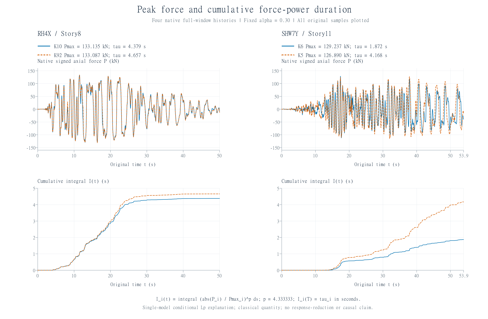

# Maxwell能量评价与局部响应：工程记录核查及合成反例

工作标题；maxwell-engineering-draft-v010，2026年10月18日。阶段稿，非投稿定稿。C025/C026/C027按各自合同整合，本版待独立整合审核；v009及其状态补充原样保留。

## 摘要

整体耗能、器件力需求与目标楼层响应需要分别评价。本文审计单一有控Maxwell模型的六工况记录：有限窗Link/Global能量比为0.795653—1.458992；仅按5%背景参考得到3.9783%—7.2950%的附加标定，实际背景仍待核。共同完整32只器件的192组记录按唯一K2/RH4X训练参数重建，其余191组仅为给定观测力的同模型条件检查；相对RMSE为0.0664601%—2.53052%，最大绝对RMSE为1.06349×10⁻⁵ m。RH4X/Story8按功选前2时遗漏最大峰力的比例仅0.0358518%；SHW7Y/Story11的K6峰幅略高于K5，但归一化力幂积分τ约为1.87与4.17 s，对应更小整窗条件功。τ为经典幂积分量，不是阈值持续时长或新理论指标。六工况Bottom层剪与CM位移前三控制层分别为Story1—3和Story12—10；六条最大导出Drift记录对应本层完整P/U1均0/8，形成补导出缺口。另在已审α=1合成系统中，仅换端口便可保持所列全局能量及器件F/总变形历史相同，而固定u1全尾绝对峰分别<1.7与>8.8；u2交换、两位置全局最大不变，故该证书只限定局部辨识，不表示整体更优。另在明确binary64/Fraction及运行合同内，α=3/10无量纲合成例取得条件连续全时证书：A全峰<1.325、B在T处幅值>8.809；它不是无条件形式化机器认证或真实工程减幅。共同L1输入族进一步给出每个共享d下A全峰<4.155、B固定T幅值>5.979；另一主体的有无装置比较则以U全峰<2.41、加装D固定真见证>4.349给出条件分离，同外力不要求同输入功。结果限定于当前记录与固定条件模型，不认证真实全装置耗能、独立事件泛化、布置优劣或工程减幅。

关键词：Maxwell装置；有限窗能量；器件峰力；楼层响应；条件功账本

## 1 研究问题与已有方法

工程判断同时面对三个对象：整体在记录窗内耗去多少能量、哪只器件承受较大的轴向力，以及结构哪一层控制某项响应。它们的统计窗口、空间对象和单位不同，应分别给出结果，再检查同一指标能否代表另一个指标。本稿的目标是将这三类已审记录接到同一证据范围内，提供下一步局部预算和公平替代比较的明确接口。

本版进一步区分三层证据：本建筑记录给出单状态数据观察；独立理论接口给出带条件的保守边界；另一个冻结α=1合成机械反例检验“所列全局能量信息能否普遍唯一确定固定局部峰”。该反例不替代本建筑α=0.3的公平成对验证，也不把模态投影本身作为创新。

Hu等[1]及兰香等[2]已采用装置耗散与背景耗散之比标定附加阻尼。Hu等还在多层金属屈服阻尼器算例中，将能量标定的附加阻尼、指定Rayleigh形状和等效弹性杆刚度组合成替代模型，重新动力分析并比较层剪力与层间位移。因此“能量标量—替代重算—响应比较”已有直接先例，本文不以该流程或能量公式为创新。

有限串联刚度、内部弹簧储能及频变属于Maxwell既有本构[3,4]，支撑与空间装配对装置及结构响应的影响也已有研究[5]。本工程需要先回答两个可核问题：导出记录支持哪些实际计算；所选完整力—变形记录是否与标准串联本构一致。本文结合原生能量、器件分布与楼层控制位置报告这些结果；公平配对下替代方案的绝对加速度和局部传力误差仍是后续问题。

## 2 模型、导出覆盖与功共轭接口

### 2.1 模型与数据窗口

研究对象来自有控.xlsx，按用户说明为真实Maxwell装置模型。指定表含88只Link1，类型Damper - Exponential、作用DOF为U1，Story1—11各8只；参数表没有k/c/α数据行。属性摘要列25 kg，实际质量源与节点组装方式待核。旧“0”“附加3”分别为弹性统一模态5%/8%模型，尚不具备真实装置开/关对照资格。

已审能量记录共16,296行，六工况均从0开始、步长0.02 s；RH4X/Y、SHW4X/Y、SHW7X/Y分别截至50、59、53.9 s。工况名称不单独证明输入事件相互独立，导出末端也不等同于完整自由尾。五张装置/节点大表达到Excel的1,048,576行上限，后续计算均按真实组键和原时间交集限定。

### 2.2 实际覆盖

528个器件×工况组合中，193组完整覆盖P-I/P-J/U1三流；32只器件在六工况全部完整，位于Story8—11。RH4X有33组完整，其余各32组。另有K12/Story7/RH4Y一组部分交集，含313个共同点；334组没有三流共同数据。U1单独完整的386组不能替代力—变形共同完整性。

图1　各层各工况完整器件数（每层8只）。零表示现有导出中没有完整三流记录，不表示未安装装置或装置力为零；星号对应部分记录。图示193组完整记录和32只六工况完整器件，不认证全88只本构或积分收敛。

| 输出 | 已审覆盖 | 可用范围与定义限制 |
|---|---:|---|
| Story Forces | 72组，195,552行，完整 | 12层×6工况，仅Bottom；两截面须同刻相减，独立峰值之差不是净力峰 |
| Diaphragm CM Displacements | 108组，293,328行，完整 | 18个层/隔板对；Story3—8含D1/D2，须分隔板命名 |
| Story Accelerations | 78组，211,848行，完整 | Base及12层×6；无节点/隔板字段，绝对/相对及位置接口未核 |
| Story Drifts | 144组，229,302行，均缺步 | 总缺161,802个网格点；仅称导出记录最大值，不作固定点有符号全时程或RMS/相位 |

覆盖通过不补足空间定义。漂移控制Label变化且省略规则未知；缺项不补零，也不插值填出动力平衡。局部轴Angle=0不提供全局方向；I/J几何和连接拓扑仍须另核。

### 2.3 内部P/U1与节点集中质量

CSI手册[3]规定局部1轴由I指向J，U1=u1j−u1i，P为对应内部本构力；节点作用到单元的纵向力为(−P,+P)。因此吸收侧一次功为∫P dU1，不能把I/J当两只器件而累计2P。所选K2、K5记录的P-I/P-J数值一致，但这一现象本身不是通用节点力方向定义。

手册同时将Link质量集中于I/J节点，内部单元无惯性。因此内部P不另加mü；结构节点动力平衡仍须保留实际组装质量。25 kg属性是否进入本模型质量源尚未知，Element Joint Forces/Link Joint Force的坐标、作用对象与惯性纳入方式也须单独核定。本文识别采用内部P与U1，不据此认证这些其他端口或全局切口。

## 3 已审有限窗能量结果

### 3.1 同轨迹记录能量指标

固定同一有控轨迹u(t)和窗口[t₀,t₁]。若背景阻尼可写为固定形状矩阵的缩放Cbg=ξ₀C*，定义

$$I_{\mathcal W}[u]=\int_{t_0}^{t_1}\dot u^TC_*\dot u\,dt>0,\quad
E_{\rm bg}=\xi_0 I_{\mathcal W}[u],\qquad
\xi_{a,E}=\frac{E_d}{I_{\mathcal W}[u]}
=\xi_0\frac{E_d}{E_{\rm bg}}.\tag{1}$$

这是明确参照族后的同轨迹耗散匹配定义[1,2]；CSI支持能量分项及背景/装置耗能区分[3]，不是该完整比值的首创出处。换成另一无控轨迹的背景耗能不属于式（1），用等效模型重算后也没有理由假定轨迹仍相同。

原生列分别记EG=Global Damping Energy、EL=Link Damper Energy，采用共同端点增量。本模型实际背景设置未核，因此本版仅报告

$$\Delta E_\bullet=E_\bullet(t_1)-E_\bullet(t_0),\qquad
R_E=\frac{\Delta E_L}{\Delta E_G},\qquad
\xi_{a,E}^{[5\%]}=0.05R_E.\tag{2}$$

六个完整窗口的分母均正。式（2）的百分数是参考5%下的附加标定值，不是总阻尼、实际每阶增量或性能改善比例。Global列若含不同模态/材料阻尼，尚须核其与C*和ξ₀的关系。早期或短窗分母接近0时只报累积能量，不解释瞬时巨大比值；不将整段累计耗能除任意峰值应变能冒充单周期指标。

### 3.2 原生能量与条件标定

表1采用独立复算且已接纳的原生能量结果，均按共同端点差计算。

表1　有限导出窗原生能量与参考标定。背景5%未认证；能量数字和比值已审，最后一列仍是有条件标定。

| 工况 | 点数 | 导出终点/s | ΔEG / kN·m | ΔEL / kN·m | ΔEL/ΔEG | 仅按背景5%标定的附加值/% |
|---|---:|---:|---:|---:|---:|---:|
| RH4X | 2501 | 50.0 | 295.435571 | 344.550409 | 1.166245514 | 5.831228 |
| RH4Y | 2501 | 50.0 | 256.079083 | 373.617294 | 1.458991849 | 7.294959 |
| SHW4X | 2951 | 59.0 | 364.199590 | 318.045046 | 0.873271289 | 4.366356 |
| SHW4Y | 2951 | 59.0 | 320.137632 | 348.483069 | 1.088541409 | 5.442707 |
| SHW7X | 2696 | 53.9 | 674.735652 | 536.855184 | 0.795652612 | 3.978263 |
| SHW7Y | 2696 | 53.9 | 595.363992 | 586.150258 | 0.984524200 | 4.922621 |

这里既没有把EL/EG当作装置占总耗散份额，也没有将最后一列加到背景后称实际总模态阻尼。不同窗口、输入和状态的能量不可混配；表1未包含任何无控性能结果。

### 3.3 闭合符号、负增量与末端储能

逐时余量定义为

$$R(t)=E_{\rm in}(t)-E_K(t)-E_P(t)-E_G(t)-E_L(t)-E_H(t),
\qquad R(t)\approx E_{\rm Error}(t).\tag{3}$$

本次审核确认各分量加同号Energy Error后闭合，不能换成R≈−Error或隐藏Error为严格零。表2的第一项以导出窗内max绝对输入能为分母；第三项统计原生EL相邻采样负增量，全部保留，未用累积最大值或置零修复。

表2　导出窗内审计结果。表内余量一致性不代表求解收敛或通用精度标准。

| 工况 | max绝对R/max绝对Ein | max绝对(R−Error) / kN·m | Link负增量数 | 末动能+势能 / kN·m |
|---|---:|---:|---:|---:|
| RH4X | 4.703227e-05 | 3.212850e-08 | 54 | 0.055302 |
| RH4Y | 4.865792e-05 | 6.256477e-09 | 47 | 0.038525 |
| SHW4X | 4.085282e-05 | 2.922090e-08 | 11 | 1.092628 |
| SHW4Y | 4.198898e-05 | 7.650614e-07 | 8 | 0.752696 |
| SHW7X | 7.885626e-05 | 2.083328e-08 | 51 | 3.390283 |
| SHW7Y | 8.767751e-05 | 3.417822e-13 | 35 | 3.131572 |

六工况共有206个微小负Link能量增量。它们不是本稿已解释的物理机制，也不单独证明主动供能；该原生累计列的负增量机制仍需结合其内部积分/输出口径核验。余量相对输入峰约4.09×10⁻⁵—8.77×10⁻⁵，即0.00409%—0.00877%；R−Error最大约7.65×10⁻⁷kN·m，所支持的是本次数值转录和账目符号一致。

All组Internal Viscous+Support Viscous与Total的Link Damper Energy逐时最大差约1.93×10⁻¹²kN·m；滞回对应列在缓存记录中差为0。证据强度是“Total原表独立取证＋两张缓存跨表一致”，不是两表均有第二读取器原表逐项复核，也不认证All分组的全部器件本构或无重复装配。

末动能加势能仍为0.038525—3.390283kN·m。以末输入能或输入能峰归一化是两个不同分母，不能混写；本版未将这些较小余项换成严格无限尾界。输出终点、激励终点和自由尾结束不能互相代替，因此表1—2始终限定于现有导出窗。

图2　六工况有限导出窗内ΔEL/ΔEG。图示不采用背景5%假设；不同工况窗口分别为50、59、53.9 s，不据此比较因果减震率或声称独立事件泛化。

## 4 条件积分本构一致性结果

### 4.1 本构与预设识别协议

对固定k>0、c>0、α>0的标准单轴串联模型，d=F/k+dv、F=c|ḋv|^αsgn(ḋv)[3,4]。在P/U1作为内部功共轭力与总变形的条件下，积分得到

$$d(t)-d_0=a[F(t)-F_0]+b\int_{t_0}^{t}\operatorname{sgn}F(\tau)|F(\tau)|^{1/\alpha}\,d\tau,
\qquad a=1/k>0,\quad b=c^{-1/\alpha}>0.\tag{4}$$

这是一项既有本构的积分重排。采用Story11的K2/RH4X作训练、K5/RH4X作同记录异器件迁移；各有2501点，0—50 s、0.02 s。预设α=0.20—2.00、步长0.02，共91点；仅由K2全网格SSE选点，K5不参与拟合或选参。每个α下对两列设计矩阵作正尺度归一化，再以非负最小二乘枚举可行活动集；保留全部原点，以梯形法积分，不增截距、不求时间导数、不平滑、重采样、翻转力号或剔除小值。

### 4.2 参数与实际误差尺度

独立复算审核覆盖全部91个候选点及两器件共5002个残差。最优网格点α=0.30为内点；全部候选的线性解均为正内部解。在此点，a=2.000604253×10⁻⁶ m/kN、b=1.179819002×10⁻⁹ m/[s·kN^(1/α)]，对应

$$\widehat k=499848.982420\ {\rm kN/m},\qquad
\widehat c=476.930816\ {\rm kN}\!\cdot\!({\rm s/m})^{0.30}.\tag{5}$$

表3　式（4）重建位移增量的残差。相对RMSE定义为RMSE除以原始d−d0的RMS，非峰值归一化。

| 量 | K2训练 | K5同RH4X迁移 |
|---|---:|---:|
| 点数 | 2501 | 2501 |
| 原始位移增量RMS / m | 3.057592536e-4 | 1.389577342e-5 |
| RMSE / m | 4.974464219e-7 | 8.092760011e-8 |
| MAE / m | 3.836778423e-7 | 6.333215320e-8 |
| 最大绝对残差 / m | 3.219173997e-6 | 2.251287340e-7 |
| 相对RMSE / % | 0.162692189 | 0.582390038 |

K5绝对残差更小，但其响应尺度也更小，相对RMSE更高。固定α时两设计矩阵秩均为2，原始条件数分别为6794.980740、324.151304，列尺度归一化后为1.029185708、1.056925063；原始条件数受列单位和幅值影响。网格内较清晰的最小值与固定α满秩不证明三个物理参数的全局唯一性，也不是置信区间。

本结果是所选记录对、网格、积分离散与标准模型下的条件估计，不是参数表导出真值；K5为同RH4X的器件迁移，不能计作独立地震验证，也不外推为全部88只装置的本构闭合。

### 4.3 固定参数在192组上的条件重建

将K2/RH4X的α、a、b原值固定，用式（4）重建共同完整32只器件的192组记录，共521,472个配对点。K2/RH4X是唯一训练记录，其余191组是给定本模型观测F的条件检查，包含此前使用过的器件与工况；不能作为191个独立或未见地震事件。没有重选参、去均值、拟合偏置或末点校正。

相对RMSE以各条原始Δd的RMS为分母，192组分母均正，范围为1.20353×10⁻⁵—1.90646×10⁻³ m。全部相对RMSE为0.0664601%—2.53052%；最大比例来自K13/Story10/RH4X，其Δd RMS为2.11084×10⁻⁵ m、RMSE为5.34153×10⁻⁷ m。比例应连同绝对尺度阅读，不能只按最差比例判断最大绝对误差。

最大绝对RMSE与最大绝对残差均来自K82/Story9/SHW7Y，分别为1.06349×10⁻⁵ m和1.99771×10⁻⁵ m；该记录Δd RMS为1.55528×10⁻³ m，相对RMSE为0.683797%。平均残差−8.41756×10⁻⁶ m及末残差−1.62333×10⁻⁵ m保留，未以偏置修正改善结果。它不在相对最差前2中，因此完整分母、均值和绝对误差不能由相对排名替代。

先前K2/K5四条SHW记录的固定参数迁移表、六工况范围、各工况最差前2及两种极值记录见附录E；完整192行指标与源定位见本仓库R013已审包。以上是式（4）在给定原生F及既定P/U1接口下的条件一致性，不是地震输入到结构响应的前向预测，也不认证参数真值、全88只本构或工程验收。

### 4.4 端部功与不可逆耗散

标准模型的弹簧储能为F²/(2k)，故有限窗端部功减去储能增量才是黏壶耗散：

$$E_d=\int_{t_0}^{t_1}F\,\dot d\,dt-
\frac{F(t_1)^2-F(t_0)^2}{2k}
=\int_{t_0}^{t_1}c^{-1/\alpha}|F|^{1+1/\alpha}\,dt\ge0.\tag{6}$$

式（6）为已有本构关系；端部功等于耗散需起止储能相等。本文的积分回归检验位移关系，不将回归误差直接当作原生Link累计耗散误差或总能量闭合误差。

## 5 器件力需求与目标楼层：已审工程结果

### 5.1 共同完整子集与条件功口径

按计算前既定的共同完整规则，Story8—11每层8只、共32只进入六工况分布分析，合计192组、521,472个配对点和521,280个原始区间。各组的原生轴向P与U1峰值、控制时刻及源定位已独立复核。K12/Story7只有RH4X完整，未进入六工况共同完整子集；这一选择由覆盖条件产生，没有依据响应大小筛选。

原生峰力记为各器件的max|P|；端口功与扣除条件弹簧储能后的账本量分别定义为

$$W_{\rm trap}=\sum_i F_{i+1/2}(d_{i+1}-d_i),\qquad
D_{\rm port}=W_{\rm trap}-\frac a2(F_N^2-F_0^2).\tag{7}$$

此处a固定沿用K2/RH4X识别值，应用于其他器件的Dport均为条件量，不认证它们具有真实相同参数。Wtrap是一次端口功，不直接称纯黏性耗能；各器件自身记录峰也不组成同刻合力。两张完整24组分布小表见附录B。

### 5.2 峰幅与归一化力幂积分：两例实际解释

记录峰力只取最大幅值，功账本还保留其余力时程。对P=max|F|>0，固定p=1+1/α，定义经典归一化力幂积分

$$\tau=\sum_i\frac{\Delta t_i}{2}
\left[\left(\frac{|F_i|}{P}\right)^p+
\left(\frac{|F_{i+1}|}{P}\right)^p\right],\qquad
D_{\rm force}=bP^p\tau.\tag{8}$$

τ的单位为秒，是归一化幂权重积分，不能解释为超过某个阈值的持续时长。它由力采样直接积分，Dforce另以未归一化力幂计算，两者满足经典离散Lp幅值归一恒等式；这不是新指标或因果路径识别。对正Dport、Dforce再令q=Dport/Dforce，则

$$\log\frac{D_{{\rm port},i}}{D_{{\rm port},j}}
=p\log\frac{P_i}{P_j}+\log\frac{\tau_i}{\tau_j}
+\log\frac{q_i}{q_j}.\tag{9}$$

RH4X/Story8的K10与K92峰力分别为133.13494、133.08721 kN，几乎相同；τ分别为4.37872、4.65725 s，条件Dport为8.27175、8.78534 kN·m。较高峰值对应较小的力幂积分，说明这对记录的能量次序无需依靠端口差额项制造。按Wtrap或Dport前2选择K92/K103时，遗漏全组最大峰力K10的幅度仅0.0477313 kN，即相对全组最大值0.0358518%。必须保留这一很小的尺度，不能将集合不同直接写成工程风险或实用增益。

SHW7Y/Story11的K6峰力129.23733 kN略高于K5的126.88997 kN，但τ仅1.87188 s，K5为4.16810 s；条件Dport分别为3.10227、6.38916 kN·m。式（9）中幅值项为正，而τ项的负值更大，故在这个固定模型账本中，较高瞬时峰值仍可对应较小的整窗力幂积分及Dport。该分解解释已记录波形的算术组成，不据此归因高阶模态、特定传力路径或阻尼因果。

图4　左列RH4X/Story8的K10、K92，右列SHW7Y/Story11的K6、K5。上排为原生带符号P-I（kN）；下排为$I_i(t)=\int_0^t(|P_i(s)|/P_{\max,i})^p\,ds$，α=0.30、p=1+1/α，单位s，末值$I_i(T)=\tau_i$，未再除以τ。每列内同器件上下同色同线型，保留原0.02 s网格和完整0—50 s／0—53.9 s窗口。本图接续式（8）的经典条件解释，不是阈值持续时长、真实能量或因果减幅曲线。

24组中有5组的峰力前2集合与功账本前2集合不同，但只有上述RH4X/Story8遗漏了全组最大控制者；另4组仍选中最大值，只漏掉另一名前2器件。所选最大峰值缺口为0不能代表前2全部覆盖，完整集合与筛选诊断见附录B/G。Wtrap与Dport在本批的前后2选择相同，不能把这些集合差异归因于储能扣除。

在每组8只器件的全部配对中，24组共672对，有38对出现“峰值更大而Dforce/Dport更小”，分布于17组。这里是同一子集的全配对描述，同一器件重复参与多对；38/672不能作为独立样本频率、泛化概率或实用增益，也不认证承载能力或最优布置。

### 5.3 楼层控制位置与归一化剖面

六工况的Bottom层剪绝对记录峰前三层均为Story1、2、3，CM位移记录峰前三层均为Story12、11、10，两集合无交集；各自最大控制层分别为Story1与Story12。该现象是当前单模型输出的控制位置描述，不以“底层剪力大、顶层位移大”作为创新或装置布置优劣证据。

图3　左为Bottom层剪绝对记录峰，右为同层各已导出隔板CM对应分量记录峰的最大值；每工况、每指标分别除以自身12层最大值。横轴0—1只比较剖面形状，不将kN与mm相除。各层峰值可能发生在不同时刻，连线并非同刻剖面。颜色及线型在两面板中一致，稀疏Drift未绘制；原值及12个分母见附录A绘图小表。

### 5.4 最大导出Drift记录的最小补导出缺口

六条最大导出Drift记录的控制层依次为RH4X/Story5、RH4Y/Story4、SHW4X/Story5、SHW4Y/Story5、SHW7X/Story7、SHW7Y/Story7。每个指定Story/Case的本层8只器件均缺两端P记录而U1完整，完整P-I/P-J/U1为0/8。这里的0/8表示力记录缺失，不能解释为未安装装置、真实力为零或装置无效；上部32只的记录也不能替代这些控制层的本层传力验证。

应保留K12/Story7/RH4X完整2501点这一例外，不能把六条控制记录的0/8扩大为Story4/5/7在所有工况均无完整器件。Drift仍为稀疏导出记录，单位尚未认证；恢复Label/坐标只增加源行定位，不能将其升级为完整时程漂移角、固定点有符号响应或局部连接拓扑。

下一项最小数据动作是补导出已有结果中这些控制层的P/U1，保留I/J、工况、原时间及源定位。可按Story4/5/7的24只及六工况组织，或全88只按工况分表以避开Excel行上限；附录C给出已有行数预算。此项仅需补导出已有结果，不要求重算，也不据此启动求解器。

### 5.5 同能量历史而固定局部峰不同：已审α=1合成反例

为区别“粗能量上界相同”与“实际全局能量历史相同”，采用已获解析独审的冻结两自由度构造。M=I，K=I+ε[[1,−1],[−1,1]]，ε=0.001，C=0.1√K；两坐标各有单位接地弹簧并由正刚度ε弹簧连接，非通常仅底层接地的两层剪切链。裸主体两模态背景阻尼均为5%，不指受控增广系统全部模态仍为5%。

同一线性Maxwell器件取α=1、λ=r³、κ=3r²−1−0.1r³>0、c=κ/λ，其中r是(1.7,1.73)内r³−3r+0.1=0的唯一根。全部初态为零，共同输入为b=(1,1)ᵀ乘sin(t)，作用于0—T、T=20π，其后为0；只交换到固定参考端的端口B_A=(1,0)、B_B=(0,1)，主体、输入和器件参数均不变。以下数值属于该合成单位制，不转写成真实建筑mm。

交换矩阵P给u_B=Pu_A、v_B=Pv_A、F_B=F_A，且δ_B=B_Bu_B=B_Au_A=δ_A，总端口速度亦相同。总动能、主体弹性能、器件弹簧储能、背景/器件耗散功率及输入功率逐时相等，累计历史也相等；同窗、同公式且仅依赖这些量的能量比在分母非零处相同。固定物理目标始终为u1，没有随端口一起重命名。

表4　同主体、同输入、同器件的合成端口对比。解析界覆盖t≥0全部自由尾；末两行仅为0—6T、每T取16384步的有限网格支持。

| 比较对象 | 布局A | 布局B |
|---|---|---|
| 器件到固定参考端的端口 | (1,0) | (0,1) |
| 所列全局储能/耗散/输入功历史 | 与B相同 | 与A相同 |
| 器件F、总δ及δ̇历史 | 与B相同 | 与A相同 |
| 固定u1全时绝对峰，解析证书 | <1.7 | >8.8 |
| 固定u2全时绝对峰，交换对应 | >8.8 | <1.7 |
| 两位置max_i sup_t绝对位移 | 与B相同 | 与A相同 |
| RK4细网格u1采样绝对峰 | 0.705602291991 | 9.56623246766 |
| 根独立LTI同网格u1采样绝对峰 | 0.705602291988 | 9.56623246762 |

全尾分离来自交换共轭、参照卷积核L1估计与固定小连接扰动证书，不由有限采样峰外推；源协议裸响应的>9.5只指幅值，带符号值<−9.5，按R021勘误使用。实验R012对两布局分别作两步长RK4至6T，根再用LTI特征分解及浮点二次积分独立核对有限网格。末储能约1.00053×10⁻¹²仍保留；这些数值是有限支持，不是连续峰/全尾或浮点严格误差界的证明。

固定u1的差异并不使A整体更优：u2交换后比较方向相反，两位置全局最大保持。此例只排除仅依赖所列全局不变量、忽略端口位置和固定输出映射的普遍精确局部预测；不否定保守能量界、受限布局族内的经验关联，也不证明任何保留BΦ的近似算法必然正确。

方法使用经典交换对称性、线性卷积和输入—端口—输出投影；模态投影本身已有先例。特定正连接Maxwell构造及严格全尾证书的同条件发表覆盖仍未闭合，不称首创、真实α=0.3减幅、布置最优或工程风险结论。证书、有限数值及贡献边界分别见[解析独审R021](../research/roles/verification/maxwell-session004/布局交换反例全尾解析独审-R021.md)、[实验R012](../research/roles/experiments/maxwell-session004/R012-layout-symmetry-synthetic/report.md)、[根LTI有限复核](../../../research/sessions/20261017-2109/R009-layout-numerical-root-review.json)与[创新R011](../research/roles/novelty/maxwell-session004/R011/report.md)。

### 5.6 α=3/10的条件连续全时证书

本节是一对独立的无量纲α=3/10布局：采用冻结正连接主体M/K/C、零初态、对称输入及固定u1目标，器件κ、c按[非线性协议](../../../research/sessions/20261017-2109/layout-nonlinear03-protocol-v001.json)的确切代数定义，仅在这一指数内保持A/B器件相同并换端口。κ/c的数字定义沿用前述根式，不代表跨指数的c具有同单位或同物理意义，不能据此比较α=1与α=3/10的真实器件性能。

[R023](../research/roles/verification/maxwell-session004/非线性交换与条件尾能量独审-R023.md)的精确交换恒等式给：所列整体储能、背景/器件耗散、输入功及器件F、总δ、总速度历史相同，同定义且分母非零的能量比亦同。保护固定u1的同时u2交换，两位置全局最大不变；该事实不是从数值余额接近推断的。

在IEEE binary64 nearest舍入、渐进下溢且无FTZ/DAZ、正确nextafter、精确Fraction语义、正确Python/NumPy float64解码和运行模式保持的**实际运算合同**内，主控合并准入数学、helper/参数和全实现审查，得到表5。下列数是安全向外十进制，不是将普通浮点结果随意四舍五入；结论为有前提的解析与验证数值证书，不是形式化无条件机器认证。

表5　无量纲α=3/10合成例的条件连续证书，T=20π、拼接点s=6T。差额行由原有向端点直接比较所得，不能用已经向外松弛的显示十进制相减重算。

| 证书对象 | 安全向外十进制结论 | 时间域与含义 |
|---|---:|---|
| A固定u1的全时绝对峰 | <1.325 | t≥0，合并连续早期与真实无限尾 |
| A固定u1的未来尾绝对峰 | <1.098 | t≥6T；输入已在T停止 |
| B固定T处的u1绝对幅值 | >8.809 | 固定T的真实下界，故B全峰亦更大 |
| B固定T幅值减A全时峰的差额 | >7.485 | 原有向下界减上界，非显示数相减 |

最终存储二进制端点在真网格上定义无跳跃连续分段直线（PL）近似。它一般不满足u_h′=v_h，故运动学残差r_u必须与动量残差r_v、本构残差r_F共同进入误差储能预算；即使中点r_u近零，整段变化项也不能删除。完整98,304段有向预算覆盖0—6T的连续误差，PL位移段的极值由端点覆盖，再叠加真实误差界，因此没有把节点峰直接当连续峰。

尾界从s=6T向无穷延伸；T至6T仍在前段连续覆盖中，6T不是宣布尾峰结束。真实系统停载后的被动耗散与完整末储能控制全部未来，不能只由近似余额或小末能得出。B在固定T的下界使用精确交换u1,B(T)=u2,A(T)及误差预算，不把近似轨迹当真实B。

该证书分三道门：[R024误差数学](../research/roles/verification/maxwell-session004/全残差误差储能与中点预算独审-R024.md)；[R017 helper修复](../research/roles/ideation/maxwell-session004/R017-helper-v002-fix-review/report.md)与[R018参数/时间合同](../research/roles/ideation/maxwell-session004/R018-interval-parameter-audit/report.md)；[R025全实现独审](../research/roles/verification/maxwell-session004/R025/report.md)。R025完整复跑全部98,304段并与冻结包逐位核对，另有未导入helper的独立Fraction挑战；有限挑战不替代普遍机器语义，主控最终范围以[C025接纳记录](../../../research/sessions/20261017-2109/R011-certificate-adoption.md)为准。

本节与§5.5的α=1解析全尾证书、至6T的有限RK4/LTI支持分属不同证据层。交换、模态投影、增量耗散和残差工具均为经典方法，特定条件证书的同条件发表覆盖仍未闭合。它不认证真实ETABS建筑、实际α=0.3器件参数、工程减幅或整体最优；本地缓存及helper失败/修复的复现边界见附录H。

### 5.7 C026：共同L1输入族内的条件全时分离

保持§5.6的近单位主体K=I+0.001[[1,−1],[−1,1]]、同一α=3/10器件、A/B端口、零初态和固定u1。令T=20π，外力为(1,1)ᵀ[sin(t)+d(t)]，名义正弦在[0,T]外取零；d为定义在实轴上的连续函数，支撑包含于[0,T]，且∫₀ᵀ|d(t)|dt≤2。**每一个d同时用于A/B和两个输入分量**，不允许各自另选扰动。这一冻结输入族由[R019](../research/roles/ideation/maxwell-session004/R019-robust-input-family/report.md)推导、[R027](../research/roles/verification/maxwell-session004/R027/report.md)独审并经[C026根接纳](../../../research/sessions/20261017-2109/R012-adoption.json)采用。

表6　C026共同输入族的条件界；对族内每个d均成立，继承C025名义模型与机器合同。

| 比较对象 | 保守精确十进制结论 | 时间及配对量词 |
|---|---:|---|
| A固定u1的全时绝对峰 | <4.155 | 所有t≥0，包含无限停载尾 |
| B固定T处的u1绝对幅值 | >5.979 | 同一d下，T=20π |
| B全时峰减A全时峰 | >1.824 | 同一d的A/B配对内 |

这里比较的是同一布局的受扰真解和名义真解。单调阻性给两轨迹差耗散，零初误差的储能半径不超过√2∫|d|；固定u1误差的统一上界为2√(2·1001/1002)<2.83。与C025名义A全峰<1.325、B固定T>8.809组合，即得表6。它不是从单轨迹被动性直接跳到增量结论，误差储能也不是两条真实能量之差。统一常数严格小于2.83，故面积恰为2时仍严格；T后差储能不增，误差覆盖真正无限尾，不需要新增扰动ODE样本。

对**每个固定d**，精确交换仍使A/B所列整体储能、背景/器件耗散、输入功及器件F、总δ和总速度历史相同，同定义能量比限于分母非零处。这不表示受扰历史与名义历史相同，也不表示不同d之间相同。u2仍交换，两位置全局最大仍相同，不能把A称为全楼更优。

名义正弦绝对面积为40，预算2是该面积的5%，不是PGA、谱、统一幅值或任意地震强度的5%；整个输入族没有统一峰幅上限。新增部分为经典增量耗散估计对特定证书的解析扩展，继续继承§5.6实际机器合同，不是实际地震保证、新鲁棒控制理论或首创结论。

### 5.8 C027：同外力下无装置与加装装置的固定位移比较

本节另用[冻结加装协议](../../../research/sessions/20261017-2109/addition-local-peak-protocol-v001.json)：M=I、K=[[2,−1],[−1,2]]、C=0.1√K，零初始主体状态。U无装置；D只在固定端口B=(0,1)增加κ=8、c=10、α=3/10的被动Maxwell器件，初始F=0。共同外力为(1,1)ᵀsin(√2t)，在T_add=20π/√2后停止，目标仍为固定物理u1。主体为两个分别接地并正连接的质量，不能套作通常二层剪切链或实际ETABS楼层。该K、κ/c、频率和停止时间均不同于C025/C026，旧例的预算数值与同史结论不能搬来。

表7　C027的U完整解析上界与D固定真见证下界；数值部分以根接纳记录中的原有向binary64端点作保守十进制转录。

| 对象 | 安全结论 | 覆盖范围或用途 |
|---|---:|---|
| U固定u1的全时绝对峰 | <2.41 | 加载段及全部无限停载尾 |
| U固定u1的停载后尾峰 | <1.7625 | t≥T_add；解析界141/80 |
| D固定真见证处的u1绝对幅值 | >4.349 | N=16384，J=16529=N+145，t*=J·20π/(√2N) |
| D全时峰减U全时峰 | >1.939 | 单个D真实下界超过U全时上界 |
| D到见证的残差积分上预算I_J | <0.715880662 | 完整16,529个连续PL区间；不是响应峰 |

U的共同载荷只激励对称模态，故u1=u2=x，满足x″+0.1x′+x=sin(√2t)。[R020解析基线](../research/roles/ideation/maxwell-session004/R020-addition-baseline-proof/report.md)及[R028独审](../research/roles/verification/maxwell-session004/R028/R028-review-report.md)给加载段的统一严格界；停载后由同时匹配位移、速度的齐次延拓覆盖无穷，未用末位移或有限采样代替尾幅。这些是保守上界，不是U实际峰的等式。

D将冻结存储端点视为真网格上的连续无跳跃PL比较轨迹，保留完整r_u/r_v/r_F；本K的最大特征值为3，κ=8，采用新残差权2/1/3，固定u1柔度为2/3，输出误差系数保守取1。前J段逐段向上预算给I_J，固定节点存储幅值减误差上界向下计算得到真实幅值下界。停载后的145段仍纳入；缓存时间标签只核身份，t*由真h定义。

J由先前冻结有限诊断的首个存储峰索引固定，再按[见证协议](../../../research/sessions/20261017-2109/addition-witness-certificate-protocol-v001.md)认证；它不是事前于所有诊断选定的点，也不因此成为D真实连续峰或尾终点。**一个固定真时刻的下界已足以超过U全时上界**，所以本比较不需要D尾上界。无须知道D完整峰在哪里，也未宣称其尾已消失。

[参数/helper域R021](../research/roles/ideation/maxwell-session004/R021-addition-parameter-audit/report.md)和R028分别覆盖新参数/时间与完整实现；R028隔离重放全部16,529段，并作未导入helper的独立Fraction挑战。隔离重跑是复现核验，有限挑战也不是普遍机器语义证明。当前条件准入以[C027根接纳](../../../research/sessions/20261017-2109/R013-addition-certificate-adoption.json)为准，继承IEEE binary64 nearest、渐进下溢且无FTZ/DAZ、正确nextafter/Fraction、Python/NumPy float64解码及稳定运行模式合同。

U/D**同外力不等于同输入功或同能量历史**，输入功还取决于各自速度；这里不主张同史。Maxwell同时增加内部弹性储能与耗散，不能改称只把统一模态ζ加大。表7只给指定无量纲模型中固定u1全时峰反升的条件证书，不推断所有输出、整体能量、实际楼层改善或最优。局部反升的一般现象已有先例，当前具体α=3/10位移证书的同条件发表覆盖仍未闭合。

## 6 讨论：结果范围与下一项工程检验

现有结果分别给出了整体有限窗耗能、器件峰力及条件功账本、楼层控制位置。实际背景模态/材料阻尼、连接几何、原始输入身份及积分设置仍未闭合；因此能量表的5%只为参考标尺，能量余量也不代替求解收敛或完整自由尾认证。

局部同刻传力预算需要明确切口、统一方向以及完整跨界器件清单；节点集中质量须在结构平衡中按真实组装纳入。当前Bottom层力可作各自定义的单状态分析，尚不能与无隔板标识的Story加速度硬配局部F=ma。一次预设的相邻Bottom截面窗口诊断未找到能量比满足匹配阈值的合格窗对，结论为当前协议下不可检验，不能解释为能量比充分或替代失败。

公平替代误差还需核对同主体、同输入、背景、质量源、模态基和输出身份。Hu等[1]已给出附加阻尼与等效刚度共同参与的重算流程；本工程若继续，须明确是否调整刚度及阻尼形状，再分别报告位移、绝对加速度、漂移、Bottom层剪与装置/连接力的误差。完成这些配对之前不报告减震率或本工程的全输出等效反证。

六条K2/K5记录的离散账本还显示，力端模型积分Dforce与式（7）的Dport差额，相对|Dport|为0.3066%—0.5487%（附录D）。差额分为离散乘积项和带符号回归残差功，二者的抵消及负Dport增量均保留。这是同一固定条件模型下的离散算术核对，不给连续积分误差界，也不能用小位移RMSE直接保证小功差或证明真实耗散。

共同完整子集192组在原导出窗口中的初力F0全部精确为0，但末力FT与净总变形dT−d0均无一精确为0，因此这些窗口不能按导出端点直接满足初末力均为0的前提。这只是数据适用域说明：精确非零不代表工程显著，净总变形是否为0也不自动成为额外条件；不由此要求末净变形为零、补零或补自由尾。

已有缓存中Base FX/FY与Story1 Bottom VX/VY在六工况的12条时程、32,592个分量样本上同号逐点相等，是重复输出，不能计作两份独立响应验证。66对相邻Bottom截面有4处上截面绝对记录峰更大，附录F只列共同网格上的同刻代数差N=A−B；各自峰值之差不是同刻力，N未分解为惯性、背景或装置贡献，不能据此写成阻尼导致放大。

前述器件/楼层记录只是本建筑的单状态观察；§5.5给的是独立合成类中的解析信息边界，不能把两者拼成真实布局的因果对照。[单器件理论附录v002](maxwell-theory-appendix-v002.md)保留三类端点和有界可测总变形速度条件，[模态接口v001](maxwell-modal-interface-v001.md)保留完整能量、局部有符号投影及认证尾项的最小合同；此处只链接，不复制其证明。实际目标位置、端口/字段、共同输入、初态、背景与参数尚须认证，再进行公平成对模型/布局检验，才能回答本建筑目标响应是否改善。

本版将α=1的解析全尾、有限网格RK4/LTI支持、α=3/10在明确机器合同内的验证数值全时证书分开。指数相同不使无量纲合成例等同于本建筑，跨指数保留c的数字也不构成同物理器件比较；新增证书没有补齐真实模型的端口、参数、输入、背景及成对布局证据。

C026把同一近单位主体的布局分离扩展到共同L1输入族；C027另比较强连接主体的有无器件，不要求能量同史。前者限定能量信息对固定输出的辨识，后者限定被动加装对固定局部峰的普遍单调改善；二者均不否定所有保守能量界、受限类经验方法或已经公平验证的具体设计。

按[贡献卡R014](../research/roles/novelty/maxwell-session004/R014-contribution-card/report.md)，论文可主张的是工程记录的可追溯审计、标准本构的条件一致性、筛选遗漏的实际尺度与特定合成基准的可复核证据。交换、增量耗散、解析模态解和后验残差均为已知工具；同条件发表覆盖未知，不因证书更严格而成为首创。该卡写成时C027尚待审属于历史状态，本版采用较晚的根R013准入。真实工程价值仍须身份匹配的成对模型及预设预测基线、目标和容差，现有单状态数据及微小漏峰不替代这一步。

## 7 阶段结论

1. 六工况导出窗内的Link/Global能量比为0.795653—1.458992；Energy Error符号及跨表能量对应已审。206个微小负Link增量和末端动势能均保留。
2. 528个器件×工况组合中193组P-I/P-J/U1完整，32只器件覆盖六工况。该范围为当前导出可用性，不等于全装置本构认证。
3. K2/RH4X为唯一训练记录；固定α=0.30、k≈499849 kN/m、c≈476.931 kN·(s/m)^0.30用于192组重建，相对RMSE为0.0664601%—2.53052%。其余191组为同模型给定F的条件检查，不是独立事件外验；绝对误差、响应分母和K82/SHW7Y负偏置均保留。

4. 峰力与整窗条件功的控制器件可不同，但RH4X/Story8实际最大漏峰仅0.0358518%。K6/K5的峰幅—τ分解说明应同时读取波形积分与峰值；经典恒等式及38/672全配对描述不构成新指标、独立统计或实用增益。
5. 六条最大导出Drift记录所处Story/Case均为0/8完整器件力—变形记录。保留K12/Story7/RH4X完整例外及Drift稀疏、单位未知的限制，最小后续动作是补导出已有结果中的控制层P/U1。

6. 已审α=1合成反例在同主体/同输入/同器件条件下，所列全局能量及器件F/总δ历史相同，而固定u1全尾峰A<1.7、B>8.8；u2交换且两位置全局最大不变。它提供所列能量标量不能普遍唯一辨识固定局部峰的解析基准，不证明整体优胜或本建筑α=0.3减幅。

7. α=3/10无量纲合成例在明确binary64 nearest/渐进下溢、nextafter、Fraction、解码和稳定运行合同内，A全峰<1.325、s=6T后的尾峰<1.098，B固定T幅值>8.809，原有向差额>7.485。完整残差与真实被动尾覆盖连续时间；条件证书不等于无条件机器形式认证，F/总δ同史及u2交换不推出整体更优或真实工程减幅。

8. 在C025同一模型与机器前提下，每个连续共同d支撑于[0,20π]且∫|d|≤2时，A全峰<4.155、B固定T幅值>5.979、峰差>1.824；同史仅指同一d的A/B内部配对。预算2是名义输入绝对面积的5%，不是地震强度的5%。

9. 另一主体K=[[2,−1],[−1,2]]的无装置U全峰<2.41；同外力下加κ=8、c=10、α=3/10器件的D在固定J=16529真时刻幅值>4.349，故全峰差>1.939。U无限尾已覆盖，D只需一个真见证而无需尾上界；同外力不等于同输入功，且Maxwell包含储能，结论不是仅加统一ζ或真实楼层改善。

工程数据部分仍限于当前有控单状态与条件计算；合成反例不补齐实际建筑的公平成对布局证据。两部分均不认证布置最优、真实全88只耗能或工程减幅。实际属性、软件版本、I/J几何、质量源与背景设置仍需对照，使后续同刻局部预算和公平替代误差具有共同模型身份。

## 附录A 证据与复现范围

原始大表及全时程缓存保留本地。本版只整合已审输出并作转录、链接、单位与冻结身份检查，未重读原Excel、未运行ETABS。原始文件身份、源行、审核报告、识别协议、全部网格结果、图件散列和逐段映射见[证据映射](../research/roles/writing/maxwell-session004/draft-v010-evidence-map.json)；协作与验收过程保留于研究记录。

图3的[72行绘图小表](../../../research/sessions/20261017-2109/figures/plot_floor_profiles_72rows.csv)保留原kN/mm与每工况/指标分母；[矢量图](../../../research/sessions/20261017-2109/figures/03_floor_record_peak_profiles.svg)与PNG来自同一已审绘图包。

## 附录B 24组器件分布与完整小表

各表每行只比较本工况、本层8只器件，不跨组求和。前2/后2包含精确边界同值；本次均恰2只。原生端口功与条件Dport分开列出；沿用K2识别参数不认证全32只真实同参。

表B1　原生轴向峰力范围与前后2。

| 工况 | 层 | 原生绝对峰力范围/kN | 峰力前2含并列 | 峰力后2含并列 |
|---|---|---:|---|---|
| RH4X | Story8 | 42.57012–133.1349 | K10、K92 | K83、K27 |
| RH4X | Story9 | 44.33656–126.8358 | K91、K102 | K22、K20 |
| RH4X | Story10 | 31.77236–119.8264 | K75、K101 | K15、K13 |
| RH4X | Story11 | 24.85356–105.6212 | K74、K100 | K6、K5 |
| RH4Y | Story8 | 40.41366–146.8482 | K83、K27 | K103、K61 |
| RH4Y | Story9 | 33.57225–139.9542 | K82、K20 | K66、K8 |
| RH4Y | Story10 | 32.55662–130.9433 | K81、K13 | K4、K68 |
| RH4Y | Story11 | 31.71242–117.0809 | K5、K80 | K74、K73 |
| SHW4X | Story8 | 50.07136–143.0781 | K10、K61 | K27、K83 |
| SHW4X | Story9 | 42.0979–138.0704 | K8、K66 | K21、K20 |
| SHW4X | Story10 | 37.05064–122.1208 | K75、K4 | K15、K14 |
| SHW4X | Story11 | 26.90188–109.5126 | K74、K2 | K5、K6 |
| SHW4Y | Story8 | 40.63208–152.581 | K83、K27 | K61、K103 |
| SHW4Y | Story9 | 31.8384–148.8048 | K82、K20 | K66、K91 |
| SHW4Y | Story10 | 31.45536–135.7111 | K81、K13 | K75、K68 |
| SHW4Y | Story11 | 31.00276–121.0589 | K80、K6 | K73、K74 |
| SHW7X | Story8 | 49.22379–143.9582 | K92、K10 | K27、K29 |
| SHW7X | Story9 | 51.07796–141.6968 | K8、K91 | K22、K20 |
| SHW7X | Story10 | 40.70525–136.2658 | K75、K101 | K15、K13 |
| SHW7X | Story11 | 26.57792–116.3928 | K74、K100 | K5、K6 |
| SHW7Y | Story8 | 38.1381–156.1117 | K83、K27 | K10、K103 |
| SHW7Y | Story9 | 32.31046–154.196 | K82、K20 | K8、K102 |
| SHW7Y | Story10 | 33.5512–148.6274 | K81、K13 | K4、K68 |
| SHW7Y | Story11 | 32.82711–129.9378 | K80、K6 | K2、K74 |

表B2　原生端口功与条件Dport的范围、前后2，能量单位kN·m。

| 工况 | 层 | 原生Wtrap范围 | 条件Dport范围 | Dport前2含并列 | Dport后2含并列 |
|---|---|---:|---:|---|---|
| RH4X | Story8 | 0.04125303–8.785501 | 0.04120826–8.785345 | K92、K103 | K27、K83 |
| RH4X | Story9 | 0.02447666–7.152304 | 0.02447455–7.15224 | K91、K102 | K22、K20 |
| RH4X | Story10 | 0.007711266–4.324704 | 0.007710403–4.324695 | K75、K101 | K15、K13 |
| RH4X | Story11 | 0.00153801–1.829471 | 0.001537969–1.829467 | K74、K100 | K6、K5 |
| RH4Y | Story8 | 0.01415392–12.78176 | 0.014141–12.78176 | K83、K27 | K61、K103 |
| RH4Y | Story9 | 0.0035129–10.6138 | 0.003506829–10.61378 | K82、K20 | K66、K8 |
| RH4Y | Story10 | 0.004695037–6.923692 | 0.00469394–6.923677 | K81、K13 | K68、K101 |
| RH4Y | Story11 | 0.005594356–3.985742 | 0.005594118–3.985741 | K80、K5 | K73、K74 |
| SHW4X | Story8 | 0.0427518–8.089569 | 0.04275179–8.087344 | K92、K10 | K29、K27 |
| SHW4X | Story9 | 0.01588398–6.660874 | 0.01588397–6.659835 | K8、K91 | K21、K20 |
| SHW4X | Story10 | 0.008727918–3.974571 | 0.0087178–3.974543 | K75、K4 | K15、K13 |
| SHW4X | Story11 | 0.001446442–1.697624 | 0.001428493–1.697456 | K74、K2 | K5、K6 |
| SHW4Y | Story8 | 0.006249277–12.27135 | 0.006235221–12.26819 | K83、K27 | K61、K103 |
| SHW4Y | Story9 | 0.003257167–10.22127 | 0.003248838–10.21892 | K82、K20 | K91、K8 |
| SHW4Y | Story10 | 0.006265741–6.698219 | 0.006248436–6.697138 | K81、K13 | K68、K4 |
| SHW4Y | Story11 | 0.00363195–3.850362 | 0.003620437–3.850221 | K80、K5 | K2、K74 |
| SHW7X | Story8 | 0.08956846–14.74769 | 0.08949574–14.74584 | K92、K10 | K83、K27 |
| SHW7X | Story9 | 0.03986593–12.41262 | 0.03983514–12.41131 | K91、K8 | K22、K20 |
| SHW7X | Story10 | 0.01780861–7.566097 | 0.01780095–7.565976 | K75、K101 | K13、K15 |
| SHW7X | Story11 | 0.00214736–3.122415 | 0.002141193–3.121119 | K74、K100 | K5、K6 |
| SHW7Y | Story8 | 0.01409836–22.05029 | 0.01409804–22.04932 | K83、K27 | K61、K103 |
| SHW7Y | Story9 | 0.002947173–18.63094 | 0.002945932–18.63027 | K82、K20 | K102、K8 |
| SHW7Y | Story10 | 0.0106653–12.04577 | 0.01066503–12.04555 | K81、K13 | K101、K68 |
| SHW7Y | Story11 | 0.008162467–6.790649 | 0.008161856–6.790346 | K80、K5 | K2、K74 |

[192行器件摘要](../research/roles/experiments/maxwell-session004/R006-device-distribution/device_record_summary_r006.csv)保留峰值、时刻、源格及条件账本；[192行完整前后2排名](../research/roles/experiments/maxwell-session004/R006-device-distribution/within_story_rank_extremes_r006.csv)保留阈值规则下的名单和竞争名次。完整时程NPZ仅本地复核，不随稿复制。另见[全部24组集合对比小表](../research/roles/writing/maxwell-session004/draft-v004-rank-comparison-24groups.csv)，包括三指标前后2及集合一致性。

表B3　前2集合差异的5组，名单按编号展示，不表示名次。

| 工况 | 层 | 原生峰力前2集合 | Wtrap前2集合 | 条件Dport前2集合 |
|---|---|---|---|---|
| RH4X | Story8 | K10、K92 | K92、K103 | K92、K103 |
| SHW4X | Story8 | K10、K61 | K10、K92 | K10、K92 |
| SHW4X | Story9 | K8、K66 | K8、K91 | K8、K91 |
| SHW4Y | Story11 | K6、K80 | K5、K80 | K5、K80 |
| SHW7Y | Story11 | K6、K80 | K5、K80 | K5、K80 |

## 附录C Drift控制记录定位与补导出预算

表C1中的峰值沿用导出原数，Drift单位未认证，不添加百分数、漂移角或位移单位；SourceRow仅定位Story Drifts表行，Label原表示不等于UniqueName。0/8限定本行Story/Case。

|Case|Story|导出记录峰值|t/s|SourceRow|Label原表示|本Story完整/指定|
|---|---|---:|---:|---:|---|---:|
|RH4X|Story5|0.0018287253365834272|21.52|136102|565.0|0/8|
|RH4Y|Story4|0.001724073971632062|12.040000000000001|157414|566.0|0/8|
|SHW4X|Story5|0.002237150155793864|29.900000000000002|142761|565.0|0/8|
|SHW4Y|Story5|0.0022951551444100556|29.900000000000002|146101|566.0|0/8|
|SHW7X|Story7|0.0018418041354706068|38.06|112437|547.0|0/8|
|SHW7Y|Story7|0.0018972684010277018|38.06|115403|565.0|0/8|

表C2　已有结果的导出行数预算；假定Step By Step、P两端各一行、U1一行，不要求重算。前两方案各表加少量表头仍低于Excel行上限，全88只六工况合表超过上限。

|方案|P两端数据行|U1数据行|
|---|---:|---:|
|Story4/5/7的24只，六工况|24×2×16296=782208|24×16296=391104|
|全88只，最长单工况|88×2×2951=519376|88×2951=259688|
|全88只，六工况合表|2868096|1434048|

## 附录D 六记录离散功账本

以下为固定K2参数下的已审离散算术，能量单位kN·m；不跨行累加模型总能量。Dport使用条件弹簧储能，Dforce采用原力时程的模型积分，两者差额不是已认证连续积分误差。

| 对象/工况 | Wtrap | 条件ΔUs | 条件Dport | 模型Dforce | 差额/abs(Dport) |
| --- | ---: | ---: | ---: | ---: | ---: |
| K2/RH4X | 1.59688066648 | 2.98410677182e-6 | 1.59687768238 | 1.60309390300 | 0.3892734359% |
| K5/RH4X | 0.00153801047696 | 4.10534139026e-8 | 0.00153796942355 | 0.00154640880043 | 0.5487350241% |
| K2/SHW4X | 1.54256024622 | 1.56087456977e-4 | 1.54240415877 | 1.54867564964 | 0.4066048991% |
| K2/SHW7X | 2.75669635842 | 0.00134118313701 | 2.75535517529 | 2.76380268753 | 0.3065852388% |
| K5/SHW4X | 0.00146778091190 | 1.63954417564e-5 | 0.00145138547015 | 0.00145671993367 | 0.3675428499% |
| K5/SHW7X | 0.00370399197068 | 3.01026780367e-6 | 0.00370098170288 | 0.00371976633824 | 0.5075581797% |

## 附录E 固定参数重建的范围、分母和偏置

表E1　先前四条SHW记录迁移结果，α/a/b保持RH4X训练原值；它们包含在全192组检查中，不另增样本量。

| 器件/工况 | 点数 | RMSE / m | MAE / m | 最大绝对残差 / m | 平均残差 / m | 相对RMSE / % |
|---|---:|---:|---:|---:|---:|---:|
| K2/SHW4X | 2951 | 3.82923695397e-7 | 2.16625284695e-7 | 3.49002827124e-6 | 9.12024724919e-8 | 0.1503321966 |
| K2/SHW7X | 2696 | 6.37993744485e-7 | 4.55721705089e-7 | 5.26922622589e-6 | -3.20036722021e-7 | 0.1708147954 |
| K5/SHW4X | 2951 | 1.42102155736e-7 | 1.25471715075e-7 | 2.73125123189e-7 | -1.25414174285e-7 | 1.1807130520 |
| K5/SHW7X | 2696 | 1.36730767801e-7 | 1.21204656257e-7 | 2.42129443324e-7 | -7.17289996358e-8 | 0.7619603131 |

表E2　全192组的六工况描述范围。唯一训练记录为K2/RH4X，其余191组是同模型条件检查；不可定义比例实际为0组，不能将零分母分支自动填0。

| 工况 | 相对RMSE最小–最大(%) | 绝对RMSE最小–最大(m) | 不可定义组数 | 最差前2 |
| --- | --- | --- | ---: | --- |
| RH4X | 0.0664601–2.53052 | 5.72048e-08–2.14504e-06 | 0 | K13、K15 |
| RH4Y | 0.0700008–2.25096 | 1.51154e-07–2.34339e-06 | 0 | K102、K8 |
| SHW4X | 0.097678–1.18071 | 4.25477e-08–1.64047e-06 | 0 | K5、K15 |
| SHW4Y | 0.105612–1.41661 | 6.0474e-08–2.49065e-06 | 0 | K74、K103 |
| SHW7X | 0.0888654–2.29493 | 7.38009e-08–3.20229e-06 | 0 | K15、K6 |
| SHW7Y | 0.112754–1.5601 | 5.49016e-08–1.06349e-05 | 0 | K101、K91 |

表E3　每工况相对RMSE最差前2，均附原Δd RMS及绝对残差。

| 工况 | Link/层 | 原Δd RMS(m) | RMSE(m) | 相对RMSE(%) | max绝对残差(m) | 时刻(s)/有符号残差(m) | P-I/U1源格 |
| --- | --- | ---: | ---: | ---: | ---: | --- | --- |
| RH4X | K13/Story10 | 2.11084e-05 | 5.34153e-07 | 2.53052 | 7.61001e-07 | 36.92 / +7.61001e-07 | I297024/H148514 |
| RH4X | K15/Story10 | 2.1417e-05 | 5.04111e-07 | 2.35379 | 7.38957e-07 | 36.98 / -7.38957e-07 | I362214/H181109 |
| RH4Y | K102/Story9 | 2.01615e-05 | 4.53826e-07 | 2.25096 | 9.17602e-07 | 20.12 / -9.17602e-07 | I756634/H378319 |
| RH4Y | K8/Story9 | 1.64077e-05 | 3.65119e-07 | 2.22529 | 5.3632e-07 | 10.7 / +5.3632e-07 | I527548/H263776 |
| SHW4X | K5/Story11 | 1.20353e-05 | 1.42102e-07 | 1.18071 | 2.73125e-07 | 26.04 / -2.73125e-07 | I45204/H22604 |
| SHW4X | K15/Story10 | 1.91999e-05 | 1.97483e-07 | 1.02856 | 4.95291e-07 | 20.32 / -4.95291e-07 | I370552/H185278 |
| SHW4Y | K74/Story11 | 1.6457e-05 | 2.33132e-07 | 1.41661 | 3.55201e-07 | 29.3 / -3.55201e-07 | I181800/H90902 |
| SHW4Y | K103/Story8 | 1.77889e-05 | 2.47572e-07 | 1.39172 | 4.66214e-07 | 25.94 / +4.66214e-07 | I1028856/H514430 |
| SHW7X | K15/Story10 | 2.67005e-05 | 6.12758e-07 | 2.29493 | 9.88494e-07 | 38.9 / -9.88494e-07 | I384214/H192109 |
| SHW7X | K6/Story11 | 1.6307e-05 | 3.44695e-07 | 2.11379 | 5.94475e-07 | 52.14 / +5.94475e-07 | I92210/H46107 |
| SHW7Y | K101/Story10 | 2.36167e-05 | 3.68443e-07 | 1.5601 | 7.28782e-07 | 21.84 / -7.28782e-07 | I518268/H259136 |
| SHW7Y | K91/Story9 | 2.14647e-05 | 2.72788e-07 | 1.27087 | 5.50509e-07 | 52.78 / -5.50509e-07 | I749506/H374755 |

[完整192行审核指标与源定位](../research/roles/verification/maxwell-session004/R013-integral-review/review_summary.json)保留分母、均值、末值和全部最大残差点，12条最差表不代替其他记录。

表E4　全体相对最差与绝对最差记录；e为重建减原值，单位m，比例以各记录Δd RMS归一。

| 对象/工况 | Δd RMS/m | RMSE/m | max绝对e/m | mean(e)/m | 末e/m | 相对RMSE/% |
|---|---:|---:|---:|---:|---:|---:|
| K13/Story10/RH4X | 2.11084456659e-05 | 5.34152932873e-07 | 7.61001236635e-07 | 4.77382757836e-07 | 6.76376396562e-07 | 2.530517601 |
| K82/Story9/SHW7Y | 1.55527765009e-03 | 1.06349476809e-05 | 1.99771224155e-05 | -8.41756273679e-06 | -1.62332785838e-05 | 0.683797371 |

## 附录F 相邻Bottom截面的同刻代数记录

A为下截面、B为上截面，N(t)=A(t)−B(t)；下表单位kN。P_B−P_A是各自记录峰之差，不等于N(t_B)。没有完整自由体和连接拓扑，N不命名为纯惯性力、Maxwell力或阻尼贡献。

表F1　相邻Bottom截面空间峰值反升的同刻代数记录（力单位kN）。

|工况|下／上Bottom|t_A/s|t_B/s|P_B−P_A|同刻A(t_B)|同刻B(t_B)|N(t_B)|
|---|---|---:|---:|---:|---:|---:|---:|
|SHW7X|Story5／6|48.76|38.02|61.460543|−7091.739100|−7375.337197|283.598098|
|SHW7X|Story6／7|38.02|38.06|26.908674|−7309.536099|−7402.245871|92.709771|
|SHW7Y|Story5／6|48.80|38.02|229.898461|−6424.847228|−6796.605640|371.758412|
|SHW7Y|Story6／7|38.02|38.04|144.792229|−6790.587195|−6941.397869|150.810675|

[已审同刻差小表](../research/roles/literature/maxwell-session004/R006-shear-output-review/four-reversals-reviewed.csv)及[12条重复输出核对](../research/roles/literature/maxwell-session004/R006-shear-output-review/base-vs-story1-reviewed.csv)只支持当前同源缓存的算术关系。

## 附录G 两例力幂积分与筛选诊断

表G1　四条示例记录；τ由归一化力采样直接积分，不以Dforce反解。

| 工况/层 | 装置 | P/kN | tau/s | 原生W/kN·m | 条件Dport/kN·m | 峰力时刻/s、I端源格 |
|---|---|---:|---:|---:|---:|---|
| RH4X/Story8 | K10 | 133.13494 | 4.37872256 | 8.2717938 | 8.27174656 | 11.48, I783360 |
| RH4X/Story8 | K92 | 133.087209 | 4.65725033 | 8.78550103 | 8.78534488 | 11.5, I978914 |
| SHW7Y/Story11 | K6 | 129.23733 | 1.87187807 | 3.10380295 | 3.10226906 | 17.42, I94130 |
| SHW7Y/Story11 | K5 | 126.889972 | 4.16810362 | 6.3894026 | 6.38916055 | 37.86, I63582 |

[独立192条力幂诊断](../research/roles/experiments/maxwell-session004/R008-force-duration-audit/independent_devices_192_r008.csv)与[全部672对分解](../research/roles/experiments/maxwell-session004/R008-force-duration-audit/independent_pairs_672_r008.csv)保存完整范围，38对反序不删样、不另作独立事件计数。τ、q及对数分解限定P、Dforce、Dport均正的当前192条记录。

[独立筛选审核与精确缺口](../research/roles/novelty/maxwell-session004/R007/report.md)及[24组完整精确结果](../research/roles/novelty/maxwell-session004/R007/recomputed.json)保留L_F=1−max_selected(P)/max_all(P)及前2召回的区别。当前唯一正缺口为0.00035851805424838459，即0.035851805424838459%；比例为0只说明至少一个最大控制者入选，不保证前2全部覆盖。零组峰时比例无定义，精确并列按完整集合保留。此诊断不提供容量、安全、固定k阈值或布置建议。

图4的[SVG矢量图](../../../research/sessions/20261017-2109/figures/04_force_duration_examples.svg)与[四条记录末值小表](../../../research/sessions/20261017-2109/figures/04_four_record_endvalues.csv)保留Pmax、τ及绘图积分末值，图件接纳与源身份见[主控接纳记录](../../../research/sessions/20261017-2109/figures/04-root-adoption.json)。

## 附录H C025方法记录、机器合同与缓存边界

本版的四个十进制方向已由主控对原binary64端点作精确Fraction比较确认；[接纳JSON](../../../research/sessions/20261017-2109/R011-nonlinear-certificate-adoption.json)保留原hex及明确上/下界方向。本稿默认只展示保守十进制。原有向差额保留了比显示端点相减更强的信息，不将7.485写成8.809−1.325的结果。

helper v001的失败保留于[R016](../research/roles/ideation/maxwell-session004/R016-helper-review/report.md)：非整数类型2.0通过根次数检查，使本应精确的Fraction整数幂退化为浮点幂，出现不包真根的错误单点。v002在幂比较前拒绝非builtin int次数；真正整数2/3路径保持，修复及源换行/指纹差异由R017留档，不回写旧失败。453项自检和运行探针仅用于有限排错，不是全证书或历史/未来所有运行模式的证明。

R018只核参数、真网格、输入相位和helper调用域；完整残差累加、末能及比较方向由R025另审。最终存储端点的重构、r_u/r_v/r_F、全部段预算与总和必须同时成立，不能用某个内部中点零残差、能量余额或步长差替代。早期报告/summary保留原candidate/pending字段，当前条件准入绑定主控接纳记录，不篡改冻结历史。

原端点NPZ未公开上传，完整运行需要本地缓存，或按已记录环境重建后核对身份；外部读者不能假定已持有完整数组。若重建端点不同，须重新完成相应包络核验，不能照搬本表证书数。仓库提供[生成原型记录](../research/roles/experiments/maxwell-session004/R014-midpoint-residual-prototype/run_record_r014.json)、[v002包络实现记录](../research/roles/experiments/maxwell-session004/R015-outward-residual-certificate/v002-run/run_record_r015.json)、小结果、源指纹与审查，不在本稿复制缓存或完整证明。

机器合同包括nearest舍入、渐进下溢且无FTZ/DAZ、正确nextafter与Fraction转换/运算语义、Python/NumPy float64解码及全程模式保持。有限探针、sys.float_info或逐位重跑不构成对所有硬件及历史全程模式的形式化认证。三道审查与合同缺一不可；当前接纳的是该冻结无量纲例的条件证书。

## 附录I C026/C027的状态、复现与贡献边界

C026的当前权威为根R012接纳与R027，C027为较晚根R013接纳及R020/R021/R028组合。作者R019、R020、实验R017与原冻结协议中保留的candidate/pending字段、R012当时对新增器件的排除、R014贡献卡当时的待审，均是历史记录，不回写为新状态。本版证据映射将历史与当前准入分别登记；v009的原map、status-addendum与freeze保持原字节。R022接口、FNA原文范围及R018模态诊断仍在审，本版不据其增加已证事实。

C026没有新增扰动ODE运行；统一误差与严格十进制加减来自已审解析估计，名义数值仍继承C025机器前提。C027用另一套精确参数、真时间及新权重完成前缀证书，不能复用旧包络数。表7十进制方向绑定根R013中的原hex端点；本稿不把binary64的普通四舍五入写成有向证明，也不把I_J当误差能量本身。

C027的[R017小结果及运行记录](../research/roles/experiments/maxwell-session004/R017-addition-witness-certificate/run_record_r017.json)与[R028独立审查](../research/roles/verification/maxwell-session004/R028/R028-review-report.md)保留端点、参数、代码、预算与机器合同指纹。约12.9MB源NPZ仍为本地缓存，未上传；外部复现需要获得本地缓存，或按记录环境重建并核对身份。端点若不同，必须重新包络，不能搬用表7下界；已有小表及指纹不意味着完整数据已经共享。本文作者未打开NPZ、重跑ODE或证书实现。

当前增量是指定模型/输入/输出条件下的已验证基准与数据审计，非新被动性或鲁棒控制理论。已有加速度/剪力反升先例不能充作本固定位移证书，其存在也不能替代同条件发表覆盖核查。尚未知的优先权、真实器件映射、成对工程预测价值和容量/容差仍保留缺口，不称首次、显著工程风险或全楼最优。

## 参考文献

[1] Hu X., Chen Q., Weng D., Zhang R., Ren X. Estimation of Additional Equivalent Damping Ratio of the Damped Structure Based on Energy Dissipation. Advances in Civil Engineering, 2019, Article8052413. [DOI/出版方全文](https://onlinelibrary.wiley.com/doi/10.1155/2019/8052413)。本稿使用同轨迹能量比及其MDOF解释的条件，原文定位见能量来源审核。

[2] 兰香，张兴仙，潘文，余文正，张龙飞，吴克川. 基于时程分析方法的黏滞阻尼减震结构附加阻尼比计算研究. 建筑钢结构进展，2024，26(2)：54–63. [DOI/正式文章页](https://cjournal.hep.com.cn/1671-9379/CN/10.13969/j.cnki.cn31-1893.2024.02.006)。本稿复用印刷p57式(8)，不把文中案例算法判断升级为普遍不可能性。

[3] Computers and Structures, Inc. CSI Analysis Reference Manual. Rev.15, July2016. [官方PDF](https://docs.csiamerica.com/manuals/etabs/Analysis%20Reference.pdf)。本稿所依据审核定位包括印刷pp255、260–261、266–267、271、273（内部力/变形及节点质量），pp334–335（Mass Source），以及pp279–280、358–359（既有能量口径）；不假定其所有字段实现与本次未知软件版本逐项相同。

[4] Conde, Bernabeu. Influence of Maxwell Stiffness in Damage Control and Analysis of Structures with Added Viscous Dampers. Applied Sciences, 2021, 11:3089. [DOI](https://doi.org/10.3390/app11073089)。频变及本构前提按原文审核使用，不把α=1的式子套至任意指数。

[5] Londoño, Wagg, Neild. Supporting brace sizing in structures with added linear viscous fluid dampers: A filter design solution. Earthquake Engineering and Structural Dynamics, 2014, 43:1999–2013. [DOI](https://doi.org/10.1002/eqe.2433)。用于既有空间装配/频变与多输出评价背景，不代替本工程同刻预算。
