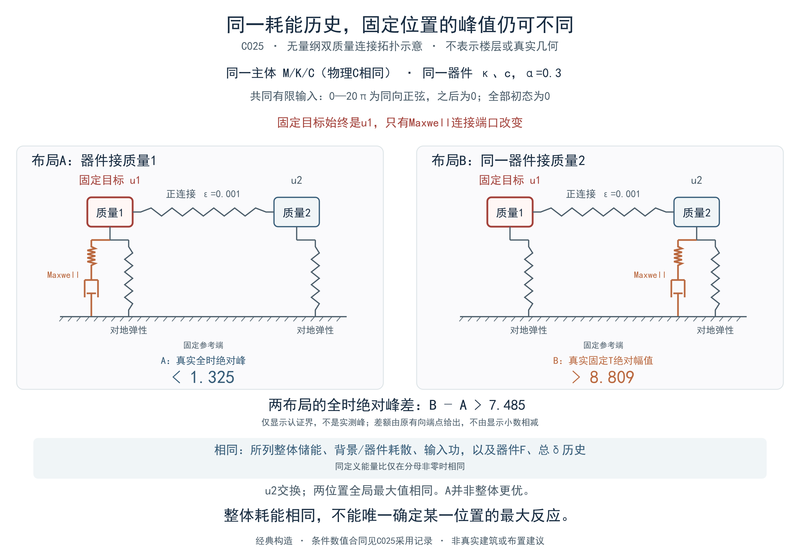

# Maxwell器件的真实耗散、峰力许可集合与局部位移边界

叙述稿候选 v002

## 摘要

整体耗散不能直接代替器件需求或固定位置响应。本文先对初力为零、末力非零、末总变形自由的单个Maxwell器件，给出有界可测速度许可类内固定真实耗散的完整峰力集合；再将真实耗散与物理主体的空间Green核结合，给出有限窗目标位移差的经典条件上界。前者说明同耗散可以对应不同器件峰，后者说明目标位置、端口投影及真实阻尼仍不可省略。一个交换端口的无量纲双质量例具有相同整体能量历史，却有不同的固定位置峰；实际模型的193组完整记录则只支持条件本构与导出口径审计，尚不支持布置效果预测。解析许可集合、合成证据和工程资料分别限定其适用范围。

## 1 从能量分账到局部目标

能量指标汇总一段响应的整体分账，工程设计还需要装置峰力、连接需求以及某个位置的位移或漂移。把较大耗散或较大附加阻尼比直接解释为某层效果更好，省略了两个问题：给定耗散时装置力可以怎样变化，以及这些力通过什么空间与动力通道影响目标。

本文依次处理这两个问题。单器件分析保留非零末力和串联弹簧储能，求出固定真实耗散允许的全部峰力；结构分析则将耗散约束转成力的幂范数，再与真实端口—目标核配对。两者不是同一类可达性结论：器件许可运动未必能由给定建筑和输入实现，结构核界也只限制位移变化的幅度。

串联储能分账、单调反演、快过渡—驻留构造以及卷积Hölder估计均采用经典工具，不据此认领新理论。已有[非线性Maxwell建筑加固研究](https://fenix.tecnico.ulisboa.pt/downloadFile/3378094857519319/Extend_Paper_Dissipadores_Energia.pdf)报告过位移或漂移相关指标反升，其主体含物理与几何非线性，不能直接替代本文固定线性主体的同条件比较。固定末力、自由末总变形及完整耗散区间等条件下的具体发表排重仍未闭合，不能由邻近文献条件不同或检索未命中推断首创。

## 2 固定真实耗散时，峰力可以取哪些值

考虑正有限参数κ、c、α及速度界V，观察时长T>0。总变形δ与力F绝对连续，v=δdot可测且|v|≤V几乎处处，初末力为F(0)=0、F(T)=σh，其中h>0、σ∈{−1,+1}。**末总变形δ(T)自由，不要求回零或与另一运动相同。** 令

$$
\begin{aligned}
\gamma&=c^{-1/\alpha},\qquad
\dot F=\kappa[v-g(F)],\qquad g(F)=\gamma\operatorname{sgn}(F)|F|^{1/\alpha},\\
r(x)&=\gamma x^{1/\alpha},\qquad\mathcal P(x)=xr(x),\qquad B=cV^\alpha,\\
M&=\max_{0\le t\le T}|F(t)|,\quad
D=\int_0^T Fg(F)\,dt=\int_0^T\mathcal P(|F|)\,dt,\quad
W=\int_0^T Fv\,dt=D+\frac{h^2}{2\kappa}.
\end{aligned}\tag{1}
$$

D为真实黏壶耗散，W为净端口功，两者相差末弹簧储能。式中B是有限速度下的力屏障，𝒫是耗散功率函数。对0≤x<B定义最快升力、降力的时间与耗散积分：

$$
\begin{aligned}
\tau_\uparrow(x)&=\frac1\kappa\int_0^x\frac{ds}{V-r(s)},&
\tau_\downarrow(x)&=\frac1\kappa\int_0^x\frac{ds}{V+r(s)},\\
\Phi_\uparrow(x)&=\frac1\kappa\int_0^x\frac{\mathcal P(s)}{V-r(s)}\,ds,&
\Phi_\downarrow(x)&=\frac1\kappa\int_0^x\frac{\mathcal P(s)}{V+r(s)}\,ds.
\end{aligned}\tag{2}
$$

先排除h≥B；此时有限时间内不能满足末力条件。若0<h<B，对h≤M<B记

$$
\begin{aligned}
\tau(M)&=\tau_\uparrow(M)+\tau_\downarrow(M)-\tau_\downarrow(h),\\
L(M)&=\Phi_\uparrow(M)+\Phi_\downarrow(M)-\Phi_\downarrow(h),\\
U(M)&=L(M)+\mathcal P(M)[T-\tau(M)],\qquad
 t_{\min}=\tau(h)=\tau_\uparrow(h).
\end{aligned}\tag{3}
$$

指定绝对峰M可达，当且仅当h≤M<B且τ(M)≤T；在该峰下真实耗散恰取满[L(M),U(M)]。允许反号峰或换号过程也不扩大该区间。因而固定D的反问题可以由两个边界的单调性求解，而不需要用能量数猜一个峰值。

$$
\begin{aligned}
\tau'(M)&=\frac{2V}{\kappa[V^2-r(M)^2]}>0,\qquad
L'(M)=\mathcal P(M)\tau'(M)>0,\\
\mathcal P'(M)&=(1+1/\alpha)\gamma M^{1/\alpha}>0,\\
U'(M)&=L'(M)+\mathcal P'(M)[T-\tau(M)]-\mathcal P(M)\tau'(M)
=\mathcal P'(M)[T-\tau(M)].
\end{aligned}\tag{4}
$$

τ在M趋于B时发散。若T≥t_min，存在唯一M_T∈[h,B)使τ(M_T)=T，可行峰域为J=[h,M_T]。T<t_min时没有许可运动；T=t_min时只有峰h及耗散Φ↑(h)。以下只讨论T>t_min：L与U在J上均严格递增。虽然U′(M_T)=0，任意非退化子区间内仍有正导数积分，故不影响U在整个闭区间的严格单调性。

定义三个不同的耗散阈值及受限逆：

$$
\begin{aligned}
D_{\min}&=L(h)=\Phi_\uparrow(h)>0,\qquad
D_0=U(h)=D_{\min}+\mathcal P(h)(T-t_{\min}),\\
D_{\max}&=L(M_T)=U(M_T),\qquad D_{\min}<D_0<D_{\max},\\
L_J^{-1}&:[D_{\min},D_{\max}]\longrightarrow J,\qquad
U_J^{-1}:[D_0,D_{\max}]\longrightarrow J.
\end{aligned}\tag{5}
$$

固定D的完整峰力许可集合为

$$
\begin{aligned}
\mathcal M(D)&=\begin{cases}
\varnothing,&D\notin[D_{\min},D_{\max}],\\
[M_-(D),M_+(D)],&D\in[D_{\min},D_{\max}],
\end{cases}\\
M_+(D)&=L_J^{-1}(D),\qquad
M_-(D)=U_J^{-1}(\max\{D,D_0\}).
\end{aligned}\tag{6}
$$

式（6）后两端仅对合法D定义。必须先判耗散域，再调用受限逆；D≤D0时下端为h。D_min虽在总耗散域内，却不在U_J⁻¹的定义域[D0,D_max]内，因为D_min<D0，不能先算无定义的逆值，再用峰值截取补救。耗散两端分别给单点{h}、{M_T}；D_min<D<D_max时峰区间严格非退化。因此，同真实耗散可有不同峰，但这句话并不适用于耗散域端点或最短时间情形。

该集合包含全部中间峰，不只是必要上下界。对任意M∈[M_−,M_+]，取

$$
\Delta=T-\tau(M)\ge0,\qquad
\theta=\frac{D-L(M)}{\mathcal P(M)}\in[0,\Delta],\qquad
D=L(M)+\mathcal P(M)\theta.\tag{7}
$$

依次零力等待Δ−θ，以v=σV按幅值最快升至σM，以v=σr(M)驻留θ，再以v=−σV按幅值最快降至σh。上升与下降分别耗时τ↑(M)、τ↓(M)−τ↓(h)，总时长恰T；M=h时下降段为零，Δ=0时驻留也为零。r(M)<V保证速度许可，M≥h>0保证分母非零。积分v得到δ，其末值无需额外闭合。固定峰取满证明见[原证明](../research/roles/verification/maxwell-session004/非零末力耗散峰力区间独审-R017.md)，反演见[解析附录](maxwell-fixed-dissipation-peak-appendix-v002.md)。

例如κ=c=V=α=1、T=4、末力h=1/2、D=1/4时，峰M=1/2与3/5都有显式许可运动；两者净功同为3/8，末总δ自由且彼此不同，详见[两个闭式说明例](../research/roles/experiments/maxwell-session004/R025-fixed-D-two-peak-example/report.md)。它们解释器件许可集合，不证明真实建筑能产生这些速度。要求连续速度、加速度限制、末δ相同或回零，以及结构动力反馈，都会增加本节未包含的条件。若给定的是W，先以D=W−h²/(2κ)换元，再判上述耗散域。

## 3 从器件耗散到固定位置的位移差

对结构，器件速度不再是任意许可输入。设约束后的物理主体M=Mᵀ≻0、裸K0=K0ᵀ≻0、实际C=Cᵀ≽0固定；有装置与无装置状态共用外力f、主体初始位移/速度、质量及其他线性自由度。无装置状态仅去掉指定Maxwell支路，全部完整功共轭力记为F_D,d，实际端口行为B_d，固定线性位移目标为y=ℓᵀu。令S为这一物理裸主体从力到位移的因果Green矩阵，则

$$
\begin{aligned}
h_d(t)&=\ell^T S(t)B_d^T,\qquad
 y_D-y_U=-\sum_d h_d*F_{D,d},\\
h_d(t)&=\sum_j\gamma_j\beta_{dj}G_j(t),\quad
\gamma_j=\ell^T\phi_j,\quad\beta_{dj}=B_d\phi_j
\quad\text{（完整质量归一模态且实际C经典对角化时）}.
\end{aligned}\tag{8}
$$

第二行不是任意模态表都可使用的公式。投影的符号、尺度、目标和全部端口必须一致；非经典C直接使用第一行的真实矩阵核。共同主体初态即使非零也相消，初态或外力不同须另加相应输出差。完整F配物理K0；有效刚度参考中的FNA残余F−k_eBu_D不服从同一个真实耗散幂率，不能直接替换F。

取有限0<H<∞，所有器件采用同一α>0、各c_d、κ_d>0，令

$$
\begin{aligned}
p&=(1+\alpha)/\alpha,\qquad q=1+\alpha,\qquad 1/p+1/q=1,\\
D_d(H)&=c_d^{-1/\alpha}\int_0^H|F_{D,d}(s)|^p\,ds,\quad
D_{\rm tot}(H)=\sum_dD_d(H),\quad
\|F_{D,d}\|_{p}=c_d^{1/q}D_d(H)^{1/p}.
\end{aligned}\tag{9}
$$

对时间和器件指标分别应用Hölder，得到

$$
\begin{aligned}
\|y_D-y_U\|_{\infty,[0,H]}&\le\mathcal E_H:=
\left[\sum_dc_d\int_0^H|h_d(t)|^q\,dt\right]^{1/q}
D_{\rm tot}(H)^{1/p},\\
|P_D-P_U|&\le\mathcal E_H,\qquad
P_D\in[\max(0,P_U-\mathcal E_H),P_U+\mathcal E_H],\quad
P_X=\sup_{0\le t\le H}|y_X(t)|.
\end{aligned}\tag{10}
$$

位移连续，故这里可取真实连续sup。核须先按空间有符号投影叠加，再取范数；权重是c_d。此为经典卷积Hölder的直接条件推论，工具出处见[MIT讲义第2页定理及第3页的无穷范数端点证明](https://math.mit.edu/~lguth/Math156/notes/25.pdf#page=3)，原页定位与有限因果窗映射见[来源说明](../research/roles/literature/maxwell-session004/R028-convolution-holder-source/report.md)，不称新的Maxwell定理。

Dtot必须覆盖全部器件的真实黏壶耗散，或由同一模型与窗口的认证上界替换。它不是工程表中的能量比、193组子集的积分，也不是残余力耗散；从端口功供预算须逐器件扣起末弹簧储能。缺器件、模态或近似核须另加认证余项。不同α不能直接套式（10）的单一p/q。实际C、几何与B、完整核及真D尚未闭合时，已有模态不能独自给出工程数值保证。

这个界只给变化幅度或参考峰误差带，没有恢复力与核的逐时相位，因而不保证降低或布局排序。较小核权重也可能只表示装置对目标几乎不起作用；布局变化还会改变核及真实耗散。未知真D时，它不是已完成的前向预测。有限窗结论不自动延伸到无限尾；加速度的直通项及含装置力的总层剪也不在该位移核结论内。

## 4 相同能量历史仍可有不同的固定位置峰

空间通道的作用可以用无量纲双质量主体直接说明。取M=I、K=I+0.001[[1,−1],[−1,1]]、C=0.1√K，初态全零；共同外力为(1,1)ᵀsin(t)在0≤t≤T=20π作用，之后精确为零。同一α=3/10器件只在端口(1,0)与(0,1)间交换，目标始终为同一物理u1。器件参数由ρ∈(1.7,1.73)、ρ³−3ρ+0.1=0确定：κ=3ρ²−1−0.1ρ³、c=κ/ρ³；两布局参数完全相同。

交换对称性使所列整体储能、背景与器件耗散、输入功及器件F/总δ历史配对内相同，同定义能量比只在分母非零处相同。但目标固定在u1后，两个峰不必相同。下述数值结论限于指定的IEEE binary64舍入、下溢及有向包络合同；连续误差预算和真实停载尾论证见[复现附录](../research/roles/writing/maxwell-session004/narrative-paper-v002/reproduction-appendix.md)。

图1　正连接双质量主体的端口交换，非真实楼层或实际轴向几何。A的真实全时绝对峰小于1.325，B在固定T的真实绝对幅值大于8.809，两者全时绝对峰差B−A大于7.485；T不是已认定的B真峰，数字是条件界而非实测值。严格差额来自更紧的原有向端点，不能由显示小数相减重算。u2同时交换，两位置的全局最大仍相同，故这不是A整体优胜或实际布置推荐。[完整图注与来源](../research/roles/writing/maxwell-session004/C025-layout-explanation-figure-v001/caption.md)保留比较条件。

本例不使用实际工程拟合参数，也不将跨指数沿用的c数字当成同一物理装置。它表明，在这个固定目标的合成模型中，即使指定能量历史相同，局部峰仍不能由这些能量量唯一确定；它不否定附带充分信息的保守能量界或经过公平验证的受限经验方法。

## 5 实际资料支持的是哪一层结论

实际资料来自单一有控Maxwell模型，88只装置；RH4、SHW4、SHW7三个波族的X/Y组成六工况，不能当作六个独立事件。导出窗分别为50、59、53.9 s，步长0.02 s，部分大表达到行数上限。这里没有身份闭合的无装置及替代布置配对，不能把合成模型的对照解释为该建筑已实现的改善。

| 审计对象 | 结果 | 解释范围 |
|---|---|---|
| 力—变形覆盖 | 193/528组合完整；共同32/88只×6=192组 | 仅共同P-I/P-J/U1完整子集 |
| 有限窗能量 | R_E=0.795653—1.458992 | 参考5%标定3.9783%—7.2950%，非真实ζ |
| 固定参数重建 | 相对RMSE 0.0664601%—2.53052% | 给定观测F的条件一致性 |
| 功排序筛峰 | 5/24组前2集合不同；最大漏峰仅0.0358518% | 集合不同尚无实际风险/增益证据 |

表1　单一工程模型的记录审计。共同32只是六工况交集，不是每工况均恰32只。R_E为Link与Global Damping Energy共同端点增量之比，0.05R_E仅是在5%参考下的同轨迹标定；真实背景5%及其物理C尚未认证，不能直接当实际附加ζ或某层减幅。原生能量分项也须按软件定义读取，不自动等同式（9）的全器件真D。

功排序筛峰比较的是同工况/楼层器件组中导出轴力P的采样峰，不是楼层位移峰。旧弹性统一模态5%/8%结果不构成新真实装置模型的装置开关配对。

共同192组内仅K2/RH4X用于训练，给α=0.30、κ约499849 kN/m、c约476.931 kN·(s/m)^0.30；这些是条件辨识参数，不是属性真值。其余191组仍是同模型给定观测F的条件检查，不是独立事件外验或地震前向预测。相对RMSE以各记录位移增量RMS为分母；最大绝对RMSE为1.06349×10⁻⁵ m，K82/SHW7Y的负偏置保留。

能量账目保留206个微小负Link增量及非零导出末动能与势能之和，符号收支不代替积分收敛或无限尾界。六条最大导出Drift所在Story/Case的本层完整装置记录均0/8，涉及Story4、5、7；这是导出缺口，非力为零，Story7/RH4X的K12完整例外也保留。漂移稀疏且单位未知，不能与有符号连续位移混用。实际属性、质量源、I/J与局部轴映射、几何端口及局部连续峰收敛仍缺，当前资料不足以计算式（10）的工程保证。[详细工程审计](maxwell-engineering-draft-v010.md)保留全表、误差与原始定位。

## 6 讨论与结论

真实耗散对响应有约束，但这种约束需要明确对象。单器件在给定初末力、速度界和自由末总变形下，固定D对应一个精确峰力区间；这既比把峰力当耗散的单值函数更准确，也没有赋予建筑任意实现许可速度的能力。到固定位置位移时，还要加入实际主体、空间端口和目标核，才能把全器件耗散预算变成条件幅度界。

附加阻尼比把更多信息压成一个数，不能自行恢复端口投影、力的符号相位或目标位置。合成交换例提供了这种不足的具体证据；工程子集则指出，在给出任何实际楼层效果前，记录口径本身仍需补齐。这些结果没有证明所有能量方法无效，也没有给出最优布置、容量安全或跨事件泛化结论。

实际验证应先固定目标和容差，闭合物理参数、背景C、端口/模态及共同输入初态，再区分已知真力后的诊断、仅模型与输入的闭环预测，以及真实布局公平对照。已有[三门验证计划](maxwell-engineering-validation-plan-v001.md)尚未执行，不能写成工程验证成功。本文给出的是可审阅的解析许可结果、经典条件接口及有范围的证据组织，具体同条件发表覆盖仍待核清。
