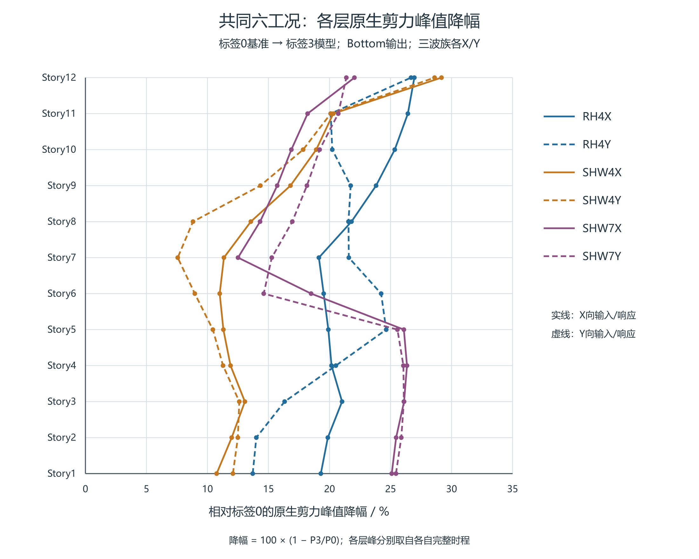
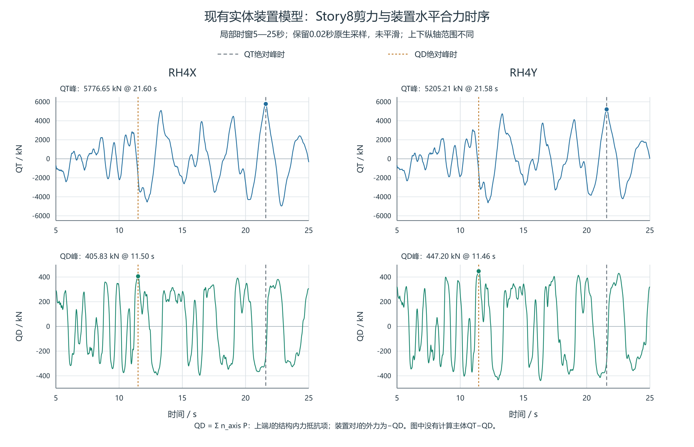
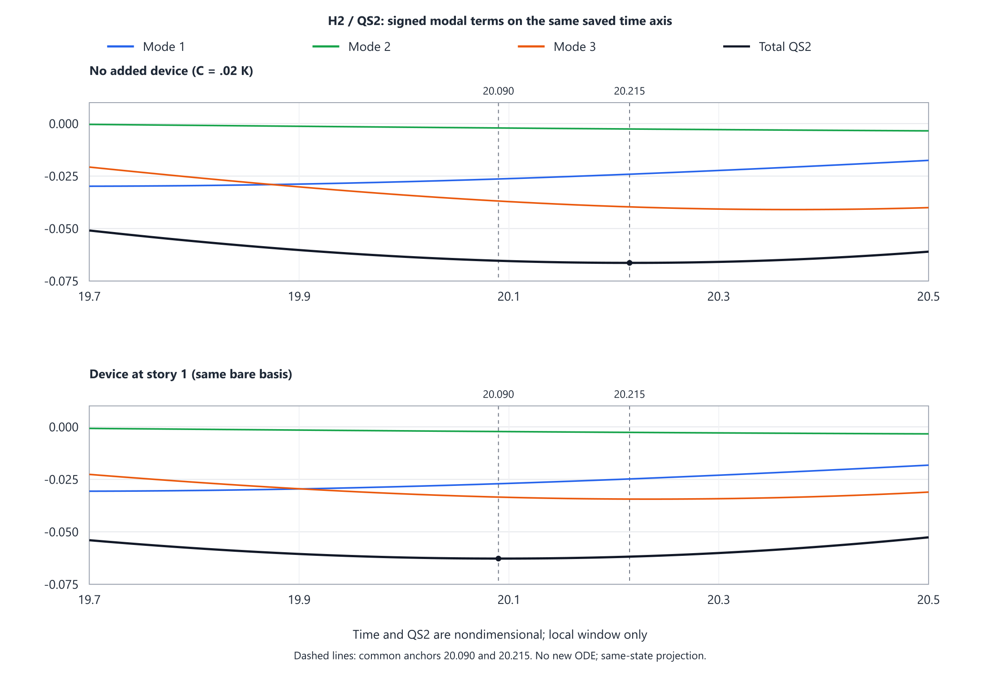

# 附加阻尼作用下楼层剪力变化的振型叠加分析

**Modal-superposition analysis of story-shear changes under added damping**

作者、单位及邮编：待作者填写。

## 摘要

针对附加阻尼后不同楼层剪力减幅不一致的问题，比较基准阻尼模型、增加3个百分点模态阻尼的参考模型与实体装置模型，并用已知三层模型分析振型响应的同刻叠加。在同输入的14工况、12层共168条主方向记录中，参考模型的楼层剪力峰均下降6.85%～30.55%，不同楼层改善程度不同。三层模型前两阶累计方向有效质量达到95.21%，只叠加两阶得到的局部剪力峰仍明显偏小。各阶全程幅值分别降低约3.15%、29.58%和18.58%，但在两个共同控制时刻，第三阶改善被前两项变化部分抵消。按各阶峰比缩放原波形后，合成峰仍不等于该三层装置模型，说明峰幅匹配不足以恢复局部剪力。实体模型Story8两例中，楼层剪力峰时的装置合力仅为其自身峰的58.67%和62.53%。结果表明，楼层剪力评价应结合具体输出、控制时刻及各阶带符号时程，质量覆盖和装置自身峰值只能作为辅助依据。

**关键词**：楼层剪力；模态响应；振型叠加；黏滞阻尼器；时程分析

## Abstract

This study examines differences in story-shear reduction after added damping using a baseline-damping model, a reference model with three additional percentage points of modal damping, and a physical-damper model. Signed modal superposition is analyzed separately in a known three-story model. Across 168 main-direction records from 14 input-matched cases and 12 stories, reference-model shear peaks decrease by 6.85–30.55%, with unequal improvement among stories. In the known model, the first two modes cover 95.21% of directional effective mass, yet their two-mode sum substantially underestimates a local shear peak. Individual modal peak amplitudes decrease by approximately 3.15%, 29.58% and 18.58%; at two common control times, however, changes in the first two terms partly offset the third-mode improvement. A signal reference matching every modal peak still differs from the device-equipped three-story model in its combined peak. In two Story8 engineering records, the damper-force sum at the story-shear peak is only 58.67% and 62.53% of its own peak. Story-shear assessment therefore requires output-specific, signed time histories and their control times, with mass coverage and damper-force peaks used as supplementary information.

## 1 工程问题与已有基础

同样的阻尼设置变化，在不同楼层未必产生相同减幅。屋顶位移、方向有效质量参与系数和楼层剪力分别对应不同输出；解释减剪时，需要先确认实际比较的是哪种剪力、哪一层及哪个时刻。

Song等分别建立弹性层剪力与含阻尼作用的广义层剪力，二者采用不同输出系数[1]。Londoño等在线性Maxwell模型中说明，支撑柔度会随频率改变传力幅值和相位[2]。Conde和Bernabeu讨论储能、损耗及等能线性化的频率依赖，指出基本与高阶振型的表现可能不同[3]。本文据此先报告真实逐层响应差异，再以已知模型分析同刻叠加；装置出力时序作为辅助解释。

## 2 资料对照与模态输出方法

### 2.1 三类原生结果及比较范围

基准模型与参考模型各含14工况，已有输入配对记录表明输入逐样本一致。依据用户给出的模型说明，模态附加阻尼参考模型在基准阻尼模型上直接增加3个百分点模态阻尼；本轮未重新核查软件设置表。下文简称基准模型、参考模型和实体模型。实体装置模型覆盖RH4、SHW4、SHW7各X/Y六工况；其与前两态的输入及完整主体身份尚未全部配对。因此，基准与参考模型的逐层比较和三态描述性对照分开报告。

各层比较均保留原生Bottom剪力名称，以自身保存时程绝对最大值为峰。令两态对应峰为P_B、P_M，减幅定义为1−P_M/P_B。峰时分别来自各态，不把两个独立峰当成同一时刻。Bottom的截面侧别、正方向与Link包含关系未闭合，实楼结果沿用原生Bottom剪力名称。

### 2.2 方向阶次与精确分解的区别

三模型前三阶周期在所示精度下相同，约为2.7781、2.7322、2.5669s；主要方向参与质量分别为第一阶UY 65.22%、第二阶UX 64.87%、第三阶RZ 64.34%。原生参与因子换号本身不说明振型形状改变，周期接近也不足以证明完整形状相同。

进一步在各自300阶摘要中按方向质量率排序，三模型X向前三重要阶次均为2/4/10，Y向为1/5/11。全局1/2/3阶不是任一方向的前三剪力贡献。当前摘要缺节点振型及广义响应，不能恢复实楼精确单阶剪力占比；以下精确叠加仅用于资料完整的已知模型。

### 2.3 已知模型的弹性剪力输出

线弹性主体的弹性层剪力可写为固定输出F_IS=T_SK u；含阻尼的广义层剪力另由T_S(C udot+Ku)构造[1]。取第s层时，令ℓsᵀ=e_sᵀT_SK。在完整质量归一实参考基ΦᵀMΦ=I下，将u=Φq代入，得到本文使用的展开：

$$V_s(t)=\ell_s^Tu(t)=\sum_r(\ell_s^T\phi_r)q_r(t),\qquad q=\Phi^TMu.$$

式中剪力系数包含刚度和输出映射，不等于输入方向的质量参与率。各阶先在同一时刻有符号相加，再求整体绝对峰；第一至第三阶与其余阶分别组织。只用部分基时保留重构剩余项。非线性装置方案中的q来自完整耦合响应投影，不将各阶当作互不耦合的独立系统。

按阶增加模态阻尼，先改变相应广义响应中的阻尼项，再经各层输出系数和同刻叠加影响剪力；即使增加相同阻尼百分点，各层减幅也不必一致。实体Maxwell则由连接点轴向相对运动形成内部变形和轴力，轴力作用于结构并反过来改变运动。实际出力取决于串联刚度、阻尼系数、速度指数及运动过程，不能直接用线性滤波相位或一个参考阻尼比替代[2–3]。

## 3 实楼逐层减幅及三类结果差异

### 3.1 基准与参考模型的减幅与峰时

14工况、12层共168条主方向记录峰全部下降，减幅为6.8513%～30.5458%，未发现主方向反增。表1列与实体模型共同的六工况中各自下降最少的楼层。

**表1 基准与参考模型共同六工况的最小减幅记录**

|工况|楼层|P_B/kN|P_M/kN|减幅/%|峰时（基准→参考）/s|
|---|---|---:|---:|---:|---|
|RH4X|Story7|6725.06|5438.72|19.128|21.58→21.56|
|RH4Y|Story1|10123.05|8735.50|13.707|12.20→12.20|
|SHW4X|Story1|11399.73|10174.19|10.751|29.94→29.92|
|SHW4Y|Story7|7343.57|6788.32|7.561|29.84→29.86|
|SHW7X|Story7|8481.83|7421.40|12.502|38.12→38.10|
|SHW7Y|Story6|8091.99|6909.98|14.607|48.88→38.10|

共同六工况中，SHW4Y的Story7减幅最小，约7.561%；全14工况最小值则来自SHW3X的Story5，为6.851%。样本范围不同，不能混作同一最小记录。本组各层记录均下降，但降幅随楼层和输入变化。

全14工况最大绝对峰时迁移为12.76s。峰时差可能包含不同波包或控制峰的切换，不是相位角，也不能单独判定某阶模态因果。

图1 共同六工况的逐层原生Bottom剪力峰减幅。图中标签0、3分别对应本文基准模型、参考模型；实线为X向、虚线为Y向，每层各取本状态完整记录的绝对峰。

### 3.2 三态原生峰值对照

**表2 两组代表性记录的三态峰值与各自峰时**

|工况／楼层|基准模型峰/kN|参考模型峰/kN|实体峰/kN|三态各自峰时/s|实体/参考模型|
|---|---:|---:|---:|---|---:|
|SHW4Y／Story7|7343.5700|6788.3221|6715.1270|29.84／29.86／29.92|0.98921749|
|RH4X／Story1|10566.7533|8528.6654|8916.7141|21.68／12.20／12.08|1.04549934|

72个共同工况—楼层记录中，实体峰高于参考模型为34项、低于为38项。RH4X／Story1的实体峰比参考模型高约4.55%，而SHW4Y／Story7略低。结合第2.1节模型范围，表2作三类输出的描述性对照。

实体模型六工况的原生剪力峰最大均在Story1，稀疏漂移记录中的控制层则为Story4、5或7。剪力峰所在层与变形控制层不同，且均不等于承载力最危险层。上部四层32只装置的原生力可补充查看出力时序，不据此补齐全楼装置作用。

### 3.3 装置合力与楼层剪力的峰时

Story8的I端在Story7、J端在Story8，n由I指向J。在原生P取正拉力的约定下，本节QD=Σn_eP是J端结构内力抵抗项，装置对J节点的外力为−QD。每个主输入方向有4只非零投影装置，表中合力保留该层8只装置的方向投影。

**表3 Story8两例装置水平合力与原生Bottom剪力**

|工况|QT绝对峰/kN（时刻/s）|QD绝对峰/kN（时刻/s）|QT峰时QD/kN|QT峰时绝对值／QD自身峰/%|tQD−tQT/s|
|---|---|---|---:|---:|---:|
|RH4X|5776.6513（21.60）|405.8268（11.50）|-238.1133|58.6736|-10.10|
|RH4Y|5205.2112（21.58）|447.2019（11.46）|-279.6257|62.5278|-10.12|

六个Story8工况在QT峰时的|QD|相对QD自身绝对峰为48.5899%～65.9515%。RH4X/Y中，装置合力自身峰比层剪峰分别早10.10s和10.12s；层剪峰时的合力绝对值仅为自身峰的58.6736%和62.5278%。这些比例描述同刻出力相对于本输出峰的大小，不是减震贡献率、耗能效率或利用率。

因此，比较层剪力需求与装置出力时，应同时查看层剪力峰时的有符号合力和装置自身峰。

图2 Story8在RH4X、RH4Y下的原生剪力与装置水平合力。曲线显示5—25s的原生时刻，未平滑；上下纵轴分别为±6500kN和±500kN，尺度不同。虚线标示各自完整记录的绝对峰时；QD为J端内力抵抗项，装置对J的外力为−QD。

## 4 已知三层模型中的振型叠加解释

采用已计算的无量纲三层模型，M=diag(1,1.2,.8)，K=[[2.4,−1,0],[−1,1.7,−.7],[0,−.7,.7]]，背景C=.02K。H2为既有包络多频输入，完整保存状态覆盖t∈[0,200]、步长h=.005。比较无装置与第一层一只κ=.5、c=.02、α=.3的装置方案，按同一参考基投影；第2层主体弹性剪力为V2=k2(u2−u1)，本模型k2=1；屋顶位移为u3。

### 4.1 不同输出的高阶影响

**表4 完整输出各自峰时的有符号模态项（模型量及时间无量纲）**

|方案／输出|t|第1阶|第2阶|第3阶|三阶和|
|---|---:|---:|---:|---:|---:|
|无装置／第2层剪力V2|20.215|-0.024113170|-0.002564914|-0.039675603|-0.066353687|
|无装置／屋顶位移u3|70.395|+0.033002219|+0.171593784|-0.003758265|+0.200837738|
|层1装置／第2层剪力V2|20.090|-0.027078427|-0.002214950|-0.033446139|-0.062739516|
|层1装置／屋顶位移u3|20.510|-0.045631229|-0.113265030|+0.004794006|-0.154102254|

每行的三项取自同一时刻；不同行是各自输出峰时，不能逐项相减解释装置因果。无装置V2在t=20.215达到完整峰，第三阶约−.0396756，与前两阶同向，加强了局部剪力。只保留前两阶时，其峰改在17.225出现，前两项和约+.0376083，第三项则为−.0039561并反向抵消。因此，两阶峰与完整峰之差也不能直接叫作某一任选时刻的第三阶贡献。

无装置屋顶在其完整峰时，第三阶约−.0037583，与前两阶和反向，且相对较小。删除第三阶后的屋顶峰略增，而V2峰明显偏小；第一层装置方案也呈现这一输出差异。由完整响应只叠加前两阶得到的V2峰分别低估43.3215%和41.6360%，屋顶峰分别高估1.8839%和3.1416%。

该模型前两阶累计方向有效质量为95.2108%，仍有上述局部重构差。这里先由完整响应计算各阶分量，再比较三阶与前两阶叠加的峰值；减少振型后重新求解是另一类分析。质量覆盖不能代替目标层剪力核查。这里的模型机制不移作实楼逐阶占比。

### 4.2 各阶全程幅值削弱不同

**表5 各阶V2贡献项的全程绝对峰（无量纲）**

|阶次|无装置峰|层1装置峰|峰值降幅/%|
|---|---:|---:|---:|
|1|0.036860629|0.035698331|3.1532|
|2|0.005451629|0.003838988|29.5809|
|3|0.048356739|0.039373788|18.5764|

第一阶的全程幅值降低约3.15%，第二、三阶分别降低29.58%和18.58%。由于同一阶剪力输出系数在两方案间固定且非零，这些峰比也等于相应广义响应绝对峰的比。三阶峰不在同一时刻，不能相加为完整剪力峰，也不能据整段峰比固定缩放每个时刻。

### 4.3 在相同控制时刻比较三阶变化

**表6 两方案在两个共同时间的三阶有符号项（无量纲）**

|t|方案|第1阶|第2阶|第3阶|V2总值|
|---:|---|---:|---:|---:|---:|
|20.090|无装置|-0.026376888|-0.002081898|-0.036890200|-0.065348985|
|20.090|层1装置|-0.027078427|-0.002214950|-0.033446139|-0.062739516|
|20.215|无装置|-0.024113170|-0.002564914|-0.039675603|-0.066353687|
|20.215|层1装置|-0.024804146|-0.002619741|-0.034393647|-0.061817533|

在20.090，两方案三项均为负。装置方案的第三阶向零移动+.003444061，但第一、二阶分别变得更负，变化为−.000701539和−.000133053；合计仅向零移动+.002609469。20.215也类似：第三阶变化+.005281957，经前两项−.000690976与−.000054827部分抵消后，合计变化为+.004536154。

因此，全程峰幅值下降与控制时刻的各阶变化不是同一件事。装置方案的第三阶改善在这两个时刻被前两项变化部分抵消；三项本身仍同向，不能解释为原有模态抵消关系消失。本例给出固定参考基下的同刻差异分解，不将每阶变化认作彼此独立的因果作用。

图3 三层模型中两方案在19.7—20.5局部时段的三阶项与合计，采用同一横纵坐标；图中QS2对应本文第2层主体弹性剪力V2，时间及响应均无量纲。两条竖线为共同时间20.090和20.215，曲线不代表完整0—200时程。

### 4.4 匹配各阶峰值后的信号参照

利用已得到的两方案结果，以各阶装置响应峰与无装置响应峰之比a_r，对无装置单阶时程乘正常数，构造V2,ref(t)=Σa_rV2,r,0(t)。倍率为(.96846775,.70419090,.81423580)，因此各阶参照峰分别与装置方案匹配，单阶原波形的时间位置保持不变。

**表7 各阶峰幅匹配后的合成剪力比较（无量纲）**

|输出|V2绝对峰|峰时|相对无装置减幅/%|
|---|---:|---:|---:|
|无装置完整响应|0.06635368725|20.215|0.000000|
|各阶峰幅缩放参照|0.05751805433|20.185|13.315964|
|实际层1装置响应|0.06273951643|20.090|5.446827|

各阶峰虽然匹配，参照合成峰0.05751805仍不同于装置响应0.06273952。参照未移动单阶波形，合成峰时却从20.215移至20.185，说明总峰时迁移本身不足以证明模态相位改变。该参照使用已知装置峰作人工构造，用来检验峰值信息是否充分，不代表另一个可实现结构；它与实际响应的差额不单独归为相位损失。

## 5 工程应用与计算复核

工程评价先按控制方向辨识主要参与阶，分别查看X、Y和扭转特征，再将目标楼层剪力与其他层对照。本例方向质量排序有助于确定观察对象，但不直接给出某层剪力占比。比较阻尼影响时，应同时保存剪力原值、减幅和峰时，不只用屋顶位移或全楼平均减幅判断。

CSI手册说明，动力荷载参与率主要反映模态基对荷载空间分布的覆盖，响应精度还与荷载随时间变化的频率成分有关，仍需改变模态数量检查不同动力荷载的响应[4]。据此，工程计算应针对目标层剪力检查增阶后峰值及控制时段的稳定性，而不由累计质量阈值推定局部内力误差界。静力修正可补充未表达荷载的近静力响应，但静力参与率达到100%并不等于质量或动力荷载参与率达到100%，也不代替完整非线性反馈。

最后将装置原生轴力按统一方向投影，比较同层剪力与装置合力的同刻值及各自峰值。Story8结果说明两类输出并不同步，装置自身峰只能作为需求参考。上述检查分别对应整体响应、模型叠加和实际传力三类信息，无须先假定振型形状发生改变。

## 6 结论

（1）同输入的基准与参考模型记录中，168条主方向剪力峰全部下降6.85%～30.55%，但改善程度随楼层和输入变化。共同六工况中的SHW4Y／Story7仅下降约7.561%，应与较大减幅记录分别解释。

（2）方向参与排序与剪力贡献排序不同。三态X向主要参与阶次为2/4/10、Y向为1/5/11；周期与参与质量接近不能据以恢复各层实际响应组成。

（3）已知模型中，第三阶对局部剪力和屋顶的影响不同。各阶峰幅匹配后的参照合成峰仍不等于装置响应，且单阶时序不变时合成峰时仍会移动，说明评价叠加需要同刻有符号时程，不能仅依赖单阶峰幅和总峰时差。

（4）小模型各阶全程幅值分别削弱约3.15%、29.58%、18.58%，但所列两个共同控制时刻的前两项并未同比减弱，部分抵消了第三阶改善。真实Story8两例的QT峰时装置合力为其自身峰的58.6736%和62.5278%，说明出力与剪力需求必须按同刻比较；这些比例不作为减震贡献率。

## 参考文献

[1] SONG J, CHU Y L, LIANG Z, LEE G C. Modal Analysis of Generally Damped Linear Structures Subjected to Seismic Excitations[R]. Buffalo: University at Buffalo, State University of New York, 2008. Technical Report MCEER-08-0005.

[2] LONDOÑO J M, WAGG D J, NEILD S A. Supporting brace sizing in structures with added linear viscous fluid dampers: A filter design solution[J]. Earthquake Engineering & Structural Dynamics, 2014,43:1999–2013. DOI:10.1002/eqe.2433.

[3] CONDE J, BERNABEU A. Influence of Maxwell Stiffness in Damage Control and Analysis of Structures with Added Viscous Dampers[J]. Applied Sciences, 2021,11:3089. DOI:10.3390/app11073089。

[4] COMPUTERS & STRUCTURES, INC. CSi Analysis Reference Manual: for SAP2000, ETABS, SAFE and CSiBridge[M]. Rev.15. Berkeley: Computers & Structures, Inc., 2016. ISO#GEN062708M1.

完整计算条件、原文定位和资料范围见[补充说明](../../../research/sessions/20261020-1844/roles/role5/R007-notes.md)。
