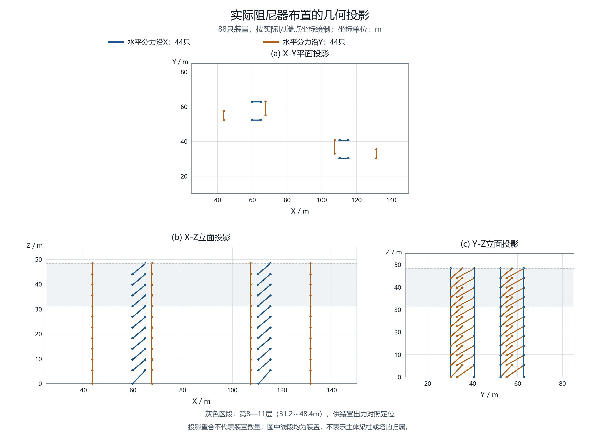
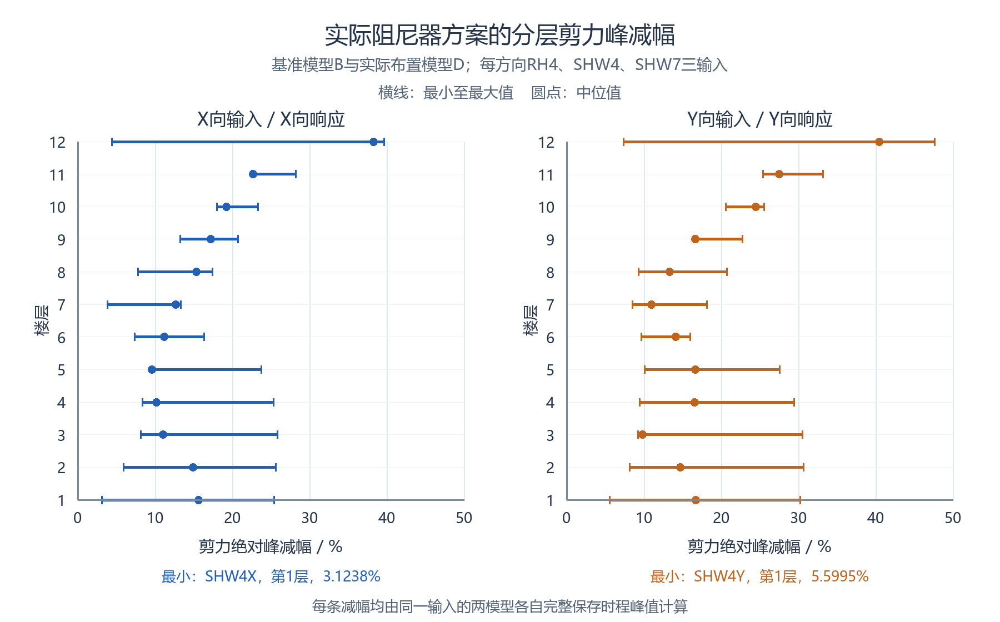
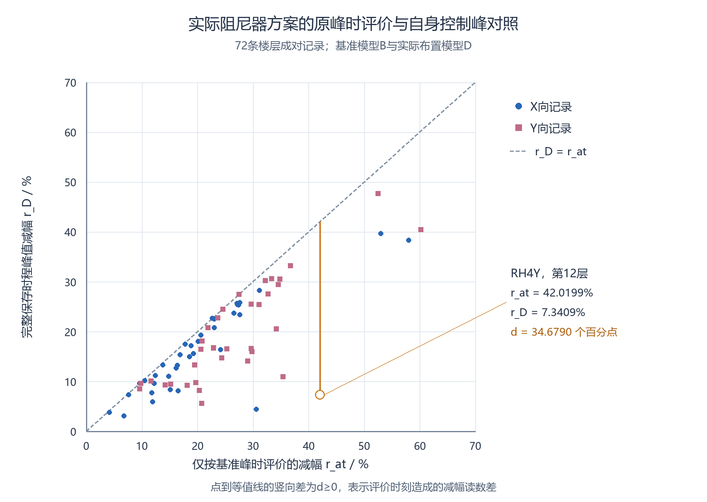
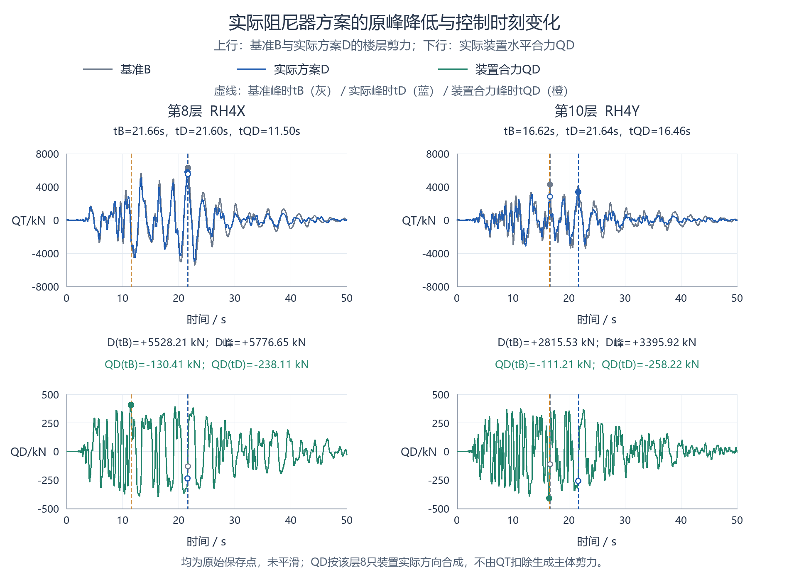

# 附加阻尼作用下双塔连体结构楼层剪力的分层评价

**Story-by-story assessment of shear changes under added damping in a coupled twin-tower structure**

## 摘要

设置阻尼器后，楼层剪力减幅较小的地震输入未必产生最大的剪力需求，底层或全楼平均减幅也可能掩盖局部改善不足。以一座布设88只非线性黏滞阻尼器的双塔连体结构为例，对基准与实际阻尼器方案在六个方向工况下的72条楼层剪力记录进行配对分析，分别保留最小减幅和最大需求的控制输入，并检查各模型自身峰时及该时刻装置出力。结果表明，24个楼层—方向组中有12组的两类控制输入不同；六工况中仅两个工况的底层恰为减幅最小层。SHW7Y下底层减幅为30.2486%，第6层仅为16.0082%。若只在基准峰时读取实际方案响应，减幅高估量的中位数为3.6586个百分点，RH4Y第12层达到34.6790个百分点。第8层X向需分别检查RH4X的7.7713%减幅与SHW7X的7132.2925kN需求，RH4Y第10层的实际控制时刻由16.62s变为21.64s，两时刻原有需求接近，但降低量不同，使原先略低的时段转为控制。装置水平合力的自身峰与楼层剪力控制峰分别保留；14工况模态增阻尼结果仅作扩展对照。提出由成对峰值、两类控制输入、各自峰时及同刻装置出力组成的复核流程，为实际消能方案的逐层检查与比选提供依据。

**关键词**：楼层剪力；黏滞阻尼器；分层评价；控制输入；时程分析

## Abstract

After dampers are installed, the input producing the smallest story-shear reduction may differ from that producing the largest demand. Base-story and building-average reductions can also conceal smaller improvements at individual stories. A coupled twin-tower structure with 88 nonlinear viscous dampers is examined using 72 paired story-shear records from a baseline model and the actual-damper scheme under six directional cases. The two governing inputs, each model's own peak time, and simultaneous damper forces are retained. Different inputs govern the smallest reduction and largest demand in 12 of the 24 story-direction groups. The base story has the smallest reduction in only two of the six cases. Under SHW7Y, the base-story reduction is 30.2486%, whereas Story 6 achieves only 16.0082%. Reading the actual-scheme response only at the baseline peak time overstates reduction by a median of 3.6586 percentage points and by 34.6790 percentage points at Story 12 under RH4Y. At Story 8 in the X direction, RH4X controls the reduction of 7.7713%, while SHW7X governs the demand of 7132.2925 kN. At Story 10 under RH4Y, the governing time changes from 16.62 to 21.64 s. Demand at these two times is initially similar, but unequal reductions make the previously lower response govern. Damper-force peaks are checked separately from story-shear peaks, while the 14 directional modal-damping cases provide an extended comparison. A practical checking procedure combines paired peaks, both governing inputs, individual peak times and simultaneous damper forces to assess actual damping schemes story by story.

**Keywords**: story shear; viscous damper; story-by-story assessment; governing input; response-history analysis

## 1 引言

阻尼器方案的工程复核既要判断剪力降低了多少，也要确定哪一条输入产生较大需求。减幅是相对基准的变化比例，绝对剪力则对应受力需求；一条记录改善较小，不代表它产生的剪力最大。底层剪力或各层减幅平均值可以概括方案，却不能替代每层检查。此外，实际装置出力和楼层剪力往往不在同一时刻达到峰值，仅看装置最大轴力或基准峰附近的响应，可能遗漏方案自身的控制时段。

已有研究从不同目标与沿高度配置评价阻尼设置。柳博哲、汪梦甫比较了阻尼参数对框架—核心筒结构基底剪力和变形的影响[1]。Liu等依据指定响应的重要模态调整钢框架阻尼器配置，指出较大的有效阻尼未必使不同目标同时获得最佳控制效果[2]。De Domenico和Hajirasouliha采用沿高度性能反馈调整非线性黏滞阻尼器，并用地震记录检验结构响应[3]。张敏、李阳研究阻尼器布置与各层变形响应[4]；陈泰锟等比较沿高度设置非对称阻尼器的响应并开展混合模拟验证[5]。这些工作表明，方案评价需要把具体目标响应与楼层位置联系起来。

Cetin等分别评价多输入下的位移、绝对加速度及层间位移角[6]。对于楼层剪力，还需区分最小减幅与最大需求各自由哪条输入控制。Song等区分弹性层剪力和含阻尼作用的广义层剪力输出[7]，说明比较应先固定受力定义。Londoño等与Conde、Bernabeu分别讨论支撑柔度及Maxwell整体刚度对装置传力和结构响应的影响[8,9]。实际非线性装置通过端部运动及整体柔度产生作用，不能由统一增加模态阻尼完全代替。

本文以实际布设88只黏滞阻尼器的双塔连体结构为主体，利用共有六方向工况的基准与实际方案输出，建立逐层成对峰值、两类控制输入、各自峰时和同刻装置出力的工程检查表。增加3个百分点模态阻尼的14工况结果作为扩展对照；通过实际模型在两个控制时刻的响应及装置出力，说明原控制峰降低后，另一个接近峰如何转为控制。研究重点是把常规时程输出转为需要重点复核的楼层、输入和时段。

## 2 实际阻尼器方案与比较资料

### 2.1 工程模型和共有输入

采用双塔连体结构的ETABS分析结果，基准模型记为B，按工程真实位置设置黏滞阻尼器的方案记为D。主体比较覆盖RH4、SHW4、SHW7三组输入各X/Y方向，共六个方向工况；每工况有12层，形成72条主方向楼层记录。X/Y是对应输入的转向计算，不计为六次独立地震事件。另有增加3个百分点模态阻尼的参考模型M，覆盖14个方向工况、168条记录，用于第5节扩展比较。

基准与实际方案共有六工况的基底加速度，在16296个保存时刻、六分量共97776个数值上逐点一致。实际模型18个质心的X/Y方向质量与基准对应数值吻合。以下评价所提供实际方案相对基准的软件响应变化；背景阻尼、完整内部积分及初始设置的导出范围见[计算资料与完整工程表](../../../research/sessions/20261103-1700/工程资料与完整附表.md)。

楼层剪力统一取Story Forces表的Bottom输出，第1—12层对应Story1—12。各模型在各自完整保存时程中求剪力绝对峰；同条成对记录的保存时间逐点一致，名义间隔为0.02s，输入PGA为350mm/s²。保存间隔与内部积分步分别记录。本文直接比较该软件截面输出，装置力另用于同刻检查，不从楼层剪力中扣出主体剪力。

**表1 资料范围与用途**

|资料|范围|用途|
|---|---|---|
|基准与实际方案楼层剪力|六方向工况×12层，72条成对记录|工程主分析：逐层减幅、两类控制输入、峰时与原峰时评价偏差|
|实际布置|3416节点坐标、88只Link两端位置|安装层、方向、倾角及轴力水平投影|
|原生装置轴力与变形|第8—11层32只×六工况|完整范围内的同刻装置水平合力|
|基准与模态增阻尼参考剪力|14方向工况×12层，168条成对记录|扩展输入对照与线性机制说明|

### 2.2 实际布置与装置参数

88只装置按真实I/J端点坐标绘于图1。第1—11层每层8只，水平投影沿X、Y的装置各4只，全楼各44只；第12层没有该连接表所列跨层装置。装置轴线长度为6.440～9.401m，与水平面的夹角为29.20°～48.37°，各层配置见表2。图中灰色区段为具有完整原生轴力时程的第8—11层。

图1 实际88只阻尼器轴线的X-Y、X-Z和Y-Z投影，坐标单位为m。不同装置在投影中可重合，未绘主体梁柱；灰色区段标出第8—11层完整装置力资料的范围。

实体方案采用工程提供的有限Maxwell参数κ=500000kN/m、c=477kN(s/m)^0.3、α=0.3。装置总变形由串联弹性变形和黏滞单元变形组成，出力取决于端部运动、本构与整体柔度[8,9]。比较方案峰值无需先把这些作用换算为统一附加模态阻尼比。

**表2 实际装置分层配置（按上端J所在层归类）**

|上端所在层|连接标高/m|数量|X向/Y向数量|轴长/m|水平倾角/°|
|---|---|---:|---|---|---|
|第1层|0.0→5.4|8|4/4|7.225～9.401|35.06～48.37|
|第2层|5.4→9.7|8|4/4|6.444～8.815|29.20～41.86|
|第3层|9.7→14.0|8|4/4|6.440～8.815|29.20～41.89|
|第4层|14.0→18.3|8|4/4|6.633～8.815|29.20～40.41|
|第5层|18.3→22.6|8|4/4|6.633～8.815|29.20～40.41|
|第6层|22.6→26.9|8|4/4|6.633～8.815|29.20～40.41|
|第7层|26.9→31.2|8|4/4|6.633～8.815|29.20～40.41|
|第8层|31.2→35.5|8|4/4|6.633～8.815|29.20～40.41|
|第9层|35.5→39.8|8|4/4|6.633～8.815|29.20～40.41|
|第10层|39.8→44.1|8|4/4|6.633～8.815|29.20～40.41|
|第11层|44.1→48.4|8|4/4|6.633～8.815|29.20～40.41|

### 2.3 模态分析的解释范围

工程模型前三阶周期在所示精度下约为2.7781、2.7322和2.5669s，主要方向参与分别对应UY、UX与RZ；方向质量参与率不是目标层剪力分担。非线性模态时程仍可用选定振型或Ritz向量表示结构运动，但装置非线性力进入广义受力，各阶响应需考虑其相互影响[10]。

因此，背景模态阻尼与装置作用分开描述。本文主要结论直接由实际方案的原生剪力和装置力得到，不依赖等效阻尼转换；第5.2节直接比较实际B/D模型控制时段及装置出力。第2、13阶实际坐标的恢复另作有限诊断，观测投影与真实模态坐标的区别见[模态恢复补充](../../../research/sessions/20261103-1853/补充A-线性机制与实际模态恢复.md)。

## 3 逐层成对峰值与控制记录

### 3.1 逐输入保留各模型自身峰

对楼层s、方向a和同一输入c，在共同保存时间集T内分别求基准与实际方案的剪力绝对峰：

$$P_{B,s,a,c}=\max_{t\in T}|V_{B,s,a,c}(t)|,\qquad P_{D,s,a,c}=\max_{t\in T}|V_{D,s,a,c}(t)|.$$

实际方案相对基准的减幅定义为：

$$r_{D,s,a,c}=1-\frac{P_{D,s,a,c}}{P_{B,s,a,c}},\qquad P_{B,s,a,c}>0.$$

两模型各自峰时记为t_B和t_D。每条记录同时保留工况、两峰、减幅、峰时和所在层；按每层每方向三个输入统计减幅最小值、中位值与最大值。全楼各层减幅的算术平均仅作对照，不代表总剪力减幅。

### 3.2 分别确定改善与需求的控制输入

对固定楼层和方向，在相同输入集合C内分别取最小减幅输入c_r与最大实际方案剪力输入c_V：

$$c_r\in\operatorname{argmin}_{c\in C}r_{D,s,a,c},\qquad c_V\in\operatorname{argmax}_{c\in C}P_{D,s,a,c}.$$

c_r用于查看改善较小的记录，c_V用于查看较大绝对需求。两条记录各自列P_B、P_D、r_D与峰时，不将一个输入的百分比标在另一个输入的需求上。并列控制可保留全部输入，或按事先确定的顺序列示；本例按工况名稳定排序。零基准峰的归一减幅不定义。

在缺少承载力和组合资料时，减幅小不等于受力危险，需求大也不单独决定方案优劣。两类记录用于指定需要打开的时程，再结合相应构件、变形与装置需求复核。

### 3.3 检查原峰时读数是否遗漏方案自身峰

记A_D=|V_D(t_B)|，仅在基准峰时读取实际方案响应所得减幅记为r_at,D，其相对自身峰减幅的高估量为d_D：

$$r_{\mathrm{at},D}=1-\frac{A_D}{P_B},\qquad d_D=\frac{P_D-A_D}{P_B}\ge0,\qquad r_D=r_{\mathrm{at},D}-d_D.$$

P_D是同一保存时间集内的绝对最大值，因此d_D非负，乘100后单位为百分点。d_D反映评价时刻不同造成的读数差别，不是相位或某阶振型的贡献。本文对并列绝对峰取最早保存时刻，并保留并列数量。应先逐条计算，再汇总各层和输入，不能把不同记录的百分比和偏差相减。

## 4 实际阻尼器方案的分层结果

### 4.1 底层与平均减幅不能代替逐层检查

实际方案的72条主方向记录相对基准均下降，减幅为3.1238%～47.6719%，但分布随楼层和输入变化。图2按每层每方向三个输入给出最小、中位与最大减幅；表3另按每个工况列出改善最小层，并与该工况底层及十二层平均值比较。

图2 实际阻尼器方案相对基准的逐层剪力峰减幅范围。X、Y分别统计RH4、SHW4、SHW7三个输入，横线为最小至最大值，圆点为中位数。

**表3 各实际工况的改善最小层及总体指标对照**

|工况|最小减幅层|该层减幅/%|底层减幅/%|12层减幅平均/%|底层与该层差/百分点|
|---|---|---:|---:|---:|---:|
|RH4X|第7层|3.8221|15.6154|11.5603|11.7933|
|RH4Y|第12层|7.3409|16.7603|15.1791|9.4194|
|SHW4X|第1层|3.1238|3.1238|15.6557|0.0000|
|SHW4Y|第1层|5.5995|5.5995|15.5511|0.0000|
|SHW7X|第7层|12.7282|25.4398|22.4355|12.7116|
|SHW7Y|第6层|16.0082|30.2486|27.1508|14.2404|

六工况中只有SHW4X、SHW4Y的底层恰为改善最小层。SHW7Y底层减幅为30.2486%，而第6层仅16.0082%，前者高14.2404个百分点；十二层平均减幅27.1508%，仍高11.1426个百分点。若仅看底层或平均值，就会掩盖第6层的较小改善。SHW4X则从另一侧说明平均值的局限：底层仅下降3.1238%，十二层平均为15.6557%，相差12.5319个百分点。

这两类情况都要求逐层保留成对记录。图2用于定位改善较小的层，表3用于说明某一输入下底层和平均值能否代表该层；它们均不能代替后续的绝对需求检查。

### 4.2 改善较小与需求较大由不同输入控制

在24个楼层—方向组中，有12组的最小减幅和最大实际方案需求由不同输入控制。表4列出第5、8层代表记录，完整24组见附表。每一行的两峰和减幅均来自同一输入。

**表4 实际方案代表层的两类控制输入**

|方向/楼层|查看用途|输入|P_B/kN|P_D/kN|本输入r_D/%|
|---|---|---|---:|---:|---:|
|X/第5层|最小方案减幅|RH4X|8261.66|7468.14|9.6048|
|X/第5层|最大实体剪力|SHW4X|10178.09|9198.67|9.6229|
|X/第8层|最小方案减幅|RH4X|6263.40|5776.65|7.7713|
|X/第8层|最大实体剪力|SHW7X|8429.68|7132.29|15.3907|
|Y/第8层|最小方案减幅|SHW4Y|6281.04|5696.28|9.3098|
|Y/第8层|最大实体剪力|SHW7Y|8467.74|6707.70|20.7852|

第8层X向的较小减幅由RH4X控制，为7.7713%，实际方案剪力峰5776.6513kN；较大需求由SHW7X控制，为7132.2925kN，该输入自身减幅为15.3907%。Y向也需分别检查SHW4Y的9.3098%与SHW7Y的6707.7015kN，后者自身减幅为20.7852%。因此，若只沿用最小减幅对应的输入，可能遗漏同层更大的剪力需求。

第5层X向的最小减幅为RH4X的9.6048%，最大需求来自SHW4X的9198.67kN；两输入减幅仅相差0.0181个百分点，宜同时保留，不把近似并列的排序夸大为机制差异。控制记录应按实际方案重新确定，而不能沿用模态增阻尼参考模型的记录。

### 4.3 实际方向下的装置水平合力

第8—11层共有24个楼层—工况组，每组8只装置的保存时间与楼层输出逐点一致。各主方向有4只装置的水平投影非零，按实际方向逐只合成；同一轴力的I/J重复列示只计一次。取单位向量n由I指向J，轴力P按原生正拉力约定，QD=Σn_eP表示J端结构内力抵抗项，装置施加于J节点的外力为−QD。

装置力分别在基准剪力峰时、实际方案自身峰时和装置合力峰时查看。它们对应的原生剪力与装置力见第5.2节；完整第8层六工况及追加一例的三时刻数据见[实际控制时段附表](../../../research/sessions/20261103-1853/实际控制时段与完整附表.md)。装置力用于同刻传力检查，与软件楼层剪力分别列示。

### 4.4 实际方案自身峰的遗漏与读数偏差

实际方案72条记录的原峰时评价高估量d_D中位数为3.6586个百分点，95%分位数为19.7051个百分点，最大为34.6790个百分点。分位数按排序位置(n−1)p线性插值。三条记录的两模型保存峰时相同，其d_D为零；其余记录均应返回实际方案自身峰附近查看。

**表5 实际方案原峰时评价与自身峰减幅的对照**

|工况/楼层|基准峰/kN|实际方案峰/kN|原峰时评价/%|自身峰减幅/%|高估量/百分点|峰时（基准→实际）/s|
|---|---:|---:|---:|---:|---:|---|
|RH4Y/第12层|565.0421|523.5629|42.0199|7.3409|34.6790|20.22→12.26|
|SHW7Y/第6层|8091.9866|6796.6056|29.7883|16.0082|13.7801|48.88→38.02|
|SHW4X/第1层|11399.7318|11043.6221|6.7843|3.1238|3.6604|29.94→29.82|

RH4Y第12层的基准峰为565.0421kN，发生在20.22s；该时刻实际方案剪力为−327.6119kN，若只读此处可得到42.0199%的减幅。但实际方案完整时程绝对峰为523.5629kN，发生在12.26s，实际峰值减幅仅7.3409%，两种读数相差34.6790个百分点。这个例子应同时保留12.26s与20.22s附近的曲线，不能用基准控制时段的较小响应替代方案整体峰值。

图3 实际方案72条成对记录的原峰时评价减幅与自身峰减幅。虚线为两者相等，点相对虚线的竖向差为d_D，单位为百分点；标注RH4Y第12层的最大差例。

该偏差与控制峰选择直接相关，不要求先确定等效模态阻尼比。峰时改变还可能包含波包或正负控制峰切换，故不把时间差单独解释为纯相位改变。

## 5 控制输入对照与实际峰值变化

### 5.1 较大输入范围的扩展对照

基准B与均增加3个百分点模态阻尼的参考M共有14方向工况、168条记录，其峰减幅为6.8513%～30.5458%。按同样流程，24组中有19组的最小减幅和最大参考需求来自不同输入；X向第5层分别由SHW3X的6.8513%和SHW4X的9027.7451kN控制。该扩展输入分析说明两类控制记录也需要分别保留，完整结果见[原14工况附表](../../../research/sessions/20261102-1917/roles/role5/R002/engineering-data-and-full-tables.md)。

若把输入集合限制为与实际方案相同的六方向工况，模态增阻尼参考中两类控制输入不同的为7/24组，实际方案为12/24组。72条实际峰相对参考峰有34条较高、38条较低；第12层X/Y的最大需求控制输入由参考的SHW7X/SHW7Y转为实际方案的RH4X/RH4Y。工程上不能用统一增加3个百分点的结果代替真实布置方案，也不能把两个不同输入集合的19组和12组直接作为阻尼方式优劣指标。

### 5.2 实际方案控制峰变化与装置出力时序

比较实际方案D与基准B的原生时程，分别检查原控制时段、自身控制峰和装置出力。先保留第8层六工况的全部三时刻对照，再在第8—11层具有完整装置出力的24条记录中，取峰时迁移最大的第10层RH4Y作为控制时段变化例；第8层RH4X则用于说明两峰相距很近时的读数差别。表6与图4分别列出两条记录。

图4 两条实际记录的B/D楼层剪力与装置水平合力QD。左为第8层RH4X，右为第10层RH4Y，均保留0—50s完整保存时程；灰、蓝、橙虚线分别标t_B、t_D和QD自身峰时。上行纵轴为±8000kN，下行为±500kN；空心点为实际方案在基准峰时的读数。QD为J端结构内力抵抗项，装置对节点外力为−QD。

**表6 两条实际记录的原峰降低与自身控制峰**

|量|第8层RH4X|第10层RH4Y|
|---|---:|---:|
|基准峰时t_B/s|21.66|16.62|
|实际方案峰时t_D/s|21.60|21.64|
|基准原峰/kN|6263.4015|4277.2798|
|实际方案原峰时读数/kN|5528.2062|2815.5314|
|基准在实际方案峰时读数/kN|6070.9624|4167.6790|
|实际方案自身峰/kN|5776.6513|3395.9230|
|原峰时降低/kN|735.1953|1461.7485|
|重新取峰比原峰时读数高/kN|248.4451|580.3917|
|最终峰降低/kN|486.7502|881.3568|
|原峰时评价/%|11.7380|34.1747|
|完整时程峰减幅/%|7.7713|20.6055|

第8层RH4X的基准峰为21.66s的+6263.40kN，实际方案同刻降为+5528.21kN，降低735.20kN。但其自身峰在21.60s达到+5776.65kN，比原峰时读数高248.45kN，最终峰降低486.75kN，减幅7.7713%。两时刻只差0.06s，仍应取实际方案自身峰，而不是把接近的峰时视为完全相同。

第10层RH4Y的控制时段变化更明显。基准在16.62s为+4277.28kN，在21.64s仍有+4167.68kN，两个时刻仅差109.60kN。实际方案在前一时刻降为+2815.53kN，在后一时刻为+3395.92kN。原控制时刻降低1461.75kN，后一时刻降低771.76kN，前者降低得更多，使原先略低的时段转为实际方案的控制时段。两状态在这些时刻均为正剪力，此例不是正负峰号切换。

用两时刻的绝对值可写清这一关系。令t₁=t_B、t₂=t_D，b_i=|V_B(t_i)|、d_i=|V_D(t_i)|，δ_i=b_i−d_i为该时刻的降低量，则：

$$d_2-d_1=(\delta_1-\delta_2)-(b_1-b_2).$$

当两时刻降低量之差大于原需求差时，t₂时刻在实际方案中更大。对第10层RH4Y，降低量之差689.99kN超过原需求差109.60kN，故实际方案在21.64s比16.62s高580.39kN。原峰时的34.1747%减幅因此回落为完整峰值减幅20.6055%，相差13.5692个百分点。该关系直接核对已得到的两状态时程，说明两个时刻的大小关系如何改变。

**表7 两条实际记录的同刻装置出力**

|楼层/输入|QD(t_B)/kN|QD(t_D)/kN|QD自身绝对峰/kN|tQD/s|剪力峰时绝对值/自身峰/%|
|---|---:|---:|---:|---:|---:|
|第8层/RH4X|-130.4117|-238.1133|405.8268|11.50|58.6736|
|第10层/RH4Y|-111.2123|-258.2223|411.9139|16.46|62.6884|

第10层RH4Y的装置合力自身绝对峰411.91kN发生在16.46s；原剪力峰时16.62s仅为−111.21kN，实际方案自身峰时21.64s为−258.22kN。后两者绝对值分别为装置自身峰的26.9989%和62.6884%。第8层RH4X也有相同的检查必要：装置合力峰在11.50s，而剪力控制时刻在21.60s附近。

因此，装置最大出力、原剪力峰时出力和实际方案自身峰时出力应分别保留。控制时段的剪力降低既不能用装置自身峰直接代替，也不能仅由某一个同刻QD值解释。实际曲线说明了不同时段降低程度不同，以及原有接近峰重新控制的过程；具体模态作用还需由实际运动与一致的剪力恢复关系核查。第2、13阶的实际质心运动投影及恢复诊断见[补充资料](../../../research/sessions/20261103-1853/补充A-线性机制与实际模态恢复.md)。

## 6 实际方案的工程复核步骤

（1）明确比较对象。首先核对基准与实际方案的输入方向、量级、时间轴、单位和模型设置；把模态增阻尼参考另列。按实际安装方向、所在层和两端连接位置核查装置清单。

（2）形成逐条成对记录。按楼层、方向、输入和截面位置列P_B、P_D、r_D、t_B与t_D，检查完整保存时程，而不是在基准峰时只读一次。对多个峰值时刻保留预定取值规则。

（3）同时查看改善与需求。在每层每方向分别找最小r_D和最大P_D，对两条控制记录分别保留成对峰值和时间。第8层X向先打开RH4X与SHW7X；第5层X向的RH4X、SHW4X减幅接近，应一并保留。底层及平均减幅只作总体对照。

（4）检查方案自身控制时段。计算d_D并标注两模型峰时。RH4Y第12层应分别查看12.26s与20.22s；SHW7Y第6层则分别查看38.02s与48.88s。较大d_D提示原峰时读数漏掉了方案自身更大的响应，不由此直接认定某阶模态或相位的原因。

（5）把装置需求放回实际时刻。在改善或需求控制输入下，按真实方向余弦合成装置水平力，分别列楼层剪力峰时出力和装置自身峰。随后检查装置轴力、行程、支撑与连接需求，并同时检查层间位移角，不能由剪力减幅直接替代这些项目。

（6）按可用模态信息确定深入检查的重点。若较大需求主要对应某个较大的低阶项，查看该阶层间变形、受力构件和沿高度刚度分布；若反向项在控制时刻明显，比较其变化是否削弱原有抵消。实际非线性方案应使用自身响应恢复的项，并检查各阶合成与软件输出的对应。

上述两种作用可能在同一输入下并存。进一步调整装置或连接参数时，还需核查真实两端沿轴线的相对位移和速度、整体柔度与相应频段传力[2,8,9]。分类用于决定先查哪条记录、哪一阶和哪类构件；具体参数调整后仍应重新比较各层剪力、变形、控制输入以及承载力和连接需求。

## 7 结论

（1）实际布设88只黏滞阻尼器的双塔连体结构中，共有六方向工况的72条楼层剪力峰均下降3.1238%～47.6719%，但底层仅在两个工况中恰为改善最小层。SHW7Y底层下降30.2486%，第6层仅下降16.0082%；底层与十二层平均减幅分别高14.2404和11.1426个百分点，说明总体指标不能替代逐层复核。

（2）实际方案24个楼层—方向组中，有12组的最小减幅与最大需求由不同输入控制。第8层X向应分别检查RH4X的7.7713%减幅和SHW7X的7132.2925kN需求；同一输入的百分比、成对峰值和峰时应一起保留，不能把两类控制记录拼为一个结果。

（3）只在基准峰时评价实际方案，会遗漏其自身控制峰。72条记录中该评价高估量的中位数为3.6586个百分点，RH4Y第12层达到34.6790个百分点；该例原峰时读数给出42.0199%改善，而完整时程峰减幅仅7.3409%。工程复核应分别查看两模型自身控制时段。

（4）第8层RH4X和第10层RH4Y的剪力峰时装置水平合力绝对值，分别为装置自身峰的58.6736%和62.6884%。实际布置方案应把目标剪力峰时的有符号出力与装置自身峰同时列入检查，使改善、需求和传力时序对应到相同输入。

（5）14工况模态增阻尼参考中，两类控制不同的为19/24组；相同六工况范围内为7/24组，实际方案则为12/24组，控制输入需要在方案变化后重新确定。第10层RH4Y在两个时刻的原需求仅差109.60kN，实际降低量却分别为1461.75kN和771.76kN，差异超过原需求差，使21.64s转为控制。工程解释应回到实际两状态中两处接近峰所在时段，并继续核查对应运动与装置出力。

## 参考文献

[1] 柳博哲, 汪梦甫. 梁端铰接钢管混凝土框架-核心筒结构的减震研究[J]. 世界地震工程, 2024, 40(3): 142–153. DOI:10.19994/j.cnki.WEE.2024.0053.

[2] LIU W, TONG M, WU Y, LEE G C. Optimized Damping Device Configuration Design of a Steel Frame Structure Based on Building Performance Indices[J]. Earthquake Spectra, 2004, 20(1): 67–89. DOI:10.1193/1.1648334.

[3] DE DOMENICO D, HAJIRASOULIHA I. Multi-level performance-based design optimisation of steel frames with nonlinear viscous dampers[J]. Bulletin of Earthquake Engineering, 2021, 19: 5015–5049. DOI:10.1007/s10518-021-01152-7.

[4] 张敏, 李阳. 线性粘滞阻尼耗能框架结构地震反应分析与优化[J]. 应用力学学报, 2016, 33(6): 1071–1078. DOI:10.11776/cjam33.06.C041.

[5] 陈泰锟, 卓修齐, NIKA, 等. 附加非对称阻尼器的某建筑结构减震效果分析[J]. 结构工程师, 2026, 42(1): 75–82. DOI:10.15935/j.cnki.jggcs.20250411.001.

[6] CETIN H, AYDIN E, OZTURK B. Optimal Design and Distribution of Viscous Dampers for Shear Building Structures Under Seismic Excitations[J]. Frontiers in Built Environment, 2019, 5: 90. DOI:10.3389/fbuil.2019.00090.

[7] SONG J, CHU Y L, LIANG Z, LEE G C. Modal Analysis of Generally Damped Linear Structures Subjected to Seismic Excitations[R]. Buffalo: University at Buffalo, State University of New York, 2008. Technical Report MCEER-08-0005.

[8] LONDOÑO J M, WAGG D J, NEILD S A. Supporting brace sizing in structures with added linear viscous fluid dampers: A filter design solution[J]. Earthquake Engineering & Structural Dynamics, 2014,43:1999–2013. DOI:10.1002/eqe.2433.

[9] CONDE J, BERNABEU A. Influence of Maxwell Stiffness in Damage Control and Analysis of Structures with Added Viscous Dampers[J]. Applied Sciences, 2021,11:3089. DOI:10.3390/app11073089。

[10] COMPUTERS & STRUCTURES, INC. CSi Analysis Reference Manual: for SAP2000, ETABS, SAFE and CSiBridge[M]. Rev.15. Berkeley: Computers & Structures, Inc., 2016. ISO#GEN062708M1.
