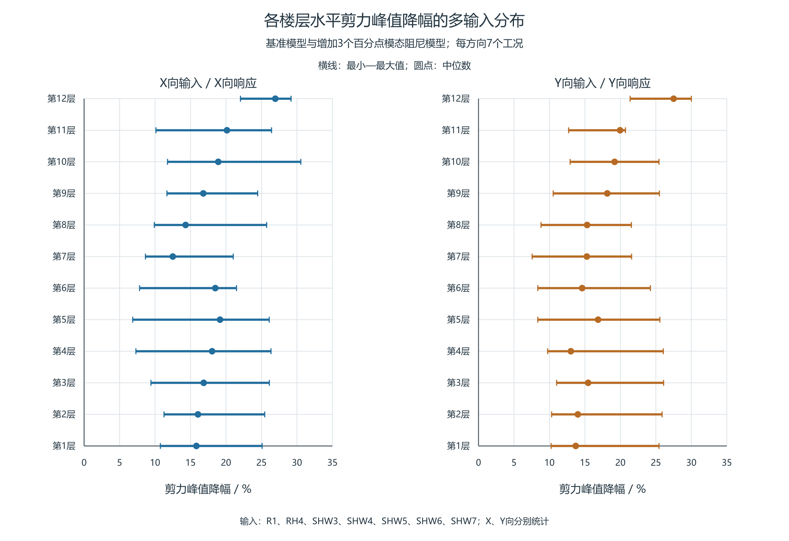
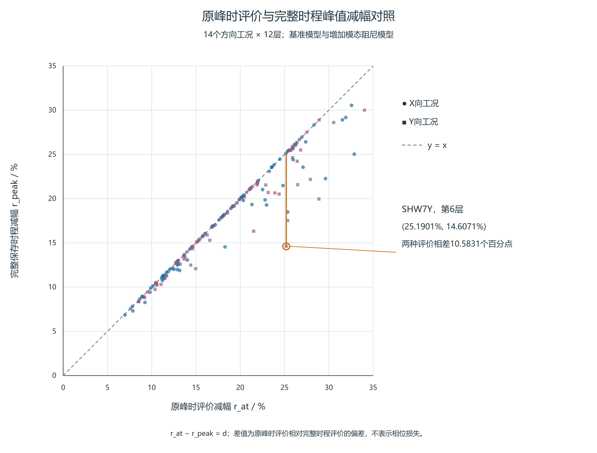
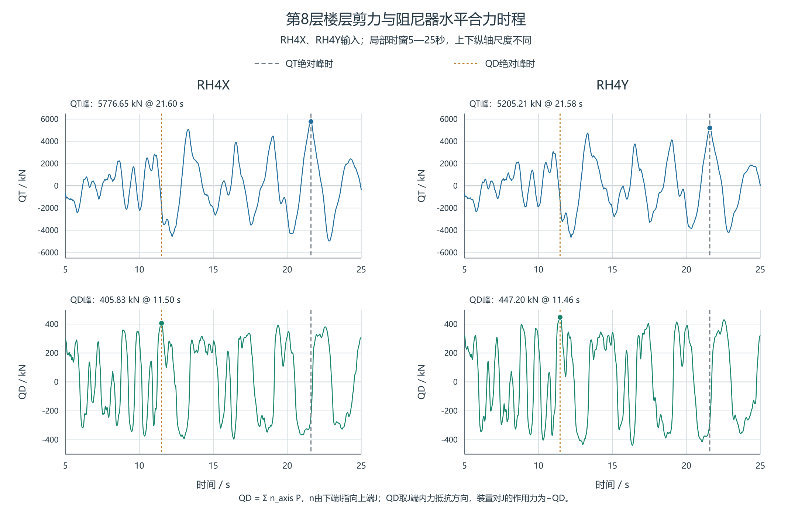

# 附加阻尼作用下双塔连体结构楼层剪力的分层评价

**Story-by-story assessment of shear changes under added damping in a coupled twin-tower structure**

## 摘要

针对附加阻尼后各层剪力降幅不一致的问题，以一双塔连体结构为例，建立按楼层与输入方向逐项复核的评价流程。采用相同输入的基准模型与增加3个百分点模态阻尼的参考模型，比较14个方向工况、12层的168条剪力记录，统计各层最小、中位和最大减幅，并保留最小减幅控制工况的成对绝对剪力；进一步计算只在基准峰时取值造成的减幅高估量。结果表明，全部记录峰值下降6.85%～30.55%，但底层仅在3个工况取得最小减幅。SHW7X中底层与第7层降幅分别为25.10%和12.50%，仅看底层或各层平均值会遗漏局部改善较小的情况。原峰时评价高估量中位数为0.0558个百分点，最大为10.5831个百分点，说明需同时保留参考模型自身控制峰。装置出力按层剪力控制时刻与其自身峰分别检查，三层模型用于解释小质量参与模态仍可能形成较大局部剪力的机制。所给流程可利用常规时程输出直接形成分层复核表，为确定重点查看的楼层、输入和时段提供依据。

**关键词**：楼层剪力；分层评价；附加阻尼；黏滞阻尼器；时程分析

## Abstract

A story-by-story assessment procedure is presented using ETABS time-history results of a coupled twin-tower structure. It retains the minimum, median and maximum shear reduction for each story and direction, together with paired absolute demands for the case controlling the minimum reduction. Evaluation-time bias distinguishes a value taken at the baseline peak time from comparison of the separate peaks. The baseline and reference model, with three additional percentage points of modal damping, are compared under identical inputs across 168 main-direction records from 14 cases and 12 stories. Peak shear decreases by 6.85–30.55% in all records. Under SHW7X, the reduction at story 7 is 12.50%, compared with 25.10% at the bottom story and a 20.60% arithmetic mean over the 12 stories. Both simplified readings miss the smaller local improvement; the bottom story controls the minimum reduction in only 3 of the 14 cases. Direction-specific ranges and the associated demands provide a basis for selecting stories for time-history inspection. The overstatement from evaluation only at the baseline peak time has a median of 0.0558 and a maximum of 10.5831 percentage points. Damper-force sums at the shear peak are compared separately with their own peaks, and a three-story model explains local modal superposition. The engineering results support checks that retain story-specific demand, input range and simultaneous damper forces.

**Keywords**: story shear; story-by-story assessment; added damping; viscous damper; time-history analysis

## 1 引言

附加阻尼方案的楼层剪力复核，既要回答峰值是否降低，也要确定改善较小和绝对需求较大的楼层及输入。底层剪力和各层减幅平均值便于概括总体变化，却不能给出每一层的改善程度；仅在原模型峰时读取调整后响应，还可能漏掉调整后模型自身的控制峰。因此，工程结果应同时保留楼层、方向、输入、成对峰值与各自峰时，使总体评价能够落实为需要查看的具体时程。

已有研究通常围绕明确的性能目标评价阻尼设置。柳博哲和汪梦甫比较了阻尼参数对梁端铰接钢管混凝土框架—核心筒结构基底剪力及变形的影响[1]。Liu等依据指定响应的主要振型及装置位置调整钢框架的阻尼器配置，指出较大的有效阻尼未必使不同目标响应同时获得最佳控制效果[2]。De Domenico和Hajirasouliha以层间位移角反馈调整非线性黏滞阻尼器的系数分布，并采用天然地震记录开展非线性时程检验[3]。这些方法说明评价应与目标响应相联系；对已有计算结果，仍需逐层查看不同输入下的改善范围和绝对需求。

楼层剪力的输出定义和取值时刻也影响结果解释。Song等对弹性层剪力与含阻尼作用的广义层剪力采用不同输出系数[4]；Londoño等说明Maxwell支撑柔度随频率改变传力幅值和相位[5]；Conde和Bernabeu讨论了储能、损耗及等能线性化的频率依赖[6]。因此，本文先固定软件输出位置和峰值口径，再比较工程记录；装置出力仅用于查看同刻受力，三层模型仅用于解释局部输出与模态叠加。

本文以双塔连体结构的已有时程结果为对象，形成按楼层和输入方向复核剪力的步骤：先逐输入求两模型各自的峰值和减幅，再列每层多输入范围，区分最小减幅与最大参考剪力的控制记录，最后检查控制峰附近时程及原峰时评价的偏差。研究重点是将常规输出组织为可直接查阅的工程记录，并通过本例说明底层、平均值和原峰时读数各会遗漏什么。

## 2 工程模型与数据范围

### 2.1 比较模型和软件输出

采用双塔连体结构的ETABS时程分析结果。核心比较为基准阻尼模型与增加3个百分点模态阻尼的参考模型，分别记为基准模型和参考模型；所提供输入对照表明，两者对应工况的输入逐样本一致。另有设置黏滞阻尼器的模型，覆盖RH4、SHW4、SHW7三组输入各X/Y方向，仅用于独立查看装置出力时序。

现有资料尚未形成三模型完整质量、刚度及全部求解设置的逐项对照，阻尼器模型与另两模型的输入配对也未完全补齐。本文以已配对的基准—参考结果讨论逐层剪力变化，不将实体装置模型与参考模型的峰值差解释为安装装置产生的减剪率。[三模型峰值的补充对照](../../../research/sessions/20261102-1917/roles/role5/R001/descriptive-three-model-comparison.md)保留原有并列记录。

楼层剪力取软件Story Forces表中楼层底部（Bottom位置）的输出，Story1—12对应本文第1—12层。现有导出未完整说明该剪力中所列阻尼器作用的包含方式、截面侧别及正方向，因此直接比较软件输出，不再扣除装置合力或另称主体抗力。各模型均在各自完整保存时程中求剪力绝对峰，峰时分别记录。

### 2.2 方向工况和保存时程

基准与参考模型包含X、Y方向各七工况，共14个方向工况；每工况覆盖12层，形成168条主方向成对记录。统计按方向分别进行，每层的七条记录保留原工况身份。X/Y方向记录不能直接计为独立地震事件；其中与阻尼器模型共同的RH4、SHW4、SHW7三组输入构成六个方向工况，其最小值也与全14工况的最小值分开报告。

两模型的逐条峰值比较采用共同保存时间集，时间单位为s、剪力单位为kN。已有结果保留各自控制峰时；输入记录来源、选取依据、缩放系数及保存网格的完整清单仍需与工程模型资料一并补齐。以下统计限定于所提供输入和保存时程，不作独立事件概率或连续时间峰值的推断。

工程几何资料包含3416个节点和88只Link；装置时序分析仅覆盖第8—11层32只装置在六工况下的轴力与变形，不将其补作全楼装置出力。资料范围及用途见表1。

**表1 计算资料范围及工程用途**

|资料|范围|本文用途|
|---|---|---|
|基准与参考模型的楼层剪力|14工况×12层，168条主方向记录|同输入逐层比较峰值、减幅和峰时|
|阻尼器模型的楼层剪力|RH4、SHW4、SHW7各X/Y六工况，72条主方向记录|与另两模型并列描述输出|
|装置轴力与变形|第8—11层32只装置×六工况|分析已有楼层装置合力及出力时序|

### 2.3 模态资料及解释用途

三模型前三阶周期在所示精度下相同，约为2.7781、2.7322、2.5669s；主要方向参与质量分别为第一阶UY 65.22%、第二阶UX 64.87%、第三阶RZ 64.34%。在各自300阶汇总中按方向质量排序，X向前三重要阶次为2/4/10，Y向为1/5/11。周期接近和质量排序不能代替完整模型配对，也不能直接给出目标层的剪力贡献。

工程结构的逐阶剪力分解还需要对应节点振型、响应时程和输出映射。本文利用工程资料比较逐层结果，并在参数完整的三层剪切模型中说明小方向有效质量与局部剪力的关系。

## 3 逐层多输入复核方法

### 3.1 先逐输入保留成对峰值

对楼层s、方向a和同一输入工况c，先在共同保存时间集T内分别求基准与参考模型的剪力绝对峰，并记录各自峰时：

$$P_{B,s,a,c}=\max_{t\in T}|V_{B,s,a,c}(t)|,\qquad P_{M,s,a,c}=\max_{t\in T}|V_{M,s,a,c}(t)|.$$

逐层减幅定义为：

$$r_{\mathrm{peak},s,a,c}=1-\frac{P_{M,s,a,c}}{P_{B,s,a,c}},\qquad P_{B,s,a,c}>0.$$

对每层每方向的七工况，分别统计减幅最小值、中位值和最大值；中位值取排序后的中间记录。每条结果保留工况、两模型绝对峰和各自峰时。这样既可查看改善范围，也能回到同一输入下的绝对剪力需求。

### 3.2 最小减幅与最大绝对需求分别查看

对固定楼层和方向，在同一输入集合C内分别选取最小减幅控制输入c_r与最大参考剪力控制输入c_V：

$$c_r\in\operatorname{argmin}_{c\in C}r_{\mathrm{peak},s,a,c},\qquad c_V\in\operatorname{argmax}_{c\in C}P_{M,s,a,c}.$$

前者用于定位改善较小的输入，后者用于查看参考模型的较大绝对需求。每个控制输入均保留其自身的P_B、P_M、减幅、原峰时评价偏差及两模型峰时；两输入不同时，分别查看两条时程。并列控制时保留全部工况或事先约定的稳定排序规则，不把不同输入的百分比、剪力和峰时拼为一条记录。

表2、表3先给出各层减幅范围及c_r对应的绝对需求。最大P_M所对应的成对减幅仍取同一输入的P_B为分母，不另以两模型分别跨输入取最大值的比例替代。缺少各层截面、配筋、承载力及组合资料时，这两类记录用于需求与改善复核，不据此排列结构安全程度。

### 3.3 原峰时评价与各自峰值比较

记t_B为该条记录的基准峰时，A=|V_M(t_B)|。若只在t_B读取参考模型剪力，所得减幅r_at及其高估量d为：

$$r_{\mathrm{at}}=1-\frac{A}{P_B},\qquad d=\frac{P_M-A}{P_B}\ge0,\qquad r_{\mathrm{peak}}=r_{\mathrm{at}}-d.$$

P_M是同一保存时间集上的绝对最大值，因此d非负；乘以100后单位为百分点。d说明评价时刻选择造成的读数差别，计算它仍需参考模型完整时程，不将其解释为相位或某阶振型的贡献。P_B=0时归一量不定义；并列基准峰须采用预定取值规则，本文原有记录按所列峰时取值，尚未遍历所有并列峰。

上述各量先逐条记录计算，再按楼层和方向汇总。不能用一个工况的r_at最小值扣除另一个工况的d最大值。较大的d提示需要同时查看参考模型自身控制峰，即使基准峰附近的响应已经明显减小。

例如SHW7X第7层，P_B=8481.8301kN、P_M=7421.3995kN，完整峰减幅为(1−7421.3995/8481.8301)×100%=12.5024%。同一工况底层减幅25.0972%，十二层减幅算术平均20.6023%，分别高12.5948和8.1000个百分点。底层或平均值均不能代替该层结果；各层减幅的算术平均也不代表总剪力减幅。

## 4 工程结果与复核要求

### 4.1 多输入下的改善范围与控制楼层

表2、表3按方向给出各层多输入范围，表中绝对剪力始终取最小减幅对应的同一工况。X/Y分别有七条方向记录；共同三波族的X/Y六工况不是六个独立事件。

**表2 X向各层七工况减幅范围及最小值对应绝对剪力**

|楼层|最小/%|中位/%|最大/%|最小值工况|P_B/kN|P_M/kN|
|---|---:|---:|---:|---|---:|---:|
|1|10.751|15.828|25.097|SHW4X|11399.73|10174.19|
|2|11.265|16.050|25.457|SHW3X|12582.62|11165.22|
|3|9.421|16.855|26.108|SHW3X|10495.37|9506.65|
|4|7.300|18.044|26.345|SHW3X|9164.94|8495.88|
|5|6.851|19.163|26.091|SHW3X|8691.64|8096.15|
|6|7.823|18.492|21.479|SHW3X|8516.50|7850.29|
|7|8.646|12.502|21.022|SHW3X|8140.43|7436.63|
|8|9.900|14.308|25.730|SHW3X|7511.24|6767.66|
|9|11.677|16.800|24.466|SHW3X|6625.36|5851.74|
|10|11.758|18.910|30.546|SHW6X|6865.20|6057.99|
|11|10.128|20.134|26.419|SHW6X|3297.45|2963.47|
|12|22.039|26.949|29.173|SHW7X|702.07|547.34|

**表3 Y向各层七工况减幅范围及最小值对应绝对剪力**

|楼层|最小/%|中位/%|最大/%|最小值工况|P_B/kN|P_M/kN|
|---|---:|---:|---:|---|---:|---:|
|1|10.243|13.707|25.443|SHW3Y|12253.15|10998.03|
|2|10.307|14.001|25.879|SHW3Y|11896.41|10670.27|
|3|11.010|15.456|26.091|SHW3Y|10415.33|9268.65|
|4|9.747|13.018|26.052|SHW3Y|9278.28|8373.96|
|5|8.354|16.858|25.565|SHW3Y|8723.97|7995.21|
|6|8.359|14.607|24.228|SHW3Y|8523.03|7810.60|
|7|7.561|15.269|21.580|SHW4Y|7343.57|6788.32|
|8|8.813|15.312|21.552|SHW4Y|6281.04|5727.50|
|9|10.531|18.149|25.496|SHW3Y|6747.48|6036.92|
|10|12.920|19.188|25.444|SHW3Y|5485.65|4776.91|
|11|12.699|19.956|20.714|R1Y|2442.77|2132.55|
|12|21.377|27.505|30.002|SHW7Y|842.24|662.20|

14工况、12层共168条主方向记录峰全部下降，减幅为6.8513%～30.5458%，未发现主方向反增。表4列与阻尼器模型共同的六工况中各自下降最少的楼层。

**表4 基准与参考模型共同六工况的最小减幅记录**

|工况|楼层|P_B/kN|P_M/kN|减幅/%|峰时（基准→参考）/s|
|---|---|---:|---:|---:|---|
|RH4X|第7层|6725.06|5438.72|19.128|21.58→21.56|
|RH4Y|第1层|10123.05|8735.50|13.707|12.20→12.20|
|SHW4X|第1层|11399.73|10174.19|10.751|29.94→29.92|
|SHW4Y|第7层|7343.57|6788.32|7.561|29.84→29.86|
|SHW7X|第7层|8481.83|7421.40|12.502|38.12→38.10|
|SHW7Y|第6层|8091.99|6909.98|14.607|48.88→38.10|

共同六工况中，SHW4Y的第7层减幅最小，约7.561%；全14工况最小值则来自SHW3X的第5层，为6.851%。样本范围不同，不能混作同一最小记录。本组各层记录均下降，但降幅随楼层和输入变化。

在14工况中，底层恰为最小减幅层的仅3项，共同六工况中为2项。第1、6、7层各在3个方向工况中取得最小减幅，并列最高；对应去重波族数分别为3、2、3，不能将方向次数解释为独立事件次数。

全14工况最大绝对峰时迁移为12.76s。峰时差可能包含不同波包或控制峰的切换，不是相位角，也不能单独判定某阶模态因果。

图1 X、Y方向各层七工况的剪力峰减幅范围。横线为最小至最大值，圆点为中位数；各工况分别由两模型完整保存时程的绝对峰计算减幅。

### 4.2 原峰时评价的偏差

在全部168项记录中，仅在基准峰时评价的减幅高估量d中位数为0.0558个百分点，95%分位数为4.5906个百分点，最大为10.5831个百分点（图2）。分位数按排序位置(n−1)p线性插值计算。这些结果表明偏差分布不均，不能用最大项代表全部记录。

最大项位于SHW7Y第6层。基准峰P_B=8091.9866kN，参考模型完整峰P_M=6909.9848kN，而在基准峰时参考剪力为−6053.6058kN，代入时取绝对值A=6053.6058kN。仅看原峰时得到25.1901%改善，完整时程峰减幅则为14.6071%，两者相差10.5831个百分点；基准与参考峰时分别为48.88s、38.10s。因此，该工况须同时保留参考模型自身控制峰。

图2 168条配对记录的原峰时评价减幅r_at与完整保存时程峰值减幅r_peak。虚线为两者相等；低于虚线的竖向差为d，单位为百分点。标注点为SHW7Y第6层，X/Y方向分别标示。

### 4.3 独立装置模型的出力时序

第8层所列阻尼器的I端位于第7层，J端位于第8层，单位方向向量n由I指向J。在导出轴力P取正拉力的约定下，本节QD=Σn_eP是J端结构内力抵抗项，装置对J节点的外力为−QD。每个主输入方向有4只非零投影装置，表中合力保留该层8只装置的方向投影。

**表5 第8层两例装置水平合力与楼层底部剪力**

|工况|QT绝对峰/kN（时刻/s）|QD绝对峰/kN（时刻/s）|QT峰时QD/kN|QT峰时QD绝对值／QD自身绝对峰/%|tQD−tQT/s|
|---|---|---|---:|---:|---:|
|RH4X|5776.6513（21.60）|405.8268（11.50）|-238.1133|58.6736|-10.10|
|RH4Y|5205.2112（21.58）|447.2019（11.46）|-279.6257|62.5278|-10.12|

第8层六工况在QT峰时的|QD|相对QD自身绝对峰为48.5899%～65.9515%。RH4X/Y中，装置合力自身峰比层剪峰分别早10.10s和10.12s；层剪峰时的合力绝对值仅为自身峰的58.6736%和62.5278%。这些比例描述同刻出力相对于本输出峰的大小，不是减震贡献率、耗能效率或利用率。

因此，比较层剪力需求与装置出力时，应同时查看层剪力峰时的有符号合力和装置自身峰。

图3 第8层在RH4X、RH4Y工况下的软件输出楼层剪力与装置水平合力时程。图示5～25s的原采样值，未作平滑处理；上下子图纵坐标范围分别为±6500kN和±500kN。虚线标出各自完整记录的绝对峰时刻。QD为J端内力抵抗项，装置对节点J的外力为−QD。

## 5 局部剪力与模态叠加的简化说明

为说明方向有效质量与局部剪力对应不同输出，采用无量纲单向三层模型，M=diag(1,1.2,.8)，K=[[2.4,−1,0],[−1,1.7,−.7],[0,−.7,.7]]，C=.02K；比较无装置与第1层κ=.5、c=.02、α=.3的Maxwell装置方案。人工输入H2有意含第二阶及近第三阶频率。输入、零初态、本构及隐式中点积分条件见[参数补充](../../../research/sessions/20261021-0737/roles/role5/R001-methods-supplement.md)。

在完整质量归一参考基中，第s层弹性剪力为：

$$V_s(t)=\sum_r(\ell_s^T\phi_r)q_r(t).$$

ℓ_s包含楼层刚度与输出映射，q来自完整耦合响应投影。表6中第三阶方向有效质量仅4.7892%，第1、2层反向运动却使层间差达到−1.316516；因k2=1，该差也为第2层剪力系数。系数并非剪力占比，须与实际响应及同刻叠加一起解释。

**表6 三层模型的方向有效质量及第2层剪力系数**

|阶次|方向有效质量比/%|第2层剪力系数（无量纲）|
|---|---:|---:|
|1|87.0289|+0.315637|
|2|8.1819|-0.022186|
|3|4.7892|-1.316516|

两个共同控制时刻的第三阶变化均朝零发展，但前两项变化部分抵消该作用，各阶自身峰的变化不能代替控制时刻的合成变化。该模型前两阶累计质量95.2108%，由同一完整响应仅保留前两阶后，第2层剪力峰分别低估43.3215%和41.6360%。这是人工H2输入下的后验重构，不是减少振型后重新求解；单向第三阶也不对应工程结构的扭转阶次。工程复核应据目标输出检查模态数量影响，不将这些比例直接移用于实际建筑。

## 6 工程复核的实施步骤

首先核对基准与参考模型的输入、单位、保存时间集和剪力输出位置，并集中列明质量、刚度、阻尼及求解设置的对照范围。按楼层、方向、工况形成成对记录，分别保存两模型峰值与峰时。输入来源和缩放说明随结果表提供，使每项需求能够回查。

其次逐方向阅读各层减幅范围，找出改善较小的楼层；同时查看该层最大参考剪力的控制输入。对两类控制记录分别保留绝对需求，不把改善较小直接等同于承载力最不利。SHW4Y第7层是共同六工况中改善较小的记录，全14工况则由SHW3X第5层控制，说明复核对象必须随所采用输入集合确定。

然后查看所选输入下目标层及相邻楼层的时程，同时标出两模型自身控制峰。将r_peak、r_at和d列在同一条记录中，必要时扩大到其他输入的控制时段。SHW7Y第6层应保留48.88s和38.10s两个时段，不能只看原峰附近；底层和各层平均减幅只作同工况的对照读数。

最后将剪力需求与层间位移角分别检查，并对独立装置模型查看连接方向、剪力峰时有符号合力和装置自身峰。装置轴力峰、层剪力峰及漂移控制层对应不同需求，应分别核对。CSI手册指出，动力荷载参与率主要反映模态基对荷载空间分布的覆盖，响应精度还与时间变化的频率成分有关，应改变模态数量检查不同动力荷载的响应[7]。目标层剪力宜据增阶后的峰值及控制时段检查稳定性，累计质量阈值不直接给出局部内力误差界。

## 7 结论

（1）本例同输入基准与参考模型的168条主方向记录剪力峰全部下降6.85%～30.55%，但各层改善程度不同。共同六工况的最小记录为SHW4Y第7层，约7.561%；全14工况的最小记录位于SHW3X第5层，约6.851%，复核对象随输入范围改变。

（2）底层为最小减幅层的仅3/14工况。SHW7X第7层减幅12.5024%，明显低于底层25.0972%及楼层算术平均20.6023%。逐层复核应分别查看最小减幅和最大参考剪力的控制输入，各自保留成对峰值和峰时；改善差异与绝对需求对应不同问题。

（3）原峰时评价高估量的中位数为0.0558个百分点，但SHW7Y第6层达到10.5831个百分点。应先逐工况比较原峰时和自身控制峰，再汇总各层结果，避免用另一工况的最大偏差解释最小减幅。

（4）第8层RH4X、RH4Y两例中，剪力峰时装置合力绝对值为其自身峰的58.6736%和62.5278%。装置自身峰不能替代控制剪力时刻的出力；这些比例用于说明时序，不作为减震贡献率。

（5）三层模型表明，小方向有效质量仍可形成较大局部剪力项。工程剪力评价除检查质量覆盖外，还需复核目标输出的模态数量影响及控制时段，而不能将简化模型的逐阶比例直接移用于工程结构。

## 参考文献

[1] 柳博哲, 汪梦甫. 梁端铰接钢管混凝土框架-核心筒结构的减震研究[J]. 世界地震工程, 2024, 40(3): 142–153. DOI:10.19994/j.cnki.WEE.2024.0053.

[2] LIU W, TONG M, WU Y, LEE G C. Optimized Damping Device Configuration Design of a Steel Frame Structure Based on Building Performance Indices[J]. Earthquake Spectra, 2004, 20(1): 67–89. DOI:10.1193/1.1648334.

[3] DE DOMENICO D, HAJIRASOULIHA I. Multi-level performance-based design optimisation of steel frames with nonlinear viscous dampers[J]. Bulletin of Earthquake Engineering, 2021, 19: 5015–5049. DOI:10.1007/s10518-021-01152-7.

[4] SONG J, CHU Y L, LIANG Z, LEE G C. Modal Analysis of Generally Damped Linear Structures Subjected to Seismic Excitations[R]. Buffalo: University at Buffalo, State University of New York, 2008. Technical Report MCEER-08-0005.

[5] LONDOÑO J M, WAGG D J, NEILD S A. Supporting brace sizing in structures with added linear viscous fluid dampers: A filter design solution[J]. Earthquake Engineering & Structural Dynamics, 2014,43:1999–2013. DOI:10.1002/eqe.2433.

[6] CONDE J, BERNABEU A. Influence of Maxwell Stiffness in Damage Control and Analysis of Structures with Added Viscous Dampers[J]. Applied Sciences, 2021,11:3089. DOI:10.3390/app11073089。

[7] COMPUTERS & STRUCTURES, INC. CSi Analysis Reference Manual: for SAP2000, ETABS, SAFE and CSiBridge[M]. Rev.15. Berkeley: Computers & Structures, Inc., 2016. ISO#GEN062708M1.
