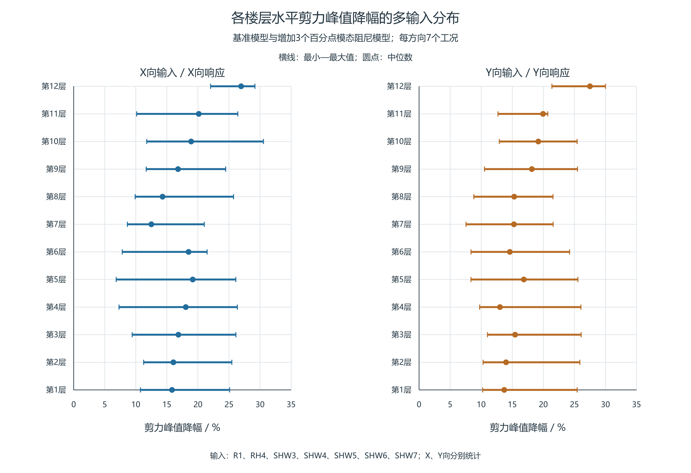
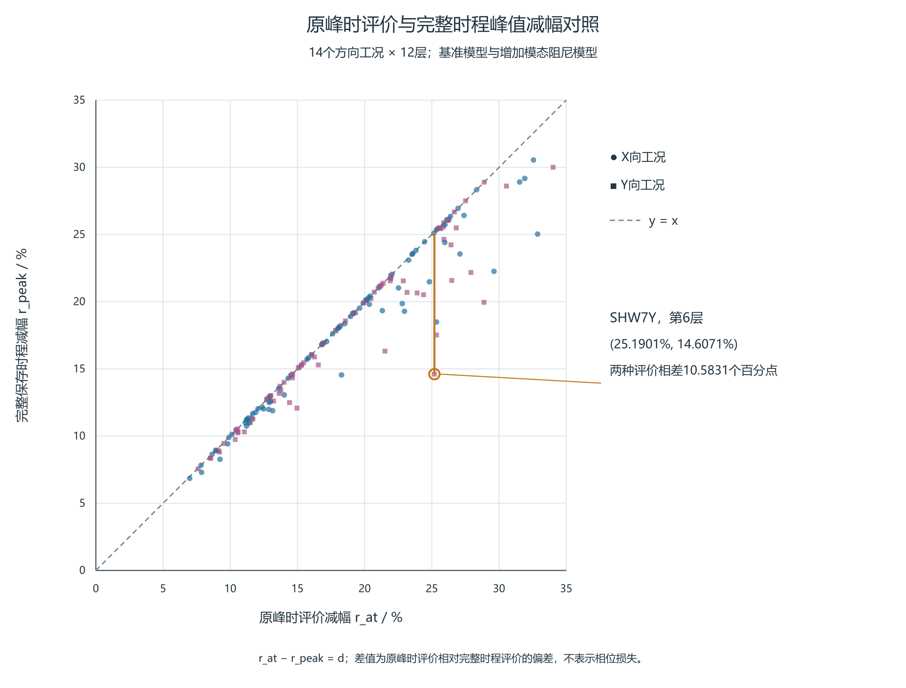
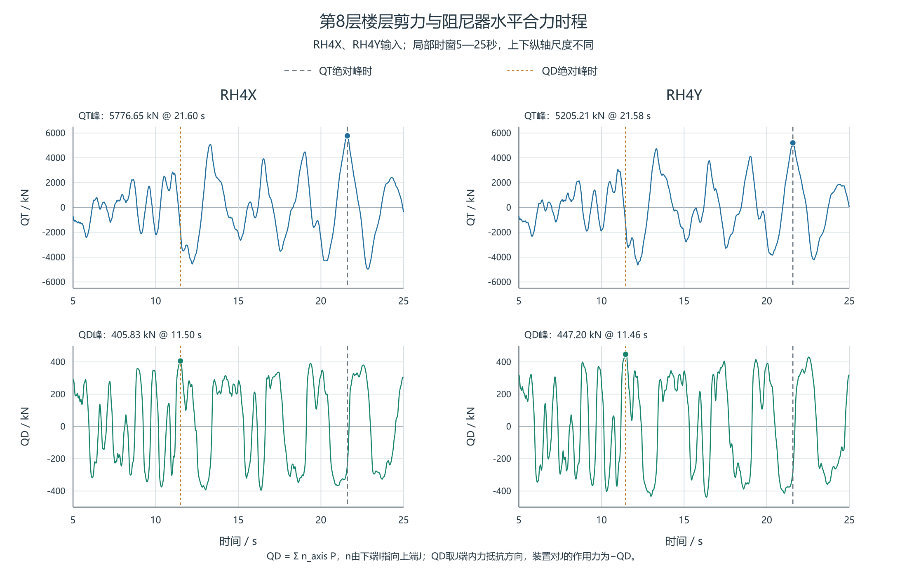

# 附加阻尼作用下双塔连体结构楼层剪力的分层评价

**Story-by-story assessment of shear changes under added damping in a coupled twin-tower structure**

## 摘要

附加阻尼后，同一楼层剪力“减幅最小”和“绝对需求最大”的控制输入可能不同，工程复核需分别保留两类记录。本文以双塔连体结构为例，比较相同输入下基准模型与增加3个百分点模态阻尼的参考模型，整理14个方向工况、12层的168条成对记录，发现24个楼层—方向组中有19组的两类控制输入不同。X向第5层最小减幅为SHW3X下的6.8513%，最大参考剪力则为SHW4X下的9027.7451kN，后者自身减幅为11.3022%。固定300阶线性参照显示，SHW3X的第13阶项在基准峰时由反向抵消转为同向作用，抵消部分剪力下降；SHW4X较大需求则对应更大的第2阶项。两类控制输入需分别辨认模态组成。底层仅在3个方向工况中取得最小减幅；仅在基准峰时评价的减幅高估量中位数为0.0558个百分点，最大为10.5831个百分点。复核流程据此分别检查改善、绝对需求、同刻模态项及装置两端运动，为主体受力与消能方案的进一步比选提供依据。

**关键词**：楼层剪力；分层评价；多输入复核；附加阻尼；时程分析

## Abstract

After damping is added, the input producing the smallest story-shear reduction may differ from that producing the largest absolute demand, so both governing records need to be retained in engineering checks. For a coupled twin-tower structure, the baseline model and a reference model with three additional percentage points of modal damping are compared under identical inputs. Among 168 paired records from 14 directional cases and 12 stories, the two governing inputs differ in 19 of the 24 story-direction groups. At Story 5 in the X direction, SHW3X gives the minimum reduction of 6.8513%, whereas SHW4X governs the reference demand of 9027.7451 kN with its own reduction of 11.3022%. A fixed 300-mode linear reference distinguishes two modal effects. Under SHW3X, the mode-13 term changes from opposing to reinforcing the total shear at the baseline peak time, offsetting part of the shear decrease. The larger demand under SHW4X instead corresponds to a larger mode-2 term. Modal composition is therefore examined separately for the two governing inputs. The bottom story gives the minimum reduction in only three directional cases. Evaluation at the baseline peak time overstates the reduction by a median of 0.0558 and a maximum of 10.5831 percentage points. The procedure checks improvement, absolute demand, simultaneous modal terms and relative damper-end motion separately to inform subsequent comparison of structural and damping schemes.

**Keywords**: story shear; story-by-story assessment; multi-input assessment; added damping; response-history analysis

## 1 引言

附加阻尼方案的楼层剪力复核，既要回答峰值是否降低，也要确定改善较小和绝对需求较大的楼层及输入。底层剪力和各层减幅平均值便于概括总体变化，却不能给出每一层的改善程度；仅在原模型峰时读取调整后响应，还可能漏掉调整后模型自身的控制峰。工程评价应落实到具体楼层、输入和响应指标，使总体比较能够转为需要查看的时程记录。

已有研究从不同控制目标和沿高度配置评价阻尼设置。柳博哲和汪梦甫比较了阻尼参数对梁端铰接钢管混凝土框架—核心筒结构基底剪力及变形的影响[1]。Liu等依据指定响应的主要振型调整钢框架的阻尼器配置，指出较大的有效阻尼未必使不同目标响应同时获得最佳控制效果[2]。De Domenico和Hajirasouliha通过沿高度性能反馈调整非线性黏滞阻尼器，并采用地震记录检验钢框架响应[3]。张敏、李阳采用状态方程法研究阻尼器布置与各层变形响应的关系[4]；陈泰锟等比较沿高度布设非对称阻尼器时的层间位移角、加速度与基底剪重比，并开展混合模拟验证[5]。这些研究提供了目标响应与楼层位置相结合的评价背景。

Cetin等在三条地震记录下分别比较楼层位移、绝对加速度及层间位移角，说明多输入结果应与具体响应指标对应[6]。本文着重楼层剪力：最小减幅用于识别改善较小的记录，最大参考剪力用于查看绝对需求，二者未必由同一输入控制。Song等对弹性层剪力与含阻尼作用的广义层剪力采用不同输出系数[7]，提示比较前还需固定输出定义。对于实体装置，Londoño等指出支撑柔度会随频率改变传力幅值和相位[8]，Conde和Bernabeu讨论装置整体柔度对不同楼层及响应变量的影响[9]。这类装置模型因素与统一增加模态阻尼不同，本文将实体装置出力另作时序描述。

本文以双塔连体结构的已有时程结果为例，逐输入保留两模型的成对剪力峰和各自控制峰时，按方向汇总各层减幅范围，分别列最小减幅与最大参考需求的控制记录。通过底层和平均值对照、原峰时评价偏差及装置同刻出力，形成可由常规输出实施的分层复核步骤；三层模型仅辅助说明局部剪力与模态叠加的关系。

## 2 工程模型与数据范围

### 2.1 比较模型和软件输出

采用双塔连体结构的ETABS时程分析结果。核心比较为基准阻尼模型与增加3个百分点模态阻尼的参考模型，分别记为基准模型和参考模型；所提供输入对照表明，两者对应工况的输入逐样本一致。另有设置黏滞阻尼器的模型，覆盖RH4、SHW4、SHW7三组输入各X/Y方向，仅用于独立查看装置出力时序。

现有资料尚未形成三模型完整质量、刚度及全部求解设置的逐项对照，阻尼器模型与另两模型的输入配对也未完全补齐。本文以已配对的基准—参考结果讨论逐层剪力变化，不将实体装置模型与参考模型的峰值差解释为安装装置产生的减剪率。[三模型峰值的补充对照](../../../research/sessions/20261102-1917/roles/role5/R001/descriptive-three-model-comparison.md)保留原有并列记录。

楼层剪力取软件Story Forces表中楼层底部（Bottom位置）的输出，Story1—12对应本文第1—12层。现有导出未完整说明该剪力中所列阻尼器作用的包含方式、截面侧别及正方向，因此直接比较软件输出，不再扣除装置合力或另称主体抗力。各模型均在各自完整保存时程中求剪力绝对峰，峰时分别记录。

### 2.2 方向工况和保存时程

基准与参考模型包含X、Y方向各七工况，共14个方向工况；每工况覆盖12层，形成168条主方向成对记录。统计按方向分别进行，每层的七条记录保留原工况身份。X/Y方向记录不能直接计为独立地震事件；其中与阻尼器模型共同的RH4、SHW4、SHW7三组输入构成六个方向工况，其最小值也与全14工况的最小值分开报告。

配套输入与导出元信息表明，14个方向工况的输入逐样本一致，168条成对输出的保存时间逐点一致；输入PGA均为350mm/s²，即0.35m/s²。名义保存间隔为0.02s，各工况点数与时窗见[资料说明及完整附表](../../../research/sessions/20261102-1917/roles/role5/R002/engineering-data-and-full-tables.md)。时间按s、剪力按kN列示。保存间隔不等于内部积分步，名义输入标签也不能单独确定独立地震事件。输入来源、倍率、时间缩放和完整模型设置的缺项集中列于该说明，以下结果限定于现有配对资料和保存时程。

工程几何资料包含3416个节点和88只Link；装置时序分析仅覆盖第8—11层32只装置在六工况下的轴力与变形，不将其补作全楼装置出力。资料范围及用途见表1。

**表1 计算资料范围及工程用途**

|资料|范围|本文用途|
|---|---|---|
|基准与参考模型的楼层剪力|14工况×12层，168条主方向记录|同输入逐层比较峰值、减幅和峰时|
|阻尼器模型的楼层剪力|RH4、SHW4、SHW7各X/Y六工况，72条主方向记录|定位装置模型自身的剪力控制时刻，辅助独立出力时序检查|
|装置轴力与变形|第8—11层32只装置×六工况|分析已有楼层装置合力及出力时序|

### 2.3 模态资料及解释用途

三模型前三阶周期在所示精度下相同，约为2.7781、2.7322、2.5669s；主要方向参与质量分别为第一阶UY 65.22%、第二阶UX 64.87%、第三阶RZ 64.34%。在各自300阶汇总中按方向质量排序，X向前三重要阶次为2/4/10，Y向为1/5/11。周期接近和质量排序不能代替完整模型配对，也不能直接给出目标层的剪力贡献。

工程结构的逐阶剪力分析需结合振型、响应时程及相应的内力输出关系。本文以软件楼层剪力作为工程需求依据，并用固定300阶线性参照辅助比较SHW3X与SHW4X下第5层的模态项；参数完整的三层剪切模型用于说明方向有效质量与局部剪力对应不同输出。

## 3 逐层多输入复核方法

### 3.1 先逐输入保留成对峰值

对楼层s、方向a和同一输入工况c，先在共同保存时间集T内分别求基准与参考模型的剪力绝对峰，并记录各自峰时：

$$P_{B,s,a,c}=\max_{t\in T}|V_{B,s,a,c}(t)|,\qquad P_{M,s,a,c}=\max_{t\in T}|V_{M,s,a,c}(t)|.$$

逐层减幅定义为：

$$r_{\mathrm{peak},s,a,c}=1-\frac{P_{M,s,a,c}}{P_{B,s,a,c}},\qquad P_{B,s,a,c}>0.$$

对每层每方向的七工况，分别统计减幅最小值、中位值和最大值；中位值取排序后的中间记录。每条结果保留工况、两模型绝对峰和各自峰时。这样既可查看改善范围，也能回到同一输入下的绝对剪力需求。

### 3.2 最小减幅与最大绝对需求分别查看

对固定楼层和方向，在同一输入集合C内分别选取最小减幅控制输入c_r与最大参考剪力控制输入c_V：

$$c_r\in\operatorname{argmin}_{c\in C}r_{\mathrm{peak},s,a,c},\qquad c_V\in\operatorname{argmax}_{c\in C}P_{M,s,a,c}.$$

前者用于定位改善较小的输入，后者用于查看参考模型的较大绝对需求。每个控制输入均保留其自身的P_B、P_M、减幅、原峰时评价偏差及两模型峰时；两输入不同时，分别查看两条时程。并列控制时保留全部工况或事先约定的稳定排序规则，不把不同输入的百分比、剪力和峰时拼为一条记录。

表2列代表层的两类控制记录，完整24组见附表；减幅最小、中位和最大范围仍由图1展示。最大P_M所对应的成对减幅仍取同一输入的P_B为分母，不另以两模型分别跨输入取最大值的比例替代。缺少各层截面、配筋、承载力及组合资料时，这两类记录用于需求与改善复核，不据此排列结构安全程度。

### 3.3 原峰时评价与各自峰值比较

记t_B为该条记录的基准峰时，A=|V_M(t_B)|。若只在t_B读取参考模型剪力，所得减幅r_at及其高估量d为：

$$r_{\mathrm{at}}=1-\frac{A}{P_B},\qquad d=\frac{P_M-A}{P_B}\ge0,\qquad r_{\mathrm{peak}}=r_{\mathrm{at}}-d.$$

P_M是同一保存时间集上的绝对最大值，因此d非负；乘以100后单位为百分点。d说明评价时刻选择造成的读数差别，计算它仍需参考模型完整时程，不将其解释为相位或某阶振型的贡献。P_B=0时归一量不定义；并列基准峰须采用预定取值规则，本文原有记录按所列峰时取值，尚未遍历所有并列峰。

上述各量先逐条记录计算，再按楼层和方向汇总。不能用一个工况的r_at最小值扣除另一个工况的d最大值。较大的d提示需要同时查看参考模型自身控制峰，即使基准峰附近的响应已经明显减小。

例如SHW7X第7层，P_B=8481.8301kN、P_M=7421.3995kN，完整峰减幅为(1−7421.3995/8481.8301)×100%=12.5024%。同一工况底层减幅25.0972%，十二层减幅算术平均20.6023%，分别高12.5948和8.1000个百分点。底层或平均值均不能代替该层结果；各层减幅的算术平均也不代表总剪力减幅。

## 4 工程结果与复核要求

### 4.1 多输入下的改善范围与控制楼层

图1给出X、Y方向各层七工况的减幅范围。表2分别保留改善较小与参考需求较大的控制记录；X向第1层用于展示两类记录的区别，第5层为全14工况最小减幅所在层，第7层另结合SHW7X实例对照底层和平均值，该实例与表中输入分别阅读，Y向第7层为共同六工况最小减幅所在层。每行的P_B、P_M和减幅均来自同一输入。完整24组及两类记录各自的d、峰时见[附表](../../../research/sessions/20261102-1917/roles/role5/R002/engineering-data-and-full-tables.md)，原完整范围数表一并保留于该说明。

**表2 代表层两类控制输入及其各自成对峰值**

|方向/楼层|查看用途|输入|P_B/kN|P_M/kN|本输入减幅/%|
|---|---|---|---:|---:|---:|
|X/第1层|最小减幅|SHW4X|11399.73|10174.19|10.7506|
|X/第1层|最大参考剪力|SHW3X|13133.39|11553.05|12.0330|
|X/第5层|最小减幅|SHW3X|8691.64|8096.15|6.8513|
|X/第5层|最大参考剪力|SHW4X|10178.09|9027.75|11.3022|
|X/第7层|最小减幅|SHW3X|8140.43|7436.63|8.6457|
|X/第7层|最大参考剪力|SHW6X|9635.92|8578.86|10.9701|
|Y/第7层|最小减幅|SHW4Y|7343.57|6788.32|7.5610|
|Y/第7层|最大参考剪力|SHW6Y|9573.15|8311.82|13.1758|

24个楼层—方向组中，最小减幅与最大参考剪力由不同输入控制的有19组。因此，仅检查最小减幅输入，不能保证同时检查该层参考模型的最大剪力需求。这个计数描述本工程相关楼层—方向组，不作为独立地震样本的概率。

X向第5层的最小减幅输入为SHW3X，P_B=8691.6380kN、P_M=8096.1503kN，减幅6.8513%，d=0.1333个百分点，峰时22.92→22.94s。最大参考剪力则来自SHW4X，P_B=10178.0915kN、P_M=9027.7451kN，其自身减幅11.3022%，d=0.3021个百分点，峰时29.94→29.92s。前一条用于查看改善较小的时段，后一条用于查看较大需求；不能把6.8513%的减幅标在9027.7451kN需求上。从两条记录本身看，SHW4X的基准剪力比SHW3X高17.10%；增加模态阻尼后，其减幅虽较大，参考剪力仍高11.51%。改善比例与绝对需求因而需要分别查看。

14工况、12层共168条主方向记录峰全部下降，减幅为6.8513%～30.5458%，未发现主方向反增。表3列与阻尼器模型共同六工况子集内各输入下降最少的楼层，仅用于区分输入范围。

**表3 基准与参考模型共同六工况的最小减幅记录**

|工况|楼层|P_B/kN|P_M/kN|减幅/%|峰时（基准→参考）/s|
|---|---|---:|---:|---:|---|
|RH4X|第7层|6725.06|5438.72|19.128|21.58→21.56|
|RH4Y|第1层|10123.05|8735.50|13.707|12.20→12.20|
|SHW4X|第1层|11399.73|10174.19|10.751|29.94→29.92|
|SHW4Y|第7层|7343.57|6788.32|7.561|29.84→29.86|
|SHW7X|第7层|8481.83|7421.40|12.502|38.12→38.10|
|SHW7Y|第6层|8091.99|6909.98|14.607|48.88→38.10|

共同六工况中，SHW4Y的第7层减幅最小，约7.561%；全14工况最小值则来自SHW3X的第5层，为6.851%。样本范围不同，不能混作同一最小记录。本组各层记录均下降，但降幅随楼层和输入变化。

在14工况中，底层恰为最小减幅层的仅3项，共同六工况中为2项。第1、6、7层各在3个方向工况中取得最小减幅，并列最高；对应去重波族数分别为3、2、3，不能将方向次数解释为独立事件次数。

全14工况最大绝对峰时迁移为12.76s。峰时差可能包含不同波包或控制峰的切换，不是相位角，也不能单独判定某阶模态因果。

图1 X、Y方向各层七工况的剪力峰减幅范围。横线为最小至最大值，圆点为中位数；各工况分别由两模型完整保存时程的绝对峰计算减幅。

### 4.2 SHW3X与SHW4X的第5层辅助对照

Liu等通过指定响应的传递函数辨认重要模态，表明不同响应量需要分别考察模态作用[2]。经典阻尼体系中的目标输出可由模态输出系数与相应动态响应在同一时刻合成[7]。据此，对SHW3X和SHW4X下第5层的软件剪力峰作辅助核查。

采用在18个质心集中方向质量条件下识别的质量，配合300阶Ritz模态数据，建立固定经典阻尼线性参照。表4列出参照阻尼取8%时，两输入各自软件峰时的参照项；所列两条软件原始峰值均为负，表中取绝对值；参照项按自身方向保留符号。参照与工程模型的完整设置对应、切口恢复关系及软件正方向尚未逐项核实，这些项仅用于辅助比较，不视为原生软件剪力的唯一逐阶分解。四状态数据和计算条件见[辅助分析资料](../../../research/sessions/20261103-0845/roles/writing/SHW3X-SHW4X-辅助分析资料-v002.md)。

**表4 第5层软件峰值与8%阻尼固定300阶线性参照的有符号项**

|量|SHW3X|SHW4X|
|---|---:|---:|
|软件剪力绝对峰/kN|8096.15|9027.75|
|软件峰时/s|22.94|29.92|
|参照合成/kN|+8096.35|+9028.47|
|相对误差/%|0.00245|0.00806|
|参照第2阶项/kN|+6762.84|+7753.76|
|参照第10阶项/kN|+506.93|+309.55|
|参照第13阶项/kN|+28.36|−1.68|

相对误差按参照合成绝对值与软件剪力绝对峰之比减1后乘100%计算，采用未舍入数值。两条记录的误差分别为0.00245%和0.00806%，表明控制峰幅值高度接近；下述逐阶项仍按固定线性参照解释。

SHW4X较高的峰值在模态组成上主要表现为第2阶项较大：8%阻尼参照中，该项为7753.76kN，高于SHW3X的6762.84kN；第10阶项则较小，第13阶项接近零。同一SHW4X输入下，第2阶项在两种阻尼状态各自软件峰时由8632.39kN降至7753.76kN，说明这里的“较大”指输入之间的幅值差异，而不是增阻尼使该阶响应放大。表4用于辨认各自峰时的组成，绝对需求仍按表2的软件成对峰值复核。

SHW3X的改善较小还可从反向模态项的变化理解。在同一基准峰时22.92s，阻尼由5%增至8%后，参照第2、10阶项分别下降389.52kN和254.14kN，而第13阶项由−42.62kN变为+37.90kN。第13阶原有的反向抵消消失并转为同向作用，其增加的80.51kN抵消了前述两项下降的一部分。因此，反向模态项抵消的变化与主导模态项的幅值差异，应作为两种不同的复核线索：前者说明剪力下降为何会被部分抵消，后者帮助辨认较大绝对需求来自何种模态组成。两种作用可以并存，需在各控制输入下分别检查。两峰时的同刻对照见[机制对照表](../../../research/revisions/20261103-1407-mechanism-classification/机制分类与同刻对照.md)。

### 4.3 原峰时评价的偏差

在全部168项记录中，仅在基准峰时评价的减幅高估量d中位数为0.0558个百分点，95%分位数为4.5906个百分点，最大为10.5831个百分点（图2）。分位数按排序位置(n−1)p线性插值计算。这些结果表明偏差分布不均，不能用最大项代表全部记录。

最大项位于SHW7Y第6层。基准峰P_B=8091.9866kN，参考模型完整峰P_M=6909.9848kN，而在基准峰时参考剪力为−6053.6058kN，代入时取绝对值A=6053.6058kN。仅看原峰时得到25.1901%改善，完整时程峰减幅则为14.6071%，两者相差10.5831个百分点；基准与参考峰时分别为48.88s、38.10s。因此，该工况须同时保留参考模型自身控制峰。

图2 168条配对记录的原峰时评价减幅r_at与完整保存时程峰值减幅r_peak。虚线为两者相等；低于虚线的竖向差为d，单位为百分点。标注点为SHW7Y第6层，X/Y方向分别标示。

### 4.4 独立装置模型的出力时序

第8层所列阻尼器的I端位于第7层，J端位于第8层，单位方向向量n由I指向J。在导出轴力P取正拉力的约定下，本节QD=Σn_eP是J端结构内力抵抗项，装置对J节点的外力为−QD。每个主输入方向有4只非零投影装置，表中合力保留该层8只装置的方向投影。

**表5 第8层两例装置水平合力与楼层底部剪力**

|工况|QT绝对峰/kN（时刻/s）|QD绝对峰/kN（时刻/s）|QT峰时QD/kN|QT峰时QD绝对值／QD自身绝对峰/%|tQD−tQT/s|
|---|---|---|---:|---:|---:|
|RH4X|5776.6513（21.60）|405.8268（11.50）|-238.1133|58.6736|-10.10|
|RH4Y|5205.2112（21.58）|447.2019（11.46）|-279.6257|62.5278|-10.12|

第8层六工况在QT峰时的|QD|相对QD自身绝对峰为48.5899%～65.9515%。RH4X/Y中，装置合力自身峰比层剪峰分别早10.10s和10.12s；层剪峰时的合力绝对值仅为自身峰的58.6736%和62.5278%。这些比例描述同刻出力相对于本输出峰的大小，不是减震贡献率、耗能效率或利用率。

因此，比较层剪力需求与装置出力时，应同时查看层剪力峰时的有符号合力和装置自身峰。

图3 第8层在RH4X、RH4Y工况下的软件输出楼层剪力与装置水平合力时程。图示5～25s的原采样值，未作平滑处理；上下子图纵坐标范围分别为±6500kN和±500kN。虚线标出各自完整记录的绝对峰时刻。QD为J端内力抵抗项，装置对节点J的外力为−QD。

## 5 局部剪力与模态叠加的简化说明

为说明方向有效质量与局部剪力对应不同输出，采用无量纲单向三层模型，M=diag(1,1.2,.8)，K=[[2.4,−1,0],[−1,1.7,−.7],[0,−.7,.7]]，C=.02K；比较无装置与第1层κ=.5、c=.02、α=.3的Maxwell装置方案。人工输入H2有意含第二阶及近第三阶频率。输入、零初态、本构及隐式中点积分条件见[参数补充](../../../research/sessions/20261021-0737/roles/role5/R001-methods-supplement.md)。

在完整质量归一参考基中，第s层弹性剪力为：

$$V_s(t)=\sum_r(\ell_s^T\phi_r)q_r(t).$$

ℓ_s包含楼层刚度与输出映射，q来自完整耦合响应投影。表6中第三阶方向有效质量仅4.7892%，第1、2层反向运动却使层间差达到−1.316516；因k2=1，该差也为第2层剪力系数。系数并非剪力占比，须与实际响应及同刻叠加一起解释。

**表6 三层模型的方向有效质量及第2层剪力系数**

|阶次|方向有效质量比/%|第2层剪力系数（无量纲）|
|---|---:|---:|
|1|87.0289|+0.315637|
|2|8.1819|-0.022186|
|3|4.7892|-1.316516|

两个共同控制时刻的第三阶变化均朝零发展，但前两项变化部分抵消该作用，各阶自身峰的变化不能代替控制时刻的合成变化。该模型前两阶累计质量95.2108%，由同一完整响应仅保留前两阶后，第2层剪力峰分别低估43.3215%和41.6360%。这是人工H2输入下的后验重构，不是减少振型后重新求解；单向第三阶也不对应工程结构的扭转阶次。工程复核应据目标输出检查模态数量影响，不将这些比例直接移用于实际建筑。

## 6 工程复核的实施步骤

（1）核对模型和输入范围。明确比较的是基准与附加模态阻尼参考模型，保留实际输入一致性、单位、保存时间集和模型设置对照；尚缺的完整质量刚度、倍率及初始状态等资料随说明提供。

（2）形成逐输入成对记录。以方向、楼层、输入和Bottom输出为键，分别求两模型完整保存时程的绝对峰与峰时，计算r_peak、r_at和d。全部量来自同一记录，遇到零基准峰或并列峰时按预定规则处理。

（3）分方向查看逐层改善。由各层最小—中位—最大范围识别改善较小的楼层，并与同工况底层及各层减幅算术平均对照。按最小减幅选择记录时，共同六方向工况对应SHW4Y第7层，全14方向工况对应SHW3X第5层；最大参考剪力的控制输入另按步骤（4）查看。

（4）另查绝对需求控制输入。在同一层并列最小减幅与最大参考剪力两条成对记录，两者不同时分别打开相应时程。X向第5层应同时查看SHW3X与SHW4X；没有承载力和组合资料时，不据这两类记录直接排列安全程度。

（5）查看两模型各自峰附近的响应。在目标层及相邻层的完整时程中标出t_B和t_M，并结合d查看原峰时读数与该输入下参考剪力峰的差别。SHW7Y第6层应分别查看48.88s和38.10s附近的曲线。

（6）分别检查变形、装置出力与模态数量影响。剪力和层间位移角分别用于需求检查；实体装置模型另查剪力峰时的有符号水平合力及装置自身峰。CSI手册指出，动力荷载参与率主要反映模态基对荷载空间分布的覆盖，响应精度还与荷载随时间变化的频率成分有关，应改变模态数量检查不同动力荷载的响应[10]。目标层剪力宜据增阶后的峰值及控制时段检查稳定性，不以累计质量阈值直接给出局部内力误差界。

### 6.1 按模态组成确定进一步复核的重点

对改善较小或绝对需求较大的楼层，先分别确定最小减幅和最大参考剪力的控制输入，再查看各输入下两种阻尼状态的模态组成。比较时既列各自峰时的组成，也在同一控制时刻保留各阶项的符号与变化。只有这样，才能分清需求本来较大、主导项下降较少和原有抵消减弱这几种情况。

当较大需求主要对应较大的低阶项时，优先检查该阶振型对应的层间变形、受力构件及沿高度的刚度分布，并结合输入的频率特征判断目标层为何形成较大内力。SHW4X第5层首先应查看第2阶项；其随增阻尼下降但仍大于SHW3X，宜围绕这一主导响应比较主体刚度分布与附加阻尼方案，而不能仅因某阶项较大就直接确定增刚位置。

当反向高阶项在控制时刻具有明显幅值时，先比较它在同一输入、同一时刻随增阻尼的变化。若反向项趋零或反号，其变化会抵消部分同向项的下降，SHW3X第13阶即属此类。若进一步采用实体阻尼器方案，则检查这些模态下真实两端沿装置轴线的相对位移和速度，并按相关频段核查支撑、连接与阻尼单元的整体柔度及本构参数[2,8,9]。检查重点是端部运动能否有效传至耗能单元，以及各阶作用合成后的目标响应；振型曲率或单节点位移不能替代端部相对运动。

两类作用可能在同一控制输入下并存：较大的低阶项形成较高需求，反向高阶项的抵消若随增阻尼减弱，则又可能抵消部分同向项下降带来的改善。复核时应同时检查主导项幅值和反向项变化，并保留其他模态共同合成，不能只选其中一类解释。

上述分类用于确定“先查哪条记录、哪一阶、哪一类构件或参数”。调整刚度分布、连接或阻尼参数后，应在相应结构模型中重新比较各层剪力、层间变形和控制输入，同时核查承载力、稳定、连接及装置力和行程，以综合响应作为方案比选依据。

## 7 结论

（1）本例同输入基准与参考模型的168条主方向记录剪力峰全部下降6.85%～30.55%，但各层改善程度不同。共同六工况的最小记录为SHW4Y第7层，约7.561%；全14工况的最小记录位于SHW3X第5层，约6.851%，复核对象随输入范围改变。

（2）24个楼层—方向组中有19组的最小减幅与最大参考剪力由不同输入控制。以X向第5层为例，SHW3X控制6.8513%的最小减幅，SHW4X控制9027.7451kN的最大参考剪力，后者自身减幅为11.3022%。工程复核应分别保留两类记录的输入、成对峰值和峰时，分别判断改善程度与绝对需求；底层及楼层减幅平均值仅作对照。

（3）固定300阶线性参照中，SHW3X第5层在基准峰时的第13阶项由−42.62kN变为+37.90kN，原有抵消消失并反号，抵消了部分剪力下降；SHW4X较大需求则对应更大的第2阶项。工程复核应区分反向模态项抵消的变化与主导项幅值较大，分别检查相关模态运动、主体受力及实体装置的端部运动和整体柔度。

（4）原峰时评价高估量的中位数为0.0558个百分点，但SHW7Y第6层达到10.5831个百分点。应先逐工况比较原峰时和自身控制峰，再汇总各层结果，避免用另一工况的最大偏差解释最小减幅。

（5）第8层RH4X、RH4Y两例中，剪力峰时装置合力绝对值为其自身峰的58.6736%和62.5278%。装置自身峰不能替代控制剪力时刻的出力；这些比例用于说明时序，不作为减震贡献率。

（6）三层模型表明，小方向有效质量仍可形成较大局部剪力项。工程剪力评价除检查质量覆盖外，还需复核目标输出的模态数量影响及控制时段，而不能将简化模型的逐阶比例直接移用于工程结构。

## 参考文献

[1] 柳博哲, 汪梦甫. 梁端铰接钢管混凝土框架-核心筒结构的减震研究[J]. 世界地震工程, 2024, 40(3): 142–153. DOI:10.19994/j.cnki.WEE.2024.0053.

[2] LIU W, TONG M, WU Y, LEE G C. Optimized Damping Device Configuration Design of a Steel Frame Structure Based on Building Performance Indices[J]. Earthquake Spectra, 2004, 20(1): 67–89. DOI:10.1193/1.1648334.

[3] DE DOMENICO D, HAJIRASOULIHA I. Multi-level performance-based design optimisation of steel frames with nonlinear viscous dampers[J]. Bulletin of Earthquake Engineering, 2021, 19: 5015–5049. DOI:10.1007/s10518-021-01152-7.

[4] 张敏, 李阳. 线性粘滞阻尼耗能框架结构地震反应分析与优化[J]. 应用力学学报, 2016, 33(6): 1071–1078. DOI:10.11776/cjam33.06.C041.

[5] 陈泰锟, 卓修齐, NIKA, 等. 附加非对称阻尼器的某建筑结构减震效果分析[J]. 结构工程师, 2026, 42(1): 75–82. DOI:10.15935/j.cnki.jggcs.20250411.001.

[6] CETIN H, AYDIN E, OZTURK B. Optimal Design and Distribution of Viscous Dampers for Shear Building Structures Under Seismic Excitations[J]. Frontiers in Built Environment, 2019, 5: 90. DOI:10.3389/fbuil.2019.00090.

[7] SONG J, CHU Y L, LIANG Z, LEE G C. Modal Analysis of Generally Damped Linear Structures Subjected to Seismic Excitations[R]. Buffalo: University at Buffalo, State University of New York, 2008. Technical Report MCEER-08-0005.

[8] LONDOÑO J M, WAGG D J, NEILD S A. Supporting brace sizing in structures with added linear viscous fluid dampers: A filter design solution[J]. Earthquake Engineering & Structural Dynamics, 2014,43:1999–2013. DOI:10.1002/eqe.2433.

[9] CONDE J, BERNABEU A. Influence of Maxwell Stiffness in Damage Control and Analysis of Structures with Added Viscous Dampers[J]. Applied Sciences, 2021,11:3089. DOI:10.3390/app11073089。

[10] COMPUTERS & STRUCTURES, INC. CSi Analysis Reference Manual: for SAP2000, ETABS, SAFE and CSiBridge[M]. Rev.15. Berkeley: Computers & Structures, Inc., 2016. ISO#GEN062708M1.
