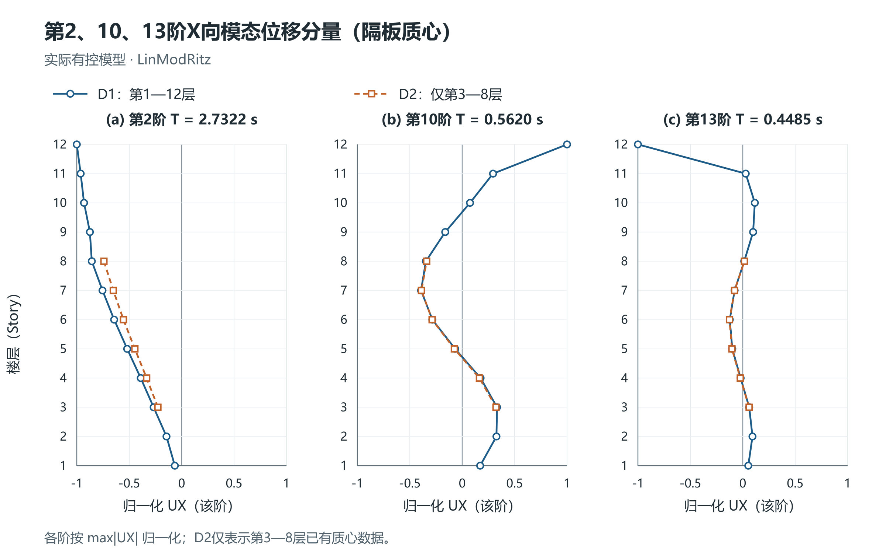
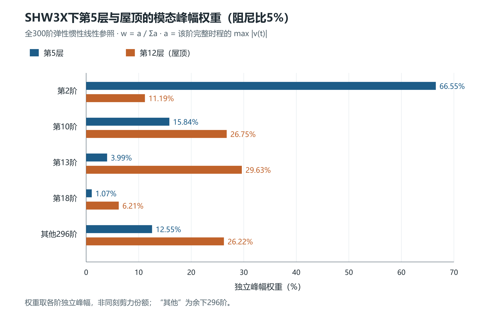
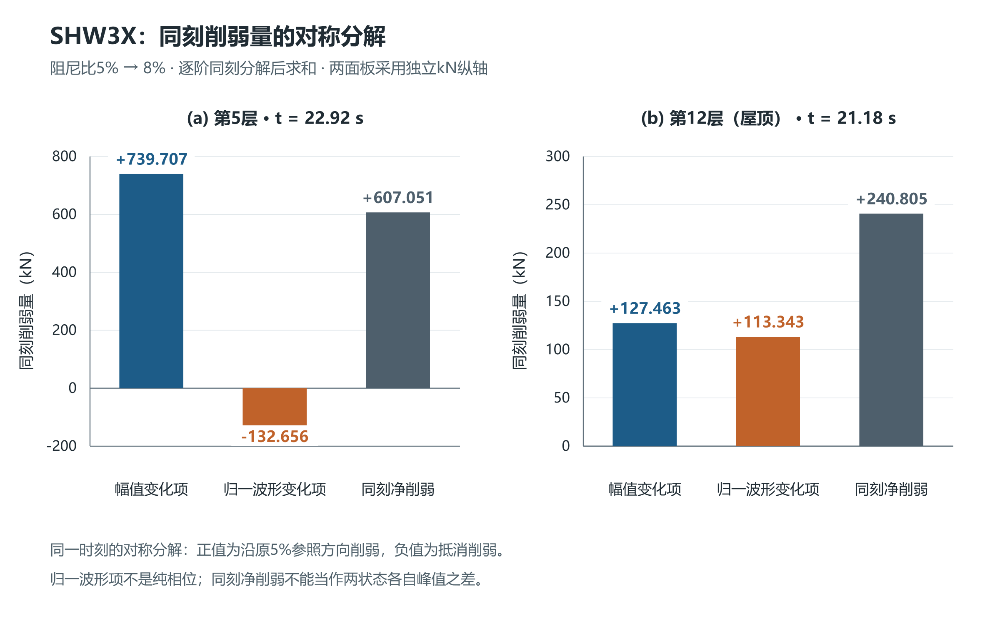

# 增大阻尼后楼层剪力降幅差异的模态叠加分析

**Modal Superposition Analysis of Differences in Story Shear Reduction with Increased Damping**

## 摘要

为解释增大阻尼后楼层剪力降幅的差异，按质量、带符号振型及输入参与关系计算楼层系数，再由共同地震输入求各阶响应。采用300阶经典阻尼线性近似模型，在同三个标量输入函数的X、Y两种施加方向下比较5%与8%阻尼。432条质心位移有符号曲线和144条弹性惯性参照剪力绝对值曲线的最大归一化均方根误差分别为0.443102%和0.669154%，剪力绝对峰误差最大为0.235170%。以独立模态峰幅总和U、合成峰P及C=P/U解释X向层差：SHW3X第5层U下降而C上升，峰降6.85%；屋顶两者同时下降，峰降28.32%。同刻幅值与归一波形分解显示，第5层波形变化抵消部分幅值削弱，屋顶两项同向削弱；各自峰差另计达峰时刻修正。两方向72对计算与软件峰降的最大差为0.196533个百分点。固定300阶基截取前10项虽累计95.18%的X向参与质量，屋顶相对300阶的曲线误差仍达64.73%。据此给出质量指标初筛、局部输出收敛和尾项充分界相结合的后处理流程，适用范围限定于所建线性近似模型及明确的目标输出。

**关键词：** 增阻尼；楼层剪力；模态叠加；归一波形；参与质量；模态截断

## Abstract

To explain differences in story shear reduction after increasing damping, story coefficients are calculated from masses, signed mode shapes, and input participation, and modal responses are obtained for common ground-motion inputs. A linear model with 300 modes and classical damping compares damping ratios of 5% and 8% using the same three scalar input functions applied separately in the X and Y directions. The maximum normalized root mean square errors are 0.443102% for 432 signed diaphragm-center displacement histories and 0.669154% for 144 story shear histories compared in absolute value using the elastic-inertia reference. The maximum absolute peak shear error is 0.235170%. The sum of individual modal peak amplitudes U, the combined peak P, and C=P/U explain differences between stories under X-direction input. For SHW3X, U decreases while C increases at Story 5, giving a peak reduction of 6.85%; both decrease at the roof, giving a reduction of 28.32%. A symmetric same-time decomposition of amplitude and normalized waveform changes shows that the waveform term offsets part of the amplitude reduction at Story 5, whereas both terms promote reduction at the roof. Differences between the separate response peaks additionally require peak-location corrections. The maximum difference between calculated and software peak reductions is 0.196533 percentage points across 72 story-record-direction pairs. Although the first ten terms of the fixed 300-mode basis account for 95.18% of the X-direction participating mass, the roof history error relative to the 300-mode reference reaches 64.73%. A postprocessing procedure therefore combines mass-based screening, local output convergence, and sufficient bounds based on omitted modal peak amplitudes. Its scope is the adopted linear model and the specified output definitions.

**Keywords:** increased damping; story shear; modal superposition; normalized waveform; participating mass; modal truncation

## 1 研究问题

相同阻尼增量在不同楼层并不产生相同剪力降幅。各阶运动对阻尼的敏感性不同，各层对这些运动的加权又不同；各阶峰值也未必发生在同一时刻。工程解释既要比较各阶幅值，也要检查它们在控制峰时刻怎样叠加。

模态惯性力分布Mφ_rΓ_r及有效质量与基底剪力的关系已有明确基础[1]。本文将其用于楼层切口，按振型和模态响应直接计算剪力，比较5%与8%阻尼下的完整曲线。本文先核对质心运动和剪力，用单阶峰幅与同刻项解释第5层和第12层的降幅差异；随后分解同刻幅值与归一波形变化，并检查全楼质量指标能否代表局部剪力收敛。

## 2 计算方法与模型范围

### 2.1 楼层系数和单位响应

令M为质量矩阵，φ_r、ω_r为第r阶振型和圆频率，b为均匀输入向量，a_s为切口以上水平虚平移选择向量。定义m_r=φ_rᵀMφ_r、S_r=φ_rᵀMb、L_sr=a_sᵀMφ_r。完整Eigen关系、目标弹性刚度一致及切口恢复完整时，实际坐标q_r形成V_sr=ω_r²L_srq_r，按SI量纲此式力为N，下文工程剪力换算为kN。经典解耦、零初始且只有同向均匀输入时，可进一步写q_r=Γ_rs_r：

$$\Gamma_r=\frac{S_r}{m_r},\qquad B_{sr}=\Gamma_rL_{sr},\qquad
\ddot s_r+2\zeta_r\omega_r\dot s_r+\omega_r^2s_r=-a_g(t),\quad s_r(0)=\dot s_r(0)=0.$$

定义g_r=ω_r²s_r，s_r为单位参与相对位移、单位m，g_r为伪加速度核、单位m/s²。B的单位为kg。完整基底切口时B退化为有效模态质量S_r²/m_r，局部B可为负。计算采用ΓL，避免近零S相除。

在本次线性参照中，按振型和模态响应计算各阶剪力及其合成：

$$v_{sr}^{\zeta}(t)=\frac{B_{sr}g_r^\zeta(t)}{1000},\qquad V_s^\zeta(t)=\sum_{r=1}^{300}v_{sr}^\zeta(t).$$

式中力为kN。每条输入的两种阻尼各求一次300阶单位运动，再由各层B加权，不需要逐层重新积分，也不从总剪力反求系数。

### 2.2 工程模型与输出约定

采用实际有控模型同源300阶LinModRitz振型、频率与广义质量，18个质心的方向集中质量由模态投影识别。两个方向总质量均约47,440,864.27 kg，X/Y不相加。原生振型mm乘0.001转m，ModalMass以kN·m·s²乘1000转kg·m²；此导出尺度下Γ单位m⁻¹、q̂=Γs为无量纲。质量识别、有限阶质量投影及观测范围见[补充说明S1](../../../research/sessions/20261031-1130/roles/role5/R006/supplement-S1.md)。

本文使用q̂=Γs的经典阻尼线性参照；Γ为零只使其直接输入项为零，不删除实际耦合运动。Ritz振型的全空间Kφ=ω²Mφ以及目标刚度与FNA有效刚度K_L+K_N之间的关系，需要相应静力恢复或残差检验[2]，故这里的B先作为输入加权惯性投影。本次统一采用上述300阶振型建立线性近似模型，并用原5%和8%软件曲线检验其精度；曲线接近不等于两组导出模型的完整质量与刚度完全相同。q̂不是软件实际FNA坐标。

三波为SHW3X、SHW4X、RH4X，步长0.02 s，保留既定SHW4末端输入延续约定。两态使用同一输入和观察时段，各阶阻尼统一取5%或8%，位移及速度零初始。先对全部18个质心的UX/UY有符号曲线核对，再对12层Bottom截面全局X向软件剪力核对；180组原生时间向量与输入逐项一致。本文剪力有符号项统一采用参照正向，软件Bottom VX保持原生符号，二者方向映射待切面定义核对。因此软件剪力只比较绝对曲线和绝对峰，表中模态项称为计算剪力项。

图1显示第2、10、13阶在现有隔板质心处的X向分量。每阶分别按现有质心点的max|UX|归一，适于比较层间形状与符号，不用于跨阶响应幅值比较。

**图1 第2、10、13阶X向模态位移分量。** D1覆盖第1—12层，D2仅含第3—8层已有质心点；此图表示质心UX分量。

### 2.3 峰幅权重与两个控制时刻

令a_sr,ζ=max_t|v_sr^ζ(t)|，定义：

$$U_{s,\zeta}=\sum_ra_{sr,\zeta},\quad P_{s,\zeta}=\max_t\left|\sum_rv_{sr}^\zeta(t)\right|,
\quad C_{s,\zeta}=\frac{P_{s,\zeta}}{U_{s,\zeta}},\quad
w_{sr,\zeta}=\frac{a_{sr,\zeta}}{U_{s,\zeta}}.$$

U是各阶独立峰幅之和，不是同一时刻合力；w是峰幅权重，不是同刻分担率。U>0时0≤C≤1，C综合符号、波形和控制峰选择，不能单独称为相位。在P_5>0、U_8>0时：

$$\frac{P_{s,8}}{P_{s,5}}=\frac{U_{s,8}}{U_{s,5}}\frac{C_{s,8}}{C_{s,5}}.$$

按5%的w选前五阶，两态固定这五阶，防止展示时更换对象。在5%控制峰时刻读取两态全部项，再在8%控制峰时刻重复读取。其余295阶保留同刻有符号合成，是计算响应的一部分；参照与软件之间的曲线误差另按第3节定义。零分母时直接报告U、P。

## 3 软件曲线对照与方向检验

### 3.1 曲线指标和X向峰值

位移NRMSE为||û−u||₂/||u||₂；剪力采用逐时绝对值曲线误差|| |V|−|V_native| ||₂/||V_native||₂。各状态在完整计算时程内独立求绝对最大值，峰误差为P/P_native−1，表1列其绝对值。E为第2.1节的剪力合成，Q=ΣB(ω²s+2ζωṡ)/1000为加入经典阻尼项的平衡参照。两种算子均保留，不能依据E更接近便倒推软件输出只含弹性力。

**表1 两个输入方向的曲线对照精度，均为全部位置的最大值**

|输入方向|比较对象|曲线条数|最大NRMSE/%|最大绝对峰误差/%|
|---|---|---:|---:|---:|
|X|CM有符号UX/UY|216|0.354370|0.065638|
|X|E：Bottom VX绝对值曲线|72|0.658221|0.235170|
|X|Q：Bottom VX绝对值曲线|72|16.208748|6.428690|
|Y|CM有符号UY/UX|216|0.443102|0.072170|
|Y|E：Bottom VY绝对值曲线|72|0.669154|0.199211|
|Y|Q：Bottom VY绝对值曲线|72|16.151545|6.987618|

X向216条质心曲线的最大NRMSE为0.354370%，72条E剪力绝对值曲线的最大NRMSE为0.658221%。Q的X向绝对值曲线误差最高16.208748%，提示输出力组成仍应按软件切面和目标内力定义核对。各输入、阻尼状态的详细结果见补充说明S1。

**表2 软件Bottom截面全局X向剪力峰值由5%至8%的降幅，单位%**

|楼层|SHW3X|SHW4X|RH4X|
|---:|---:|---:|---:|
|1|12.03|10.75|19.29|
|2|11.26|11.98|19.86|
|3|9.42|13.06|21.03|
|4|7.30|11.89|20.16|
|5|6.85|11.30|19.90|
|6|7.82|11.00|19.52|
|7|8.65|11.35|19.13|
|8|9.90|13.55|21.80|
|9|11.68|16.80|23.81|
|10|14.55|18.91|25.34|
|11|20.13|20.31|26.42|
|12|28.34|29.17|26.95|

36项X向原生峰均下降6.85%—29.17%，但第5层和屋顶的差异明显。第4节以按振型及模态响应计算的X向剪力解释这种层间差异。

### 3.2 Y向辅助检验

把同三个标量输入改施U2，重新按S_Y=Σm_Yφ_Y、Γ_Y=S_Y/m_r和B_Y=Γ_YΣ_above m_Yφ_Y计算，不把X投影改名为Y。对应函数、比例、时间和初值一致，因此直接复用同一ω、ζ下的单位s、ṡ；主向UY和交叉UX各108条，全部保留。此前X输入下的交叉UY观测与本段Y输入不同。剪力对照明确采用Bottom VY列。

Y向36项软件峰降为7.561008%—28.895981%。E与软件峰降最大差为0.128097个百分点：RH4Y第6层分别为24.355782%和24.227686%；同点Q峰降为19.668322%。Q的全部72条Y向结果保留，其绝对值曲线NRMSE最大16.151545%、绝对峰误差最大6.987618%。

合计两个方向，432条质心有符号曲线最大NRMSE为0.443102%，144条E剪力绝对值曲线最大NRMSE为0.669154%，最大绝对峰误差为0.235170%；72对峰降的最大差仍为0.196533个百分点。这是同三个输入函数的两种施加方向，不增加为六个独立事件。以下模态机制与局部截断仍以X向为主体，软件力继续采用绝对值比较。

## 4 模态幅值和同刻叠加解释楼层差异

### 4.1 第5层与第12层的U、C变化

**表3 重点楼层的幅值比、叠加系数比与峰值降幅**

|输入|楼层|U₈/U₅|C₈/C₅|P₈/P₅|计算峰降/%|软件峰降/%|
|---|---:|---:|---:|---:|---:|---:|
|SHW3X|5|0.903493|1.030990|0.931492|6.850816|6.851271|
|SHW3X|12|0.846186|0.847092|0.716798|28.320179|28.335360|
|SHW4X|5|0.891349|0.995463|0.887305|11.269545|11.302181|
|SHW4X|12|0.851985|0.832698|0.709446|29.055422|29.173450|
|RH4X|5|0.786890|1.017118|0.800360|19.964007|19.902330|
|RH4X|12|0.815056|0.896942|0.731059|26.894129|26.948768|

SHW3X第5层U从11,079.290 kN降至10,010.061 kN，下降9.65%；C从0.784510升至0.808821，增加3.10%。因此0.903493×1.030990≈0.931492，合成峰只下降6.8508%。C增大使合成峰占独立峰幅总和的比例上升，部分抵消了U的下降。

第12层U从1,880.177 kN降至1,590.980 kN，下降15.38%；C从0.452242降至0.383091，下降15.29%。两者同向变化，0.846186×0.847092≈0.716798，峰降达到28.3202%。这里是幅值总量与合成比例的乘法分解，不能把两种变化相加认作幅值和相位各自的因果份额。

三波36对中，C上升有19对，其余17对不升；计算峰降与软件峰降最大相差0.196533个百分点，发生于RH4X第11层。故本工程中较小的峰降不能统一解释为幅值下降不足，也需检查C的变化。

RH4X给出另一种层差：第5层U下降21.3110%，大于屋顶的18.4944%，但第5层C上升、屋顶C下降，最终峰降反为19.9640%小于26.8941%。因此，楼层峰降还取决于C的变化。各阶幅比的排序随输入改变，不能按阶次高低预先确定削弱程度。

### 4.2 重点模态随楼层改变

**图2 SHW3X下第5层与屋顶的模态峰幅权重，阻尼比5%。** 固定显示第2、10、13、18阶；“其他”为这四阶以外的296阶，权重来自完整时程的单阶独立峰幅，不表示同刻力份额。

第5层第2阶占5%峰幅总和的66.553%，第10阶占15.840%；第12层则以第13阶29.632%、第10阶26.752%和第4阶18.033%为主。由同一组单位运动经不同楼层B加权，重点阶次随切口改变。第2阶单阶峰降约7.91%，第13阶约19.79%，使不同楼层的U变化也不同。

另按各层5%峰幅权重选前五阶，第5层为2、10、3、13、1阶，第12层为13、10、4、2、18阶，合计分别占U的94.519%和91.810%。这些比例用于选择展示项，不表示同刻合力有相同比例，其余295阶仍保留。

图2为跨层统一对照而固定四阶，不采用每层前五阶的分组；屋顶第4阶在图中并入“其他296阶”。按各层5%权重选定的五阶及两态单阶峰值另列于补充说明S1。

### 4.3 两个控制峰时刻的同刻项

SHW3X第5层在22.92 s，第13阶由−42.617 kN变为+37.896 kN，第2阶由7,175.399 kN减至6,785.881 kN；同刻项并非按相同比例变化。8%的控制时刻略移至22.94 s，合成值由旧时刻8,084.758 kN增至8,096.349 kN。屋顶两态控制峰均在21.18 s，第10、13阶同为负向且绝对值均减小，300阶总量由−850.295 kN变为−609.490 kN。

各层在5%时选定的五阶，两态与两个时刻均不更换；其余295阶先作同刻有符号合成，再与五阶相加。完整逐项表保存在补充说明S1，剩余项属于响应，不是软件对照误差。

SHW4X屋顶则出现较明显的达峰时刻迁移：5%峰在28.34 s，8%峰在20.58 s。8%在旧峰时刻绝对值为406.481 kN，在自身峰时刻为422.972 kN，故只在旧时刻比较会高估峰降。下面对同刻变化与两个独立峰的关系作统一处理。

### 4.4 同刻幅值与归一波形的对称分解

固定楼层、输入、算子和观察窗，省略楼层下标。令a_r^ζ=max|v_r^ζ|>0，h_r^ζ=v_r^ζ/a_r^ζ。在同一时刻τ，逐阶变化可分解为：

$$v_r^8-v_r^5=
\underbrace{(a_r^8-a_r^5)\frac{h_r^8+h_r^5}{2}}_{d_{A,r}}+
\underbrace{\frac{a_r^8+a_r^5}{2}(h_r^8-h_r^5)}_{d_{h,r}}.$$

第一项由峰幅变化与两态平均归一波形确定，第二项由归一波形变化与两态平均峰幅确定。先逐阶分解，再合并选定模态和剩余项；先把组时程另取峰并归一，会得到另一种分解。归一波形保留符号，不移峰、不对齐时程，也不等于纯相位。

以旧合成方向σ₅=sign V₅(τ)表示削弱，要求旧值非零且符号可分辨。定义W_A=−σ₅Σd_A、W_h=−σ₅Σd_h；若恰一态a为零，该阶h无定义，完整Δv记入未分配项d₀，W₀=−σ₅Σd₀，不任设h=0。两态a均零则该阶差为零。于是：

$$W=W_A+W_h+W_0=\sigma_5[V_5(\tau)-V_8(\tau)],\qquad
|V_5(\tau)|-|V_8(\tau)|=W-2\max[0,-\sigma_5V_8(\tau)].$$

正分量促进沿旧方向削弱，负分量抵消削弱。两态合成不反号时W等于同刻绝对削弱；反号时须用上式修正。旧合成值为零则不定义该方向，只报告直接绝对差。此分配取决于所用峰幅归一与时刻，是参照内部的精确记账，不作为可独立施加的原因或因果百分比。

**图3 SHW3X两层同刻削弱量的对称分解。** 先逐阶分解后求和，沿5%参照方向表示；两面板采用独立kN纵轴。归一波形项不是纯相位，同刻净削弱与各自峰差的关系见表4。

第5层22.92 s的幅值削弱为739.706906 kN，归一波形项为−132.656071 kN，同刻净削弱607.050835 kN；屋顶21.18 s两项为127.462693、113.342507 kN，合计240.805200 kN，均促进削弱。上述两个位置的计算没有零幅值或两态合成反号，未分配项为零。

对任意共同锚点τ，令ℓ_ζ(τ)=P_ζ−|V_ζ(τ)|，即该状态在锚点距自身绝对峰的差额，则：

$$P_5-P_8=
\big[|V_5(\tau)|-|V_8(\tau)|\big]+\ell_5(\tau)-\ell_8(\tau).$$

**表4 SHW3X同刻削弱向两态各自峰差的换算，单位kN**

|楼层|共同锚点τ/s|同刻绝对削弱/kN|5%达峰差额ℓ₅/kN|8%达峰差额ℓ₈/kN|各自峰差P₅−P₈/kN|
|---:|---:|---:|---:|---:|---:|
|5|22.92|607.050835|0.000000|11.591024|595.459811|
|5|22.94|584.283201|11.176610|0.000000|595.459811|
|12|21.18|240.805200|0.000000|0.000000|240.805200|

第5层旧峰时607.050835 kN还须扣去8%达峰差额11.591024 kN，才是独立峰差595.459811 kN；在新峰时则由584.283201 kN加上5%差额11.176610 kN得到同一峰差。不能取旧锚点的幅值项与新锚点的波形项混加。屋顶两个峰时重合，只列一行；表内保留六位小数，近零差额按此精度记零。若查询软件峰时而非计算参照峰时，一般两个ℓ都须保留。

## 5 固定模态基的局部剪力收敛

### 5.1 阶数选择和比较基准

累计参与质量描述给定方向的总体输入参与，局部剪力还要经过楼层系数与各阶动态响应加权，不能据同一质量百分数保证其他输出的精度[1]。按原生X向参与质量比μ_r及原模式顺序，先确定累计达到90%、95%、99%的首次N，不把300阶累计量重新归一为1；再保留预先选定的13、18、300阶方案。90%和95%均首次在N=10达到，99%首次在N=173达到，去重后比较五个方案。

本节的N只是在同一个300阶Ritz基中保留前N项，频率、振型、系数和已算响应不变；它不是软件重新生成N阶Ritz模态。记V_N=Σ_{r≤N}v_r，R_N=V_300−V_N，P_N=max|V_N|。同一参照内的曲线误差为||R_N||₂/||V_300||₂，可直接按相同正向比较。软件对照仍沿用第3节的绝对曲线口径。

**表5 固定300阶基内五种截取方案的全楼最不利差异，均以300阶为参照**

|保留前N阶|累计X向参与质量/%|全楼最大曲线NRMSE/%|最大绝对峰相对差/%|最大峰降差/百分点|
|---:|---:|---:|---:|---:|
|10|95.182892|64.731660|25.149481|9.667224|
|13|96.312817|27.775362|10.794213|8.928846|
|18|97.482669|8.902102|2.332611|1.577987|
|173|99.142162|2.059709|1.074019|0.928986|
|300|99.990297|0.000000|0.000000|0.000000|

表5各列极值分别取自全12层、三波和两态，不必来自同一条曲线。关键两层的完整汇总见补充说明S1。N10累计质量为95.18%，第5层最大曲线误差仅4.68%，屋顶却达64.73%，最大绝对峰差达25.15%。屋顶最小独立峰幅留存率仅60.03%，说明全楼输入参与较高，并不代表该层重要模态已经充分保留。N18屋顶最大曲线误差降至5.86%，N173降至0.02613%；全楼N173仍有2.06%的最不利误差，不能从屋顶一层代替全部楼层检查。

本节X向N300的零差是同一曲线的自对照；它与软件绝对值曲线的最大误差仍为0.65822%。N173只描述本结构、三波和所比较方案，不作为通用或最少阶数。峰幅相对差与5%至8%峰降差另列，峰降差采用百分点，避免将300阶模型本身对软件的差异算成截断误差。

以SHW4X屋顶为例，N10峰降为19.388198%，300阶为29.055422%，二者相差-9.667224个百分点；软件峰降为29.173450%，N10对软件的差则为-9.785252个百分点。这两个差值的基准不同。

### 5.2 尾项峰幅和与停止条件

在同一楼层、算子、阻尼、输入和时间网格上，定义尾项独立峰幅之和：

$$T_N^\zeta=\sum_{r=N+1}^{300}\max_t|v_r^\zeta(t)|,\qquad
\|V_{300}^\zeta-V_N^\zeta\|_\infty\le T_N^\zeta,\qquad
\max(0,P_N^\zeta-T_N^\zeta)\le P_{300}^\zeta\le P_N^\zeta+T_N^\zeta.$$

T_N是合成尾项峰幅的上界，通常不等于max|Σ_{r>N}v_r|。若P_N>T_N，以300阶峰为分母的相对峰差满足：

$$\frac{|P_N-P_{300}|}{P_{300}}\le\frac{T_N}{P_N-T_N}.$$

项目事先规定峰幅容许相对误差ε_P时，P_N>T_N且右端不超过ε_P，可作为该峰幅的充分停止条件。它不是完整时程相对L∞误差；若项目还要求曲线误差，应另检查||R_N||∞/P_300及相应容许值。

比较两个阻尼方案时，在P_N^5>T_N^5条件下，定义：

$$R_-=\frac{\max(0,P_N^8-T_N^8)}{P_N^5+T_N^5},\qquad
R_+=\frac{P_N^8+T_N^8}{P_N^5-T_N^5},\qquad
R_-\le\frac{P_{300}^8}{P_{300}^5}\le R_+.$$

因此，300阶峰降幅落在[100(1−R_+),100(1−R_-)]%。若项目预定截断峰降容许差为ε_D个百分点，只有这个完整区间落入[D_N−ε_D,D_N+ε_D]，才可据此认定满足该充分条件，D_N=100(1−P_N^8/P_N^5)。不裁去可能的负降幅，也不在看过计算结果后临时调整容许值。

本例N10有5个状态P_N≤T_N，均在屋顶，另有2个峰比区间因分母条件不满足而未定义，原记录保留。界不可用或过宽，表示这一充分条件未给出所需保证，不等于实际截断误差一定超限；仍应报告直接算得的曲线和峰差。T_N由已算300阶单阶峰幅得到，用于已有结果的后处理判断，不据此宣称减少首次模态生成或求解的工作量。以上界限仅覆盖该有限300阶参照中的保留项与尾项，不覆盖300阶之外、Ritz恢复或软件模型差异；保存网格上的极值界也不自动扩展为连续时间极值界。

## 6 工程计算步骤与机制适用范围

### 6.1 计算与复核顺序

实际计算可按以下顺序进行。

1. 固定模型、输入方向和楼层切口，按质量与带符号振型求Γ和各层B；对目标内力核对相应恢复关系。
2. 对每条输入分别求5%、8%的各阶单位运动。每态只积分一次，再用各层B加权得到全部楼层的计算剪力。
3. 比较全部质心运动及楼层完整曲线，分别记录曲线误差、各自绝对峰与峰时；对照差异较大的输出保留单独说明。
4. 求每阶a、各层U/P/C，以5%峰幅权重选重点模态并在两态固定。依次读取两个控制峰时刻的全部项，五阶逐项展示，其余项合成保留。
5. 如需细化同刻变化，按第4.4节逐阶计算两分项并求和，再以两态达峰差额换算峰差。
6. 先报告软件原生峰降，再用计算剪力说明U与C的变化。用质量累计规则筛选保留阶数后，按第5节检查关键层的曲线、峰差与尾项尺度。容许值应由项目要求预先确定，本例未据已见结果临时设置通过阈值。
7. 固定基截取与重新生成较少Ritz模态分别核对；本次五阶展示没有删去其余运动，固定前N项检查也没有重新求解模态。

### 6.2 两层稳态的解析说明

一个两层稳态例说明这种检查的必要性。取M=I₂ kg、K=[[2,−1],[−1,1]] N/m，输入a_g=sin(√2t) m/s²，输出第一层1 N/m弹簧的弹性力。比较两种阻尼各自的单频稳态，使用不同非零稳态初值，区别于共同静止初始的有限地震过程。

**表6 两层稳态例中的峰幅与合成，力单位N**

|阻尼比|第1阶峰|第2阶峰|U|P|C|
|---:|---:|---:|---:|---:|---:|
|5%|0.446563|0.419391|0.865954|0.177673|0.205177|
|8%|0.445553|0.384768|0.830320|0.260219|0.313396|

两阶峰均下降，U下降4.115%，但C增至原来的1.527443倍，P增加46.459%。这说明U下降本身不保证P下降；本例增幅不作为真实工程或零初始瞬态结果。

该例还可由物理动态刚度写出闭式：

$$P^2=\frac{(72/5)\zeta^2}{1+56\zeta^2+64\zeta^4}.$$

在0<ζ<1/√8内，P随ζ增大而严格增加，5%和8%均在此区间。它从解析式说明独立峰幅减小不足以保证合成峰减小；两态各自的非零稳态初值与前文零初始地震参照分开。

### 6.3 仅有设计谱时

只有设计谱时，可由伪加速度S_pa=ω²S_d形成Σ|B|S_pa及峰幅权重，筛查重点模态和楼层。谱不提供同刻符号和峰时[2]，两个谱包络之商不能保证实际峰比；CQC统计相关也不同于实际非经典/FNA方程耦合。

## 7 结论

本工程第5层和第12层的峰降差异，可以在固定物理系数的线性参照中落实到不同的重点模态和时程叠加。SHW3X第5层以第2阶为主，U下降而C上升，峰降为6.85%；第12层以第13、10、4阶为主，U和C同时下降，峰降为28.32%。Y向辅助检验与X向合计72对峰降，计算与软件结果的最大差为0.196533个百分点；两方向对应同三个输入函数。

同刻对称分解可继续区分峰幅和归一波形的记账变化，但同刻净削弱还须加减各状态的达峰差额才能得到独立峰差。工程解释宜同时列出单阶峰幅权重和两个控制峰时刻的带符号项。前者用于选择重点，后者用于核对同刻合力；其余模态应合成保留。只看各阶峰幅、只比较旧峰时刻或只展示五阶，都可能遗漏决定实际峰降的因素。

全楼X向累计质量达到95.18%的前10项，屋顶相对300阶参照的曲线误差仍达64.73%。质量指标宜用于初筛，局部剪力须再检查关键层曲线、峰幅及两态峰降；尾项峰幅和可给出有限参照内的充分停止条件，容许值由项目要求事先确定。

按“各阶一次求运动、各层系数加权、两峰时读取、局部截断复核”组织计算，可复用模态响应并保留楼层差异。该流程提供本工程三波两状态的可复算解释，使用范围遵循第2.2节的模型、恢复和方向约定。

## 参考文献

[1] SONG J, CHU Y L, LIANG Z, LEE G C. Modal Analysis of Generally Damped Linear Structures Subjected to Seismic Excitations[R]. Buffalo: University at Buffalo, State University of New York, 2008. MCEER-08-0005:38,40,42–43,106–109.

[2] COMPUTERS & STRUCTURES, INC. CSi Analysis Reference Manual: for SAP2000, ETABS, SAFE and CSiBridge[M]. Rev.15. Berkeley: Computers & Structures, Inc., 2016. ISO#GEN062708M1:366,372,376–377,384–391,452–453.
